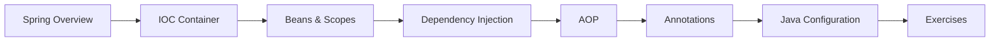

# 25 — Spring Core

> **Experience level: 🔴 Expert (3 – 5 years)**

**Spring** is the most popular Java framework. This module builds your Spring foundation: the **container**, **beans**, **dependency injection (DI)**, and **AOP** — the heart of every Spring app.

---

## 📂 Files in This Module

| File | What You'll Learn |
|------|-------------------|
| [Spring-Overview.md](Spring-Overview.md) | Why Spring, architecture, modules |
| [IOC-Container.md](IOC-Container.md) | The container that manages beans |
| [Beans-and-BeanScope.md](Beans-and-BeanScope.md) | Bean lifecycle, scopes |
| [Dependency-Injection.md](Dependency-Injection.md) | Constructor/setter/field DI |
| [AOP.md](AOP.md) | Aspect-oriented programming |
| [Annotations.md](Annotations.md) | @Component, @Service, @Autowired |
| [Java-Configuration.md](Java-Configuration.md) | @Configuration and @Bean |
| [Exercises.md](Exercises.md) | Practice tasks for this module |

---

## 🎯 Learning Objectives

By the end of this module, you will be able to:

1. ✅ Explain the Spring container and IOC.
2. ✅ Define beans and their scopes.
3. ✅ Wire dependencies with DI and annotations.
4. ✅ Apply AOP for cross-cutting concerns.
5. ✅ Configure Spring entirely with Java.

---

## 🧭 Module Map



---

## 📌 Quick Preview

```java
@Configuration
public class AppConfig {

    @Bean
    public GreetingService greetingService() {
        return new GreetingService();
    }
}
```

---

## Next Module

➡️ [26 — Spring Boot](../26-Spring-Boot/README.md) — turn Spring into fast, production-ready apps.