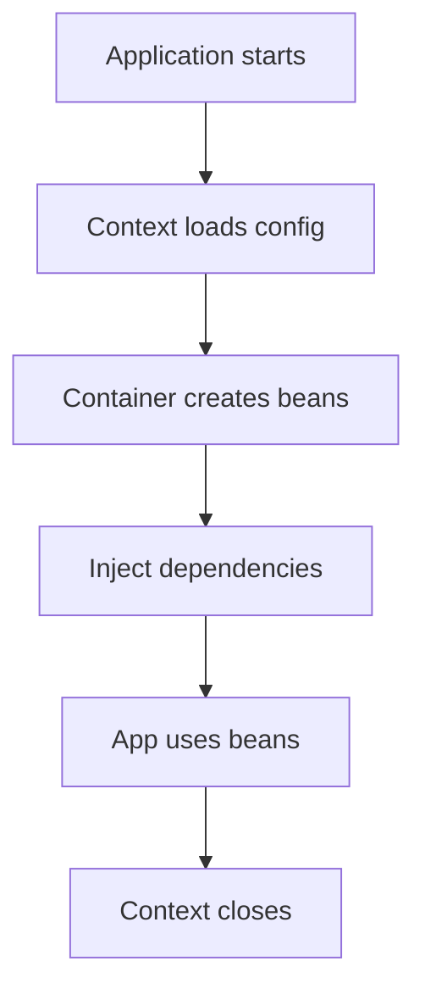

# Spring Overview

## 1. Introduction

**Spring** is a modular, lightweight Java framework built around **dependency injection** and the **Inversion of Control (IOC) container**. Spring Boot, Spring MVC, Spring Security, and Spring Data all build on Spring Core.

---

## 2. Why This Topic Is Important

- Spring dominates Java enterprise development.
- It removes boilerplate (no more manual wiring).
- DI + IOC make code testable and decoupled.
- Understanding Spring Core unlocks the whole ecosystem.

---

## 3. Real-World Analogy

Spring is like a **highly organized factory**:
- The **IOC container** is the factory floor.
- **Beans** are the workers, created once and reused.
- **Dependency injection** is the assembly line delivering each worker exactly what it needs.
- You (the developer) just declare what exists — Spring handles the wiring.

---

## 4. Theory

### What Spring Solves
| Problem | Spring's Answer |
|---------|-----------------|
| Manual object wiring | IOC container |
| Tight coupling | Dependency injection |
| Boilerplate config | Annotations & auto-configuration |
| Cross-cutting concerns | AOP |
| Transactions, security | Dedicated modules |

### Spring Modules
| Module | Purpose |
|--------|---------|
| Core / Beans / Context | Container, DI, application context |
| AOP / Aspects | Aspect-oriented programming |
| Spring MVC | Web layer |
| Spring Data | Database access |
| Spring Security | AuthN / AuthZ |
| Spring Boot | Fast, auto-configured apps |
| Spring Cloud | Microservices |

### Core Concepts
| Concept | Meaning |
|---------|---------|
| Bean | Object managed by the container |
| Container | Creates, wires, and manages beans |
| DI | Container injects dependencies |
| IOC | Control inverted: container manages lifecycle |
| Context | Runtime environment (ApplicationContext) |

---

## 5. Syntax (Minimal App)

```java
// pom.xml dependency
// org.springframework:spring-context

@Configuration
class AppConfig {
    @Bean
    GreetingService greetingService() {
        return new GreetingService();
    }
}
```

```java
public class Main {
    public static void main(String[] args) {
        ApplicationContext ctx =
                new AnnotationConfigApplicationContext(AppConfig.class);
        GreetingService service = ctx.getBean(GreetingService.class);
        System.out.println(service.greet("Ajay"));
    }
}
```

---

## 6. Flow Explanation



---

## 7. Memory Representation

One `ApplicationContext` holds all singleton bean references; beans are created at startup (or lazily) and reused.

---

## 8. Simple Example

```java
import org.springframework.context.ApplicationContext;
import org.springframework.context.annotation.*;

class GreetingService {
    public String greet(String name) {
        return "Hello, " + name + "!";
    }
}

@Configuration
class AppConfig {
    @Bean
    GreetingService greetingService() {
        return new GreetingService();
    }
}

public class SpringDemo {
    public static void main(String[] args) {
        ApplicationContext ctx =
                new AnnotationConfigApplicationContext(AppConfig.class);

        GreetingService service = ctx.getBean(GreetingService.class);
        System.out.println(service.greet("Ajay"));

        GreetingService again = ctx.getBean(GreetingService.class);
        System.out.println("Same bean? " + (service == again));
    }
}
```

---

## 9. Intermediate Example — Two Beans + DI

```java
import org.springframework.context.ApplicationContext;
import org.springframework.context.annotation.*;

class Repository {
    public String find(int id) { return "record-" + id; }
}

class Service {
    private final Repository repo;

    Service(Repository repo) { this.repo = repo; }

    public String fetch(int id) { return repo.find(id); }
}

@Configuration
class Config {
    @Bean Repository repo() { return new Repository(); }

    @Bean Service service(Repository repo) {
        return new Service(repo);       // DI via constructor
    }
}

public class DIConfigDemo {
    public static void main(String[] args) {
        ApplicationContext ctx =
                new AnnotationConfigApplicationContext(Config.class);

        Service service = ctx.getBean(Service.class);
        System.out.println(service.fetch(42));
    }
}
```

---

## 10. Advanced Example — Profiles

```java
import org.springframework.context.ApplicationContext;
import org.springframework.context.annotation.*;

class DataSource {
    private final String name;
    DataSource(String name) { this.name = name; }
    public String info() { return "DataSource: " + name; }
}

@Configuration
class Config {
    @Bean
    @Profile("dev")
    DataSource dev() { return new DataSource("H2-in-memory"); }

    @Bean
    @Profile("prod")
    DataSource prod() { return new DataSource("PostgreSQL"); }
}

public class ProfileDemo {
    public static void main(String[] args) {
        System.setProperty("spring.profiles.active", "dev");

        ApplicationContext ctx =
                new AnnotationConfigApplicationContext(Config.class);

        System.out.println(ctx.getBean(DataSource.class).info());
    }
}
```

---

## 11. Output

For the **Simple Example**:

```
Hello, Ajay!
Same bean? true
```

For the **Intermediate Example**:

```
record-42
```

For the **Advanced Example**:

```
DataSource: H2-in-memory
```

---

## 12. Common Mistakes

| Mistake | Correction |
|---------|------------|
| Instantiating beans with `new` | Let the container create them |
| Missing `@Configuration` | Context won't scan config |
| Ignoring profiles | Env-specific beans collide |
| Tight coupling services | Rely on interfaces + DI |
| Heavy context for tests | Use a slice / test context |

---

## 13. Best Practices

- Code to interfaces; let DI wire implementations.
- Prefer constructor injection.
- Use profiles for environments.
- Keep config minimal — rely on component scanning.
- Understand the container before adding frameworks.

---

## 14. Interview Questions

**Q1. What is Spring?**
*A modular framework for enterprise Java based on DI and IOC.*

**Q2. What is IOC?**
*Control inverted: the container creates and manages objects, not your code.*

**Q3. What is a bean?**
*An object created, wired, and managed by the Spring container.*

**Q4. What is the container?**
*The ApplicationContext that instantiates, wires, and holds beans.*

**Q5. Why is Spring popular?**
*Decoupling, testability, ecosystem (Boot, Security, Data, Cloud).*

---

## 15. Practice Exercises

1. Create a Spring context with a single bean.
2. Verify a bean is a singleton.
3. Wire a Service→Repository via constructor DI.
4. Switch beans using profiles.

---

## 16. Coding Challenges

1. **Easy:** Context with two beans.
2. **Medium:** DI chain (Controller→Service→Repository).
3. **Hard:** Profile-aware configuration with 3 environments.

---

## 17. Summary

- Spring = DI + IOC container.
- Beans are container-managed objects.
- ApplicationContext creates/wires everything.
- Profiles handle environments.
- Spring Core is the base for Boot and the whole ecosystem.

➡️ Continue to: [IOC Container](IOC-Container.md)