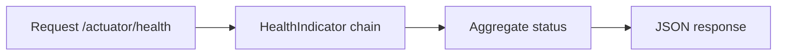

# Actuator

## 1. Introduction

**Spring Boot Actuator** exposes production-ready endpoints: health, metrics, info, environment, and more — for monitoring and operations.

---

## 2. Why This Topic Is Important

- Health checks are mandatory for every deployed service.
- Metrics feed monitoring (Prometheus, Grafana).
- Load balancers and k8s use /health.
- Actuator gives ops visibility with zero custom code.

---

## 3. Real-World Analogy

Actuator is the **instrument panel** of a plane: altitude (health), speed (metrics), fuel (memory), and system warnings (loggers) — everything the pilot/operator needs at a glance, built into the dashboard.

---

## 4. Theory

### Setup
```xml
<dependency>
    <groupId>org.springframework.boot</groupId>
    <artifactId>spring-boot-starter-actuator</artifactId>
</dependency>
```

### Core Endpoints
| Endpoint | Purpose |
|----------|---------|
| `/actuator` | List of exposed endpoints |
| `/actuator/health` | App up/down + component health |
| `/actuator/info` | Custom app info |
| `/actuator/metrics` | JVM/HTTP metrics |
| `/actuator/beans` | All beans |
| `/actuator/env` | Environment properties |
| `/actuator/loggers` | Log levels (changeable at runtime) |

### Exposure
```properties
# Expose all web endpoints
management.endpoints.web.exposure.include=*

# Or limit for security
management.endpoints.web.exposure.include=health,info,metrics
```

### Health Indicators
| Indicator | Checks |
|-----------|--------|
| diskSpace | Disk usage |
| ping | Basic reachability |
| db (with datasource) | DB connectivity |

---

## 5. Syntax

```java
// Custom health indicator
@Component
public class CustomHealthIndicator
        implements HealthIndicator {
    public Health health() {
        boolean ok = checkSomething();
        return ok ? Health.up().build() : Health.down().build();
    }
}
```

---

## 6. Flow Explanation



---

## 7. Memory Representation

Skip — ops topic.

---

## 8. Simple Example — Default Health

```properties
# application.properties
management.endpoints.web.exposure.include=health,info,metrics
```

Add the starter, then:

```bash
curl http://localhost:8080/actuator/health
```

Response:

```json
{"status":"UP"}
```

---

## 9. Intermediate Example — Custom Info

```properties
info.app.name=PaymentService
info.app.description=Handles payments
info.team=Platform
```

```bash
curl http://localhost:8080/actuator/info
```

Response:

```json
{
  "app": {
    "name": "PaymentService",
    "description": "Handles payments",
    "team": "Platform"
  }
}
```

---

## 10. Advanced Example — Custom Health Indicator

```java
import org.springframework.boot.actuate.health.*;
import org.springframework.stereotype.Component;

@Component
public class DatabaseHealthIndicator implements HealthIndicator {

    @Override
    public Health health() {
        try {
            checkDatabase();
            return Health.up()
                    .withDetail("database", "reachable")
                    .build();
        } catch (Exception e) {
            return Health.down()
                    .withDetail("database", "unreachable")
                    .withDetail("error", e.getMessage())
                    .build();
        }
    }

    private void checkDatabase() {
        // simulate a check
        if (System.currentTimeMillis() % 2 == 0) {
            throw new RuntimeException("timeout");
        }
    }
}
```

---

## 11. Output

For the **Simple Example**:

```
{"status":"UP"}
```

For the **Intermediate Example**:

```
{
  "app": {
    "name": "PaymentService",
    "description": "Handles payments",
    "team": "Platform"
  }
}
```

For the **Advanced Example** (status depends on check):

```
{"status":"UP","details":{"database":"reachable"}}
```

or

```
{"status":"DOWN","details":{"database":"unreachable","error":"timeout"}}
```

---

## 12. Common Mistakes

| Mistake | Correction |
|---------|------------|
| Endpoints not exposed | Set exposure.include |
| Exposing everything in prod | Limit to health,info,metrics |
| No auth on actuator | Secure with Spring Security |
| Health check that doesn't hit the DB | Use real indicators |
| Forgetting the starter | No actuator endpoints |

---

## 13. Best Practices

- Expose only what's needed (`health,info,metrics`).
- Secure actuator endpoints.
- Add custom HealthIndicators for critical deps.
- Use `info.*` for version/team metadata.
- Integrate metrics with Prometheus/Grafana.

---

## 14. Interview Questions

**Q1. What is Actuator?**
*Production-ready endpoints for health, metrics, and info.*

**Q2. Most important endpoint?**
*/actuator/health — used by load balancers and k8s.*

**Q3. How do you expose endpoints?**
*management.endpoints.web.exposure.include.*

**Q4. Custom health check?**
*Implement HealthIndicator returning Health.up()/down().*

**Q5. Security concern?**
*Expose minimal endpoints and secure them.*

---

## 15. Practice Exercises

1. Add the actuator starter and check /health.
2. Add custom info properties.
3. Create a custom HealthIndicator.
4. Expose only health+info in properties.

---

## 16. Coding Challenges

1. **Easy:** Health endpoint up and running.
2. **Medium:** Custom info metadata.
3. **Hard:** HealthIndicator tied to a real dependency (e.g., database).

---

## 17. Summary

- Actuator = ops visibility built in.
- /health, /info, /metrics are the essentials.
- Custom HealthIndicators verify dependencies.
- Limit exposure and secure in production.
- Every service should expose /health.

➡️ Continue to: [Deployment](Deployment.md)