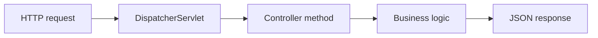

# Controllers & REST

## 1. Introduction

**Controllers** are the entry points of a web app. **@RestController** builds REST APIs returning JSON with zero view templates.

---

## 2. Why This Topic Is Important

- Every Boot API lives in a controller.
- @GetMapping/@PostMapping map URLs to methods.
- JSON responses are the modern standard.
- RestController combines @Controller + @ResponseBody.

---

## 3. Real-World Analogy

A controller is a **restaurant host**: 
- The **URL path** is the table number.
- **@GetMapping** = "serve this request at this table."
- The **returned object** is the dish served to the guest.
- The host (Spring) handles the crowd (HTTP routing) automatically.

---

## 4. Theory

### Key Annotations
| Annotation | Purpose |
|------------|---------|
| `@RestController` | REST controller (JSON responses) |
| `@RequestMapping` | Base path mapping |
| `@GetMapping` | Handle GET |
| `@PostMapping` | Handle POST |
| `@PutMapping` | Handle PUT |
| `@DeleteMapping` | Handle DELETE |
| `@PathVariable` | Value from URL `{id}` |
| `@RequestParam` | Query string `?name=` |
| `@RequestBody` | JSON body → object |

### HTTP Methods
| Method | Use | Example |
|--------|-----|---------|
| GET | Read | `/users` |
| POST | Create | `/users` |
| PUT | Update | `/users/{id}` |
| DELETE | Delete | `/users/{id}` |

### Response Helpers
| Helper | Use |
|--------|-----|
| `ResponseEntity<T>` | Full control (status, headers, body) |
| `@ResponseStatus` | Set status on exceptions |

---

## 5. Syntax

```java
@RestController
@RequestMapping("/users")
class UserController {
    @GetMapping("/{id}")
    public User get(@PathVariable Long id) { ... }
}
```

---

## 6. Flow Explanation



---

## 7. Memory Representation

A new controller instance? No — controllers are singleton beans; each request maps to the method.

---

## 8. Simple Example — Greeting Controller

```java
import org.springframework.web.bind.annotation.*;

@RestController
public class GreetingController {

    @GetMapping("/greet")
    public String greet(@RequestParam(defaultValue = "World") String name) {
        return "Hello, " + name + "!";
    }
}
```

Call: `GET /greet?name=Ajay`

---

## 9. Intermediate Example — Full CRUD

```java
import org.springframework.web.bind.annotation.*;
import java.util.*;

@RestController
@RequestMapping("/users")
public class UserController {

    private final Map<Long, String> users = new LinkedHashMap<>();
    private long nextId = 1;

    @GetMapping
    public Map<Long, String> all() { return users; }

    @PostMapping
    public Long create(@RequestBody String name) {
        users.put(nextId, name);
        return nextId++;
    }

    @PutMapping("/{id}")
    public String update(@PathVariable Long id, @RequestBody String name) {
        users.put(id, name);
        return name;
    }

    @DeleteMapping("/{id}")
    public void delete(@PathVariable Long id) {
        users.remove(id);
    }
}
```

---

## 10. Advanced Example — ResponseEntity & DTO

```java
import org.springframework.http.*;
import org.springframework.web.bind.annotation.*;

record UserResponse(Long id, String name) { }

@RestController
@RequestMapping("/api")
public class ApiController {

    @GetMapping("/user/{id}")
    public ResponseEntity<UserResponse> getUser(@PathVariable Long id) {
        if (id <= 0) {
            return ResponseEntity.status(HttpStatus.NOT_FOUND).build();
        }
        UserResponse body = new UserResponse(id, "User " + id);
        return ResponseEntity.ok(body);
    }
}
```

Call: `GET /api/user/5`

---

## 11. Output

For the **Simple Example**:

```
GET /greet?name=Ajay → "Hello, Ajay!"
```

For the **Advanced Example**:

```
GET /api/user/5 →
{
  "id": 5,
  "name": "User 5"
}
```

---

## 12. Common Mistakes

| Mistake | Correction |
|---------|------------|
| @Controller without @ResponseBody | Use @RestController |
| Returning HTML by accident | RestController always JSON |
| Forgetting @RequestBody | Body never parsed |
| Path vs param confusion | Path `{id}` vs query `?x=` |
| Not setting status codes | Use ResponseEntity / @ResponseStatus |

---

## 13. Best Practices

- Use @RestController for JSON APIs.
- Name methods by HTTP action (get/create/update/delete).
- Return DTOs, not entities.
- Use ResponseEntity for status control.
- Keep controllers thin — delegate to services.

---

## 14. Interview Questions

**Q1. @Controller vs @RestController?**
*@RestController = @Controller + @ResponseBody (JSON).*

**Q2. How do you capture a path variable?**
*@PathVariable with {id} in the mapping.*

**Q3. GET vs POST?**
*GET reads (safe); POST creates (has body/state change).*

**Q4. How do you return a custom status?**
*ResponseEntity.status(HttpStatus.X).body(...).*

**Q5. Why return DTOs?**
*Hide internals; control the API contract.*

---

## 15. Practice Exercises

1. Build a greet endpoint with a param default.
2. Build CRUD for a resource.
3. Return a ResponseEntity with status codes.
4. Define a DTO record and return it as JSON.

---

## 16. Coding Challenges

1. **Easy:** Hello controller.
2. **Medium:** In-memory CRUD with all verbs.
3. **Hard:** DTO + ResponseEntity + validation-ready structure.

---

## 17. Summary

- @RestController returns JSON.
- Verbs: GET/POST/PUT/DELETE.
- PathVariables, RequestParams, RequestBody.
- ResponseEntity for status control.
- Keep controllers thin; use DTOs.

➡️ Continue to: [Application Properties](Application-Properties.md)