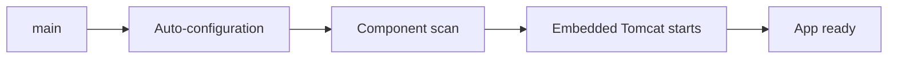

# Spring Boot Overview

## 1. Introduction

**Spring Boot** makes Spring apps effortless: embedded Tomcat, auto-configuration, and starters mean you write **business code**, not plumbing.

---

## 2. Why This Topic Is Important

- Spring Boot is the industry-standard way to build Java apps.
- It removes configuration boilerplate.
- Embedded server = no external Tomcat.
- Production features (Actuator, metrics) are built in.

---

## 3. Real-World Analogy

Spring Boot is a **turnkey restaurant kit**:
- **Starters** are pre-packed menus (web, data, security) — add one dependency, get everything.
- **Auto-configuration** is the chef who sets up the kitchen based on what's on the menu.
- You just cook the dishes (write your business code).

---

## 4. Theory

### Why Boot Exists
| Spring Pain | Boot Fix |
|-------------|----------|
| Verbose XML/config | Auto-configuration |
| External server setup | Embedded Tomcat/Jetty |
| Dependency version juggling | Starters + dependency management |
| Ops wiring | Actuator, metrics, health |

### Key Concepts
| Concept | Meaning |
|---------|---------|
| **Starter** | Curated dependency set (spring-boot-starter-web) |
| **Auto-configuration** | Configures beans from classpath + properties |
| **@SpringBootApplication** | @Configuration + @EnableAutoConfiguration + @ComponentScan |
| **Embedded server** | Tomcat runs inside the JAR |
| **Actuator** | Health, metrics, env endpoints |

### Common Starters
| Starter | Purpose |
|---------|---------|
| `spring-boot-starter-web` | REST + embedded Tomcat |
| `spring-boot-starter-data-jpa` | JPA + Hibernate |
| `spring-boot-starter-security` | Security |
| `spring-boot-starter-test` | Testing |
| `spring-boot-starter-actuator` | Monitoring |

---

## 5. Syntax (Core)

```java
@SpringBootApplication
public class MyApp {
    public static void main(String[] args) {
        SpringApplication.run(MyApp.class, args);
    }
}
```

---

## 6. Flow Explanation



---

## 7. Memory Representation

Boot spins up the ApplicationContext plus an embedded server in one process.

---

## 8. Simple Example — First App

```java
import org.springframework.boot.SpringApplication;
import org.springframework.boot.autoconfigure.SpringBootApplication;
import org.springframework.web.bind.annotation.*;

@SpringBootApplication
@RestController
public class FirstApp {

    @GetMapping("/")
    public String home() {
        return "Spring Boot is running!";
    }

    public static void main(String[] args) {
        SpringApplication.run(FirstApp.class, args);
    }
}
```

Run with:
```
mvn spring-boot:run
# then open http://localhost:8080/
```

---

## 9. Intermediate Example — Request Params & Paths

```java
import org.springframework.boot.SpringApplication;
import org.springframework.boot.autoconfigure.SpringBootApplication;
import org.springframework.web.bind.annotation.*;

@SpringBootApplication
@RestController
public class GreetingApp {

    @GetMapping("/greet")
    public String greet(@RequestParam String name) {
        return "Hello, " + name + "!";
    }

    @GetMapping("/greet/{name}")
    public String greetPath(@PathVariable String name) {
        return "Hi, " + name + "!";
    }

    public static void main(String[] args) {
        SpringApplication.run(GreetingApp.class, args);
    }
}
```

---

## 10. Advanced Example — DevTools & Actuator

```xml
<dependency>
    <groupId>org.springframework.boot</groupId>
    <artifactId>spring-boot-starter-actuator</artifactId>
</dependency>
<dependency>
    <groupId>org.springframework.boot</groupId>
    <artifactId>spring-boot-devtools</artifactId>
</dependency>
```

```properties
# application.properties
management.endpoints.web.exposure.include=health,info,metrics
```

```java
@SpringBootApplication
public class MonitorApp {
    public static void main(String[] args) {
        SpringApplication.run(MonitorApp.class, args);
    }
}
```

After starting, check:
- `/actuator/health` → `{"status":"UP"}`
- `/actuator/info` → app metadata
- DevTools auto-restarts on code changes.

---

## 11. Output

For the **Simple Example** (`http://localhost:8080/`):

```
Spring Boot is running!
```

For the **Intermediate Example**:

```
GET /greet?name=Ajay  →  Hello, Ajay!
GET /greet/Ajay      →  Hi, Ajay!
```

For the **Advanced Example** (`/actuator/health`):

```
{"status":"UP"}
```

---

## 12. Common Mistakes

| Mistake | Correction |
|---------|------------|
| App package not covering all code | Keep @SpringBootApplication at the root |
| Port already in use | Change `server.port` |
| Adding manual XML | Boot auto-configures |
| Forgetting actuator exposure | Configure `management.endpoints.*` |
| Using old Tomcat externally | Embedded server included |

---

## 13. Best Practices

- Start with Spring Initializr (start.spring.io).
- Keep @SpringBootApplication at the package root.
- Use starters, not raw dependencies.
- Expose minimal Actuator endpoints in prod.
- Prefer maven/gradle wrapper for builds.

---

## 14. Interview Questions

**Q1. What is Spring Boot?**
*A Spring framework extension providing auto-configuration, starters, and embedded servers.*

**Q2. What is auto-configuration?**
*Boot configures beans automatically from classpath and properties.*

**Q3. What is a starter?**
*A curated set of dependencies for a feature (web, jpa, security).*

**Q4. What does @SpringBootApplication combine?**
*@Configuration + @EnableAutoConfiguration + @ComponentScan.*

**Q5. Embedded server?**
*Tomcat runs inside the JAR — no external setup.*

---

## 15. Practice Exercises

1. Generate a project from Spring Initializr.
2. Build a "Hello" REST endpoint.
3. Add DevTools and watch auto-restart.
4. Enable Actuator and check /health.

---

## 16. Coding Challenges

1. **Easy:** App with a home endpoint.
2. **Medium:** Path/param endpoints.
3. **Hard:** App exposing health + custom info via Actuator.

---

## 17. Summary

- Boot = Spring + auto-config + embedded server.
- Starters bundle dependencies; @SpringBootApplication bootstraps.
- Actuator gives health/metrics.
- DevTools speeds development.
- Boot is the industry standard.

➡️ Continue to: [Getting Started](Getting-Started.md)