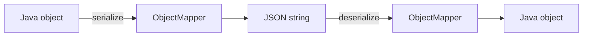

# JSON with Jackson

## 1. Introduction

**JSON** is the data format of REST. **Jackson** is Spring Boot's built-in library for converting between Java objects and JSON.

---

## 2. Why This Topic Is Important

- Every REST request/response is JSON.
- Jackson handles serialization/deserialization automatically.
- Understanding it fixes formatting, null, and date issues.
- Interviews probe JSON mapping basics.

---

## 3. Real-World Analogy

Jackson is a **translator between two languages**: Java (structured objects) and JSON (text). You speak Java to Jackson; Jackson speaks JSON to the client — and vice versa, with full fidelity.

---

## 4. Theory

### Built In
Spring Boot auto-configures Jackson:
```xml
<dependency>
    <groupId>org.springframework.boot</groupId>
    <artifactId>spring-boot-starter-web</artifactId>
</dependency>
```

### Key Annotations
| Annotation | Purpose |
|------------|---------|
| `@JsonProperty("name")` | Rename a field in JSON |
| `@JsonIgnore` | Exclude from JSON |
| `@JsonInclude(NON_NULL)` | Skip nulls |
| `@JsonFormat` | Date/number formats |
| `@JsonAlias` | Accept alternate input names |

### ObjectMapper
| Method | Purpose |
|--------|---------|
| `writeValueAsString(obj)` | Object → JSON |
| `readValue(json, Type.class)` | JSON → Object |
| `readValue(json, new TypeReference<List<T>>(){})` | Generic lists |

### Serialization Rules
- Uses **getters** (and public fields) to read.
- Uses **setters** (or constructor) to write.
- Records work out of the box.

---

## 5. Syntax

```java
ObjectMapper mapper = new ObjectMapper();
String json = mapper.writeValueAsString(user);
User u = mapper.readValue(json, User.class);
```

---

## 6. Flow Explanation



---

## 7. Memory Representation

Jackson reads/writes via reflection on getters/setters; records use canonical accessors.

---

## 8. Simple Example — Basic Mapping

```java
import com.fasterxml.jackson.databind.ObjectMapper;

class User {
    private String name;
    private int age;

    public String getName() { return name; }
    public void setName(String name) { this.name = name; }

    public int getAge() { return age; }
    public void setAge(int age) { this.age = age; }
}

public class JacksonDemo {
    public static void main(String[] args) throws Exception {
        ObjectMapper mapper = new ObjectMapper();

        User user = new User();
        user.setName("Ajay");
        user.setAge(25);

        String json = mapper.writeValueAsString(user);
        System.out.println("To JSON: " + json);

        User back = mapper.readValue(json, User.class);
        System.out.println("Back: " + back.getName() + ", " + back.getAge());
    }
}
```

---

## 9. Intermediate Example — Annotations

```java
import com.fasterxml.jackson.annotation.*;
import com.fasterxml.jackson.databind.ObjectMapper;

class Order {
    @JsonProperty("order_id")
    private String id;

    @JsonIgnore
    private String internalNote;

    @JsonFormat(pattern = "yyyy-MM-dd")
    private java.time.LocalDate dueDate;

    public String getId() { return id; }
    public void setId(String id) { this.id = id; }

    public String getInternalNote() { return internalNote; }
    public void setInternalNote(String n) { internalNote = n; }

    public java.time.LocalDate getDueDate() { return dueDate; }
    public void setDueDate(java.time.LocalDate d) { dueDate = d; }
}

public class AnnotatedJson {
    public static void main(String[] args) throws Exception {
        ObjectMapper mapper = new ObjectMapper();

        Order o = new Order();
        o.setId("ORD-1");
        o.setInternalNote("SECRET");
        o.setDueDate(java.time.LocalDate.of(2025, 12, 31));

        System.out.println(mapper.writeValueAsString(o));
    }
}
```

---

## 10. Advanced Example — Records & Lists

```java
import com.fasterxml.jackson.core.type.TypeReference;
import com.fasterxml.jackson.databind.ObjectMapper;
import java.util.List;

record Task(Long id, String title, boolean done) { }

public class RecordJson {
    public static void main(String[] args) throws Exception {
        ObjectMapper mapper = new ObjectMapper();

        String json = """
                [{"id":1,"title":"Learn JSON","done":true},
                 {"id":2,"title":"Build API","done":false}]
                """;

        List<Task> tasks = mapper.readValue(
                json, new TypeReference<List<Task>>() { });

        tasks.forEach(System.out::println);

        String out = mapper.writeValueAsString(tasks);
        System.out.println(out);
    }
}
```

---

## 11. Output

For the **Simple Example**:

```
To JSON: {"name":"Ajay","age":25}
Back: Ajay, 25
```

For the **Intermediate Example**:

```
{"order_id":"ORD-1","dueDate":"2025-12-31"}
```

For the **Advanced Example**:

```
Task[id=1, title=Learn JSON, done=true]
Task[id=2, title=Build API, done=false]
[{"id":1,"title":"Learn JSON","done":true},{"id":2,"title":"Build API","done":false}]
```

---

## 12. Common Mistakes

| Mistake | Correction |
|---------|------------|
| No getters/setters | Jackson can't map |
| Field name mismatches | @JsonProperty |
| Leaking secrets | @JsonIgnore |
| Date format surprises | @JsonFormat |
| Generic list without TypeReference | Type erasure |

---

## 13. Best Practices

- Use records or clean POJOs with getters/setters.
- @JsonIgnore secrets and internals.
- Format dates explicitly.
- Use TypeReference for generics.
- Let Boot's auto-configured ObjectMapper do the work.

---

## 14. Interview Questions

**Q1. How does Jackson work?**
*Reflects over getters/setters to serialize and deserialize.*

**Q2. How to rename a field?**
*@JsonProperty.*

**Q3. How to exclude a field?**
*@JsonIgnore.*

**Q4. Records and JSON?**
*Records work directly with Jackson.*

**Q5. Generic List mapping?**
*TypeReference to preserve generics.*

---

## 15. Practice Exercises

1. Map a simple POJO to JSON and back.
2. Use @JsonProperty and @JsonIgnore.
3. Format a LocalDate.
4. Deserialize a list of records.

---

## 16. Coding Challenges

1. **Easy:** POJO ↔ JSON round-trip.
2. **Medium:** Annotated DTO with aliases.
3. **Hard:** Nested records with collections and custom names.

---

## 17. Summary

- Jackson = automatic JSON ↔ Java.
- @JsonProperty renames; @JsonIgnore hides.
- @JsonFormat for dates.
- Records and TypeReference for clean mapping.
- Boot auto-configures ObjectMapper.

➡️ Continue to: [Validation & Error Handling](Validation-and-Error-Handling.md)