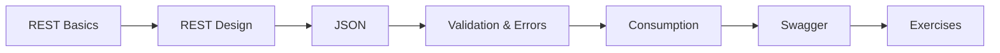

# 27 — REST API

> **Experience level: 🔴 Expert (3 – 5 years)**

**REST APIs** are how modern systems talk: JSON over HTTP with clear resources and status codes. This module covers REST design, JSON, validation, error handling, and client-side consumption.

---

## 📂 Files in This Module

| File | What You'll Learn |
|------|-------------------|
| [REST-Basics.md](REST-Basics.md) | Principles, verbs, status codes |
| [REST-Design.md](REST-Design.md) | Resources, naming, versioning |
| [JSON.md](JSON.md) | JSON with Jackson |
| [Validation-and-Error-Handling.md](Validation-and-Error-Handling.md) | Bean Validation, ProblemDetails |
| [REST-Consumption.md](REST-Consumption.md) | RestClient / WebClient |
| [Swagger-and-OpenAPI.md](Swagger-and-OpenAPI.md) | Documentation & testing |
| [Exercises.md](Exercises.md) | Practice tasks for this module |

---

## 🎯 Learning Objectives

By the end of this module, you will be able to:

1. ✅ Design RESTful resources and status codes.
2. ✅ Build JSON APIs with Spring.
3. ✅ Validate inputs and handle errors cleanly.
4. ✅ Consume external APIs.
5. ✅ Document APIs with OpenAPI/Swagger.

---

## 🧭 Module Map



---

## 📌 Quick Preview

```java
@RestController
@RequestMapping("/api/tasks")
class TaskController {

    @GetMapping("/{id}")
    public Task get(@PathVariable Long id) { ... }
}
```

---

## Next Module

➡️ [29 — Spring Security](../29-Spring-Security/README.md) — secure your APIs with authN and authZ.