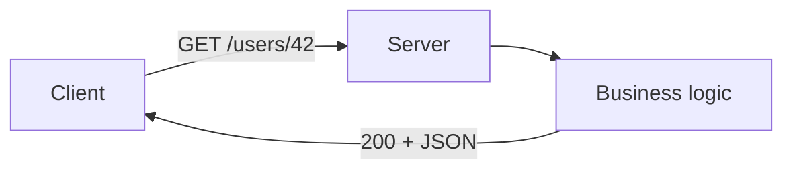

# REST Basics

## 1. Introduction

**REST** (Representational State Transfer) is an architectural style for APIs using HTTP as its foundation: resources, verbs, and status codes over JSON.

---

## 2. Why This Topic Is Important

- REST is the default for system integration.
- Interviews test verbs, status codes, and design.
- Understanding REST separates API authors from consumers.
- It's the backbone of microservices.

---

## 3. Real-World Analogy

REST is a **postal system**:
- **Resources** are addresses (e.g., `/users/42`).
- **Verbs** are actions (GET = "read the mail", POST = "send new mail", DELETE = "return to sender").
- **Status codes** are the response labels (200 OK, 404 Not Found).
- Everything uses the same standard envelope (JSON).

---

## 4. Theory

### The 6 Constraints
| Constraint | Meaning |
|------------|---------|
| Client-server | Separation of concerns |
| Stateless | Each request carries all context |
| Cacheable | Responses can be cached |
| Uniform interface | Resources, verbs, representations |
| Layered system | Proxies, gateways |
| Code on demand | Optional |

### HTTP Verbs
| Verb | Use | Idempotent |
|------|-----|------------|
| GET | Read | Yes |
| POST | Create | No |
| PUT | Replace | Yes |
| PATCH | Partial update | Yes |
| DELETE | Delete | Yes |

### Status Code Families
| Range | Meaning | Examples |
|-------|---------|----------|
| 2xx | Success | 200 OK, 201 Created, 204 No Content |
| 3xx | Redirect | 301, 304 |
| 4xx | Client error | 400 Bad Request, 401 Unauthorized, 403 Forbidden, 404 Not Found |
| 5xx | Server error | 500, 503 |

### Statelessness
Each request must be self-contained (tokens, not server sessions).

---

## 5. Syntax (Spring)

```java
@RestController
@RequestMapping("/api/users")
class UserController {

    @GetMapping("/{id}")
    public User get(@PathVariable Long id) { ... }
}
```

---

## 6. Flow Explanation



---

## 7. Memory Representation

Skip — protocol topic.

---

## 8. Simple Example — Minimal REST

```java
import org.springframework.web.bind.annotation.*;

@RestController
@RequestMapping("/api/greet")
public class GreetController {

    @GetMapping
    public String greet(@RequestParam(defaultValue = "World") String name) {
        return "Hello, " + name + "!";
    }
}
```

---

## 9. Intermediate Example — Full Verb Set

```java
import org.springframework.http.*;
import org.springframework.web.bind.annotation.*;
import java.util.*;

@RestController
@RequestMapping("/api/users")
public class UserController {

    private final Map<Long, String> users = new LinkedHashMap<>();
    private long nextId = 1;

    @GetMapping
    public List<Long> list() { return new ArrayList<>(users.keySet()); }

    @GetMapping("/{id}")
    public ResponseEntity<String> get(@PathVariable Long id) {
        if (!users.containsKey(id)) return ResponseEntity.notFound().build();
        return ResponseEntity.ok(users.get(id));
    }

    @PostMapping
    @ResponseStatus(HttpStatus.CREATED)
    public Long create(@RequestBody String name) {
        users.put(nextId, name);
        return nextId++;
    }

    @DeleteMapping("/{id}")
    public ResponseEntity<Void> delete(@PathVariable Long id) {
        if (users.remove(id) == null) return ResponseEntity.notFound().build();
        return ResponseEntity.noContent().build();
    }
}
```

---

## 10. Advanced Example — REST with DTOs & Status

```java
import org.springframework.http.*;
import org.springframework.web.bind.annotation.*;

record UserRequest(String name, String email) { }
record UserResponse(Long id, String name, String email) { }

@RestController
@RequestMapping("/api/v1/users")
public class V1UserController {

    @PostMapping
    @ResponseStatus(HttpStatus.CREATED)
    public UserResponse create(@RequestBody UserRequest request) {
        // persist...
        return new UserResponse(1L, request.name(), request.email());
    }

    @GetMapping("/{id}")
    public ResponseEntity<UserResponse> get(@PathVariable Long id) {
        if (id > 100) {
            return ResponseEntity.status(HttpStatus.NOT_FOUND).build();
        }
        return ResponseEntity.ok(new UserResponse(id, "Name", "x@y.com"));
    }
}
```

---

## 11. Output

For the **Simple Example**:

```
GET /api/greet?name=Ajay → "Hello, Ajay!"
```

For the **Intermediate Example**:

```
POST /api/users {"..."} → 201 + id
GET  /api/users/999     → 404
DELETE /api/users/1     → 204
```

For the **Advanced Example**:

```
POST /api/v1/users → 201
{
  "id": 1,
  "name": "Name",
  "email": "x@y.com"
}
```

---

## 12. Common Mistakes

| Mistake | Correction |
|---------|------------|
| Wrong status codes | 201 create, 204 delete, 404 missing |
| Verb misuse | POST create, PUT replace, GET read |
| Session state in server | Stateless with tokens |
| Verbs in URL | `/deleteUser` → DELETE /users/1 |
| Leaking internals | Return DTOs |

---

## 13. Best Practices

- Resources + verbs, not actions.
- Correct status codes per operation.
- Stateless; use tokens.
- Return DTOs, not entities.
- Use 404 for missing, 400 for bad input.

---

## 14. Interview Questions

**Q1. What is REST?**
*An architectural style using HTTP resources, verbs, and status codes.*

**Q2. Why is it stateless?**
*Each request self-contained → scalable and cacheable.*

**Q3. GET vs POST?**
*GET reads (safe, idempotent); POST creates (state change).*

**Q4. 401 vs 403?**
*401 unauthenticated; 403 authenticated but not allowed.*

**Q5. Idempotent meaning?**
*Same request repeated → same result (GET, PUT, DELETE).*

---

## 15. Practice Exercises

1. Build a GET endpoint returning a list.
2. Add POST with 201 Created.
3. Return 404 for missing resources.
4. Use DELETE returning 204.

---

## 16. Coding Challenges

1. **Easy:** Greeting API.
2. **Medium:** Full CRUD with proper codes.
3. **Hard:** Versioned API with DTOs and consistent errors.

---

## 17. Summary

- REST = resources + verbs + status codes over HTTP.
- Correct codes: 200/201/204/400/404.
- Stateless; token-based auth.
- DTOs at the boundary.
- REST is the foundation of modern systems.

➡️ Continue to: [REST Design](REST-Design.md)