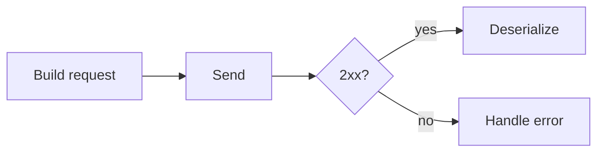

# REST Consumption

## 1. Introduction

Consuming external REST APIs from Java is a daily task. **RestClient** (Spring 6.1+) is the modern, fluent client; **WebClient** handles reactive needs.

---

## 2. Why This Topic Is Important

- Services call each other constantly (microservices).
- Third-party APIs (payment, weather) are integrated.
- Interviewers ask about HTTP clients.
- RestClient is now the recommended default.

---

## 3. Real-World Analogy

Consuming an API is like **ordering food from an app**: you send an order (request), the kitchen (external service) responds with a meal (JSON). RestClient is your reliable food-delivery app — you just say what you want and get the result.

---

## 4. Theory

### Java HTTP Clients
| Client | Style | Use |
|--------|-------|-----|
| `RestTemplate` | Classic (legacy) | Legacy apps |
| `RestClient` | Fluent, sync (modern) | Default choice |
| `WebClient` | Reactive | Async/WebFlux |
| `HttpClient` (JDK 11+) | Low-level | Custom needs |

### RestClient Steps
| Step | Method |
|------|--------|
| Create | `RestClient.create()` / `builder()` |
| Method | `get()` / `post()` / `delete()` |
| URI | `.uri(url)` |
| Body | `.body(dto)` |
| Send | `.retrieve()` |
| Result | `.body(Type.class)` |

### Error Handling
| Way | Detail |
|-----|--------|
| `onStatus` | Custom status handling |
| `.body(MyError.class)` | Map error body |
| Try/catch | For connectivity failures |

---

## 5. Syntax

```java
RestClient client = RestClient.create();

String result = client.get()
        .uri("https://api.example.com/users/5")
        .retrieve()
        .body(String.class);
```

---

## 6. Flow Explanation



---

## 7. Memory Representation

Skip — client topic.

---

## 8. Simple Example — GET a String

```java
import org.springframework.web.client.RestClient;

public class SimpleClient {
    public static void main(String[] args) {
        RestClient client = RestClient.create();

        String body = client.get()
                .uri("https://httpbin.org/get")
                .retrieve()
                .body(String.class);

        System.out.println(body);
    }
}
```

---

## 9. Intermediate Example — GET a DTO

```java
import org.springframework.web.client.RestClient;

record User(Long id, String name, String email) { }

public class DtoClient {

    static final RestClient client = RestClient.builder()
            .baseUrl("https://jsonplaceholder.typicode.com")
            .build();

    public static void main(String[] args) {
        User user = client.get()
                .uri("/users/1")
                .retrieve()
                .body(User.class);

        System.out.println(user);
    }
}
```

---

## 10. Advanced Example — POST + Error Handling

```java
import org.springframework.http.*;
import org.springframework.web.client.RestClient;

record CreateUserRequest(String name, String job) { }
record CreateUserResponse(Long id, String name, String job) { }

public class PostClient {

    static final RestClient client = RestClient.builder()
            .baseUrl("https://reqres.in/api")
            .build();

    public static void main(String[] args) {
        CreateUserResponse created = client.post()
                .uri("/users")
                .contentType(MediaType.APPLICATION_JSON)
                .body(new CreateUserRequest("Ajay", "Engineer"))
                .retrieve()
                .onStatus(status -> status.is4xxClientError(), (req, resp) -> {
                    System.out.println("Client error: " + resp.getStatusCode());
                })
                .body(CreateUserResponse.class);

        System.out.println("Created: " + created);
    }
}
```

---

## 11. Output

For the **Simple Example** (httpbin JSON):

```
{
  "args": {},
  "headers": {...},
  "url": "https://httpbin.org/get"
}
```

For the **Intermediate Example**:

```
User[id=1, name=Leanne Graham, email=Sincere@april.biz]
```

For the **Advanced Example** (reqres):

```
Created: CreateUserResponse[id=... , name=Ajay, job=Engineer]
```

---

## 12. Common Mistakes

| Mistake | Correction |
|---------|------------|
| Not decoding to a DTO | body(Type.class) |
| Ignoring error statuses | onStatus / try-catch |
| No timeout | Configure connect/read timeouts |
| Sharing stateful clients | RestClient is thread-safe; reuse |
| Wrong base URL | Use builder().baseUrl |

---

## 13. Best Practices

- Use RestClient (modern default).
- Reuse one configured client.
- Decode into records/DTOs.
- Handle non-2xx explicitly.
- Set timeouts for reliability.

---

## 14. Interview Questions

**Q1. RestClient vs RestTemplate?**
*RestClient is the modern fluent replacement for RestTemplate.*

**Q2. RestClient vs WebClient?**
*RestClient synchronous; WebClient reactive/async.*

**Q3. How do you handle errors?**
*onStatus, custom body mapping, try-catch.*

**Q4. How to decode JSON?**
*.body(MyDto.class).*

**Q5. Why set timeouts?**
*Prevent hangs on slow/down services.*

---

## 15. Practice Exercises

1. Fetch JSON as a String with RestClient.
2. Decode a JSON response into a record.
3. POST with a JSON body.
4. Handle a 404 with onStatus.

---

## 16. Coding Challenges

1. **Easy:** GET a public API.
2. **Medium:** GET into a DTO + POST create.
3. **Hard:** Full client with headers, timeouts, and error mapping.

---

## 17. Summary

- RestClient is the modern sync client.
- Fluent: method → uri → body → retrieve → decode.
- Decode into records/DTOs.
- Handle errors explicitly.
- Set timeouts; reuse clients.

➡️ Continue to: [Swagger & OpenAPI](Swagger-and-OpenAPI.md)