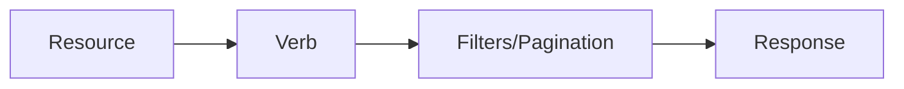

# REST Design

## 1. Introduction

Good **REST design** is about clean resources, consistent naming, and versioning — decisions that shape every consumer of your API.

---

## 2. Why This Topic Is Important

- API design is a senior engineer's job.
- Bad naming/versioning is painful to fix.
- Consistent design reduces client bugs.
- Interviewers evaluate design choices.

---

## 3. Real-World Analogy

Designing a REST API is like **naming streets in a city**: clear, predictable names (`/users/42/orders`) let anyone navigate. Renaming a street later (API change) breaks every map (client) — so you version instead of rename.

---

## 4. Theory

### Resource Naming
| Good | Bad |
|------|-----|
| `/users` | `/getAllUsers` |
| `/users/42` | `/getUser?id=42` |
| `/users/42/orders` | `/getUserOrders?id=42` |
| `/orders/99/items` | `/getOrderItems?id=99` |

### Rules
| Rule | Example |
|------|---------|
| Nouns, not verbs | `/orders`, not `/createOrder` |
| Plural for collections | `/users` |
| Singular for an item | `/users/42` |
| Nested for relationships | `/users/42/orders` |
| Lowercase, hyphens | `/order-items` |
| No trailing slash | `/users` not `/users/` |

### Versioning
| Strategy | Example | Note |
|----------|---------|------|
| URL path | `/api/v1/users` | Most common, explicit |
| Header | `Accept: application/vnd.myapi.v1+json` | Cleaner URLs |
| Query | `?version=1` | Less clean |

### Pagination & Filtering
| Concept | Example |
|---------|---------|
| Pagination | `?page=2&size=20` |
| Sorting | `?sort=name,desc` |
| Filtering | `?status=active` |

### HTTP Semantics
| Verb | Path | Meaning |
|------|------|---------|
| GET | `/orders` | List |
| POST | `/orders` | Create |
| GET | `/orders/5` | Read one |
| PUT | `/orders/5` | Replace |
| PATCH | `/orders/5` | Partial update |
| DELETE | `/orders/5` | Delete |

---

## 5. Syntax

```java
@RestController
@RequestMapping("/api/v1/users")
class UserController {
    // GET /api/v1/users?page=0&size=20&status=active
}
```

---

## 6. Flow Explanation



---

## 7. Memory Representation

Skip — design topic.

---

## 8. Simple Example — Consistent Naming

```java
import org.springframework.web.bind.annotation.*;
import java.util.*;

@RestController
@RequestMapping("/api/v1/users")
public class UserApi {

    private final Map<Long, String> users = new LinkedHashMap<>();

    @GetMapping
    public List<Long> listUsers() {
        return new ArrayList<>(users.keySet());
    }

    @GetMapping("/{id}")
    public ResponseEntity<String> getUser(@PathVariable Long id) {
        return ResponseEntity.of(Optional.ofNullable(users.get(id)));
    }

    @PostMapping
    @org.springframework.http.ResponseEntity
    public Long createUser(@RequestBody String name) {
        return null;   // replaced below
    }
}
```

---

## 9. Intermediate Example — Pagination Support

```java
import org.springframework.web.bind.annotation.*;

@RestController
@RequestMapping("/api/v1/orders")
public class OrderApi {

    @GetMapping
    public PageResult list(
            @RequestParam(defaultValue = "0") int page,
            @RequestParam(defaultValue = "20") int size,
            @RequestParam(required = false) String status) {
        return new PageResult(page, size, "demo", List.of());
    }

    record PageResult(int page, int size, String status, java.util.List<String> items) { }
}
```

---

## 10. Advanced Example — Nested Resources

```java
import org.springframework.web.bind.annotation.*;

@RestController
@RequestMapping("/api/v1/users/{userId}/orders")
public class UserOrderApi {

    @GetMapping
    public String listOrders(@PathVariable Long userId) {
        return "Orders for user " + userId;
    }

    @GetMapping("/{orderId}")
    public String getOrder(@PathVariable Long userId, @PathVariable Long orderId) {
        return "Order " + orderId + " of user " + userId;
    }

    @PostMapping
    public String createOrder(@PathVariable Long userId, @RequestBody String order) {
        return "Created order for user " + userId + ": " + order;
    }
}
```

---

## 11. Output

For the **Intermediate Example**:

```
GET /api/v1/orders?page=0&size=20&status=active
→ {"page":0,"size":20,"status":"active","items":[]}
```

For the **Advanced Example**:

```
GET /api/v1/users/5/orders/99
→ Order 99 of user 5
```

---

## 12. Common Mistakes

| Mistake | Correction |
|---------|------------|
| Verbs in URLs | Use nouns + verbs |
| Breaking changes without versioning | Version from day one |
| Inconsistent naming | Plural collections, hyphens |
| No pagination on lists | Huge payloads |
| Renaming resources later | Design first |

---

## 13. Best Practices

- Nouns + plural collections.
- Version via `/api/v1/`.
- Paginate, sort, filter via query params.
- Nested resources for clear relationships.
- Consistent error format (see next topics).

---

## 14. Interview Questions

**Q1. How do you name REST resources?**
*Plural nouns for collections, singular + id for items.*

**Q2. How do you version an API?**
*URL path /api/v1, or Accept header.*

**Q3. Why nouns not verbs?**
*HTTP verbs already express the action.*

**Q4. How do you paginate?**
*page/size query params; return page metadata.*

**Q5. Nested resources when?**
*Clear ownership (users/5/orders).*

---

## 15. Practice Exercises

1. Design a `/api/v1/tasks` resource set.
2. Add pagination and a status filter.
3. Create a nested `/users/{id}/tasks` API.
4. Compare URL-versioned vs header-versioned designs.

---

## 16. Coding Challenges

1. **Easy:** Consistent CRUD paths.
2. **Medium:** Paginated list endpoint.
3. **Hard:** Nested resources with two-level paths.

---

## 17. Summary

- Nouns + plural collections; verbs do the work.
- Version early: `/api/v1/`.
- Paginate/sort/filter via query params.
- Nested paths for relationships.
- Good design is invisible — consistent and predictable.

➡️ Continue to: [JSON](JSON.md)