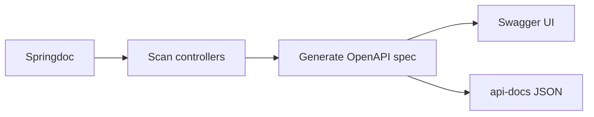

# Swagger & OpenAPI

## 1. Introduction

**OpenAPI** is a standard for describing REST APIs. **Springdoc** generates OpenAPI docs automatically and serves an interactive **Swagger UI** for testing.

---

## 2. Why This Topic Is Important

- Auto-generated docs stay in sync with code.
- Swagger UI lets anyone test endpoints without curl.
- OpenAPI specs drive codegen and clients.
- Interviewers ask how APIs get documented.

---

## 3. Real-World Analogy

OpenAPI is a **restaurant menu with photos**: the spec describes every dish (endpoint), ingredients (params), and price (response). Swagger UI is the interactive ordering tablet — tap a dish, get a sample (try it out).

---

## 4. Theory

### What OpenAPI Provides
| Feature | Detail |
|---------|--------|
| Endpoints | Paths + HTTP verbs |
| Schemas | Request/response models |
| Parameters | Path, query, header, body |
| Security | Auth schemes |
| Groups | Organize by module |

### Springdoc Setup
```xml
<dependency>
    <groupId>org.springdoc</groupId>
    <artifactId>springdoc-openapi-starter-webmvc-ui</artifactId>
    <version>2.6.0</version>
</dependency>
```

### URLs After Setup
| URL | Purpose |
|-----|---------|
| `/swagger-ui.html` | Interactive UI |
| `/v3/api-docs` | OpenAPI JSON |

### Key Annotations
| Annotation | Purpose |
|------------|---------|
| `@Operation(summary=...)` | Describe an endpoint |
| `@ApiResponse(...)` | Document responses |
| `@Parameter(...)` | Document parameters |
| `@Tag(name=...)` | Group endpoints |

---

## 5. Syntax

```java
@RestController
@RequestMapping("/api/users")
class UserController {

    @Operation(summary = "Get user by ID")
    @ApiResponse(responseCode = "200", description = "Found")
    @ApiResponse(responseCode = "404", description = "Not found")
    @GetMapping("/{id}")
    public User get(@PathVariable Long id) { ... }
}
```

---

## 6. Flow Explanation



---

## 7. Memory Representation

Skip — docs topic.

---

## 8. Simple Example — Zero-Config Docs

Add the springdoc dependency and start the app. Visit:
- `/swagger-ui.html` — interactive docs
- `/v3/api-docs` — raw JSON spec

```java
@RestController
@RequestMapping("/api/greet")
public class GreetController {

    @GetMapping
    public String greet(@RequestParam(defaultValue = "World") String name) {
        return "Hello, " + name + "!";
    }
}
```

The spec is generated automatically — no extra code.

---

## 9. Intermediate Example — Operation Descriptions

```java
import io.swagger.v3.oas.annotations.Operation;
import io.swagger.v3.oas.annotations.tags.Tag;
import org.springframework.web.bind.annotation.*;

@Tag(name = "Tasks", description = "Task management API")
@RestController
@RequestMapping("/api/tasks")
public class TaskController {

    @Operation(summary = "List tasks",
               description = "Returns all tasks, optionally filtered")
    @GetMapping
    public java.util.List<String> list(
            @Parameter(description = "Filter by status")
            @RequestParam(required = false) String status) {
        return java.util.List.of("task-a", "task-b");
    }

    @Operation(summary = "Get a task by ID")
    @GetMapping("/{id}")
    public String get(@PathVariable Long id) {
        return "task-" + id;
    }
}
```

---

## 10. Advanced Example — Custom Info & Tags

```java
import io.swagger.v3.oas.models.OpenAPI;
import io.swagger.v3.oas.models.info.Info;
import org.springframework.context.annotation.*;

@Configuration
public class OpenApiConfig {

    @Bean
    public OpenAPI customOpenAPI() {
        return new OpenAPI().info(new Info()
                .title("Payment API")
                .version("1.0.0")
                .description("Handles payments and refunds"));
    }
}
```

---

## 11. Output

For the **Simple Example** (Swagger UI):

```
/api/greet  GET  Parameters: name (query, default: World)
Response: string
```

For the **Intermediate Example** (OpenAPI JSON, excerpt):

```
{
  "paths": {
    "/api/tasks": {
      "get": {
        "summary": "List tasks",
        "parameters": [
          {"name": "status", "in": "query", "required": false}
        ]
      }
    }
  }
}
```

---

## 12. Common Mistakes

| Mistake | Correction |
|---------|------------|
| Not adding springdoc | No UI/docs |
| Wrong starter for WebFlux | Use -webflux variant |
| Unsecured UI in prod | Restrict access |
| Missing @ApiResponse | Docs incomplete |
| Forgetting version | Spring Boot 3 needs 2.x springdoc |

---

## 13. Best Practices

- Add springdoc to every API.
- Document operations and responses.
- Use @Tag to organize.
- Customize Info with title/version.
- Secure the UI in production.

---

## 14. Interview Questions

**Q1. What is OpenAPI?**
*A standard spec format describing REST APIs.*

**Q2. What is Swagger UI?**
*Interactive docs generated from the OpenAPI spec.*

**Q3. How does Springdoc work?**
*Scans controllers and generates the spec at runtime.*

**Q4. How do you document an endpoint?**
*@Operation + @ApiResponse.*

**Q5. Where are the docs?**
*/swagger-ui.html and /v3/api-docs.*

---

## 15. Practice Exercises

1. Add springdoc to a Boot app.
2. Open Swagger UI and test an endpoint.
3. Document operations with @Operation.
4. Customize the API title/version.

---

## 16. Coding Challenges

1. **Easy:** Auto-generated docs.
2. **Medium:** Documented CRUD with responses.
3. **Hard:** Grouped, tagged, custom-info API docs.

---

## 17. Summary

- OpenAPI = standard API description.
- Springdoc auto-generates spec + Swagger UI.
- @Operation/@ApiResponse enrich docs.
- /swagger-ui.html and /v3/api-docs.
- Docs stay in sync with code.

➡️ Continue to: [Exercises](Exercises.md)