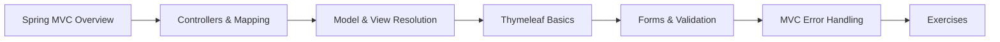

# 28 — Spring MVC & Thymeleaf

> **Experience level: 🔴 Expert (3 – 5 years)**

Spring MVC is the classic way to build **server-rendered web applications** — controllers that return HTML pages, backed by **Thymeleaf** as the modern template engine. While many APIs are JSON-only, server-rendered apps, admin panels, and full-stack Java jobs still rely heavily on Spring MVC + Thymeleaf.

---

## 📂 Files in This Module

| File | What You'll Learn |
|------|-------------------|
| [Spring-MVC-Overview.md](Spring-MVC-Overview.md) | DispatcherServlet, MVC request flow |
| [Controllers-and-Request-Mapping.md](Controllers-and-Request-Mapping.md) | @Controller, @GetMapping/@PostMapping, params |
| [Model-and-View-Resolution.md](Model-and-View-Resolution.md) | Model, view names, ViewResolver |
| [Thymeleaf-Basics.md](Thymeleaf-Basics.md) | th:text, th:each, th:if, th:href |
| [Forms-and-Validation.md](Forms-and-Validation.md) | Form binding, @Valid, BindingResult |
| [MVC-Error-Handling.md](MVC-Error-Handling.md) | @ControllerAdvice, error pages |
| [Exercises.md](Exercises.md) | Practice tasks for this module |

---

## 🎯 Learning Objectives

By the end of this module, you will be able to:

1. ✅ Explain the Spring MVC request flow.
2. ✅ Write controllers that return views.
3. ✅ Render dynamic HTML with Thymeleaf.
4. ✅ Bind and validate forms with Bean Validation.
5. ✅ Handle errors with @ControllerAdvice.

---

## 🧭 Module Map



---

## 📌 Quick Preview

```java
@Controller
public class GreetingController {

    @GetMapping("/greet")
    public String greet(@RequestParam(defaultValue = "World") String name,
                        Model model) {
        model.addAttribute("name", name);
        return "greeting";
    }
}
```

```html
<!-- src/main/resources/templates/greeting.html -->
<p th:text="'Hello, ' + ${name} + '!'">Hello, World!</p>
```

---

## Next Module

➡️ [29 — Spring Security](../29-Spring-Security/README.md) — lock your application down.