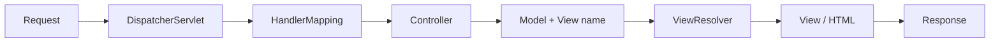

# Spring MVC Overview

## 1. Introduction

**Spring MVC** is Spring's web framework for building **server-rendered applications**. Its centerpiece is the **DispatcherServlet** — a front controller that routes every HTTP request to the right `@Controller` method and hands the result to a view template.

## 2. Why This Topic Is Important

- Spring MVC is the foundation of every Spring Boot web application, including the REST apps you already built (they use `@RestController` — a Spring MVC concept).
- Understanding the request flow explains annotations, view resolution, and interceptors.
- It's the classic architecture for traditional web apps and full-stack Java roles.

## 3. Real-World Analogy

DispatcherServlet is like the **airport control tower**. Every flight (HTTP request) must check in there; the tower decides which runway (controller method) it uses and which gate (view) it parks at. The pilots never talk directly to the maintenance crews — everything routes through the tower.

## 4. Theory

### The request flow



1. Request arrives at the **DispatcherServlet**.
2. **HandlerMapping** finds the matching `@Controller` method.
3. The controller method runs, returns a **view name** and populates the **Model**.
4. **ViewResolver** maps the view name to a template.
5. The **View** renders HTML with the model.
6. The response goes back to the browser.

### Key components

| Component | Role |
|-----------|------|
| DispatcherServlet | Front controller |
| @Controller | Class with handler methods |
| HandlerMapping | Maps URL → method |
| Model | Data passed to the view |
| ViewResolver | View name → template |
| View | Renders the response |

## 5. Syntax

```java
@Controller
public class HomeController {

    @GetMapping("/")
    public String home(Model model) {
        model.addAttribute("message", "Hello");
        return "home";   // renders src/main/resources/templates/home.html
    }
}
```

## 6. Flow Explanation

1. Browser sends `GET /`.
2. DispatcherServlet intercepts it.
3. HandlerMapping matches `/` → `HomeController.home`.
4. `home()` adds `message` to the Model and returns `"home"`.
5. ViewResolver resolves `"home"` to `templates/home.html`.
6. Thymeleaf renders the page with the model; HTML is returned.

## 7. Memory Representation

```
DispatcherServlet ──▶ HomeController.home()
                        Model {message: "Hello"}
                        return "home"
ViewResolver ──▶ templates/home.html + Model ──▶ rendered HTML
```

## 8. Simple Example

```java
@Controller
public class HomeController {

    @GetMapping("/")
    public String index(Model model) {
        model.addAttribute("title", "Welcome");
        return "index";
    }
}
```

## 9. Intermediate Example

```java
@Controller
public class ProductController {

    @GetMapping("/products")
    public String list(Model model) {
        model.addAttribute("products", productService.findAll());
        return "product-list";
    }
}
```

## 10. Advanced Example

```java
@Controller
public class OrderController {

    @GetMapping("/orders/{id}")
    public String detail(@PathVariable Long id, Model model) {
        model.addAttribute("order", orderService.findById(id));
        return "order-detail";
    }
}
```

## 11. Output

`GET /` returns `200 OK` with the rendered `index.html`, including the `Welcome` title inserted by Thymeleaf.

## 12. Common Mistakes

| Mistake | Consequence | Fix |
|---------|-------------|-----|
| Using `@RestController` for HTML views | Returns JSON, not pages | Use `@Controller` |
| Returning a view name that doesn't exist | 500 / blank page | Match template filename |
| Not adding the Model attribute | `${...}` empty in view | `model.addAttribute(...)` |
| Forgetting Thymeleaf dependency | View name returned as text | Add `spring-boot-starter-thymeleaf` |

## 13. Best Practices

- Put views under `src/main/resources/templates`.
- Keep controllers thin: delegate to services.
- Use `@RestController` for JSON APIs, `@Controller` for HTML pages.
- Let ViewResolver handle the prefix/suffix (Thymeleaf auto-configures it).

## 14. Interview Questions

**Q: What is the DispatcherServlet?**
A front controller servlet that routes every HTTP request to the appropriate controller method and dispatches the result to a view.

**Q: What is the Spring MVC request flow?**
Request → DispatcherServlet → HandlerMapping → Controller → Model + view name → ViewResolver → View → Response.

**Q: Difference between `@Controller` and `@RestController`?**
`@RestController` is `@Controller` + `@ResponseBody` — it writes the return value directly as the response (JSON); `@Controller` resolves the return value to a view name.

## 15. Practice Exercises

1. Create a controller returning a simple `home` view.
2. Add a model attribute and display it in Thymeleaf.
3. Add a path-variable route and pass it to the view.

## 16. Coding Challenges

1. Build a controller that lists products from a service and renders them in a table.
2. Add a second endpoint that redirects (not forwards) to the home page and observe the URL change.

## 17. Summary

- DispatcherServlet is the front controller of Spring MVC.
- Request → mapping → controller → model + view name → view.
- Use `@Controller` for HTML views, `@RestController` for JSON.
- ViewResolver maps names to templates under `templates/`.
- Next, master mappings in **Controllers-and-Request-Mapping.md**.