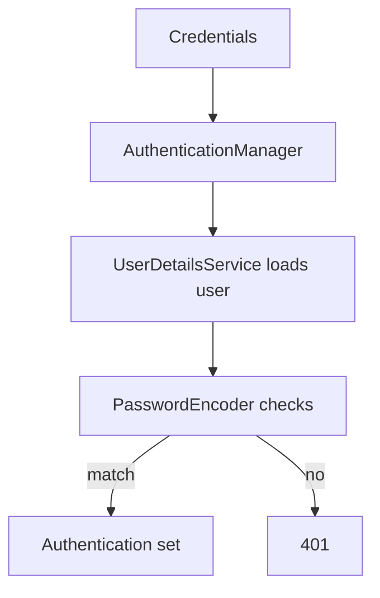
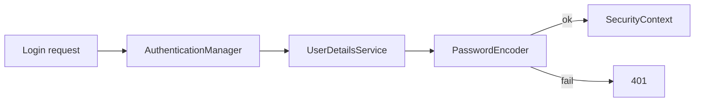

# Authentication

## 1. Introduction

**Authentication** verifies identity. Spring Security does it with a `UserDetailsService`, a `PasswordEncoder`, and the `AuthenticationManager` — then stores the result in the `SecurityContext`.

---

## 2. Why This Topic Is Important

- AuthN is the first line of defense.
- Proper password handling prevents breaches.
- UserDetailsService + BCrypt is the standard pattern.
- Interviewers drill this flow.

---

## 3. Real-World Analogy

Authentication is **showing your ID at a security desk**:
- You hand over credentials (badge/ID).
- The guard checks against the registry (UserDetailsService).
- If it matches, you're let in and marked as cleared (SecurityContext).

---

## 4. Theory

### The AuthN Flow


### Key Interfaces
| Interface | Role |
|-----------|------|
| `UserDetails` | A user record (username, password, roles) |
| `UserDetailsService` | Load user by username |
| `PasswordEncoder` | Encode + verify passwords |
| `AuthenticationManager` | Orchestrates the check |
| `Authentication` | The authenticated principal |

### UserDetailsService (from DB)
```java
@Service
class AppUserService implements UserDetailsService {
    private final UserRepository repo;

    AppUserService(UserRepository repo) { this.repo = repo; }

    public UserDetails loadUserByUsername(String username) {
        AppUser user = repo.findByUsername(username)
                .orElseThrow(() -> new UsernameNotFoundException("Not found"));
        return org.springframework.security.core.userdetails.User
                .withUsername(user.getUsername())
                .password(user.getPassword())
                .roles(user.getRole())
                .build();
    }
}
```

---

## 5. Syntax

```java
User.withUsername("ajay")
    .password(encoder.encode("secret"))
    .roles("USER")
    .build();
```

---

## 6. Flow Explanation



---

## 7. Memory Representation

The SecurityContext (ThreadLocal) holds the authenticated Authentication for the request.

---

## 8. Simple Example — In-Memory Users

```java
import org.springframework.context.annotation.*;
import org.springframework.security.core.userdetails.*;
import org.springframework.security.crypto.bcrypt.BCryptPasswordEncoder;
import org.springframework.security.crypto.password.PasswordEncoder;
import org.springframework.security.provisioning.InMemoryUserDetailsManager;

@Configuration
public class InMemoryAuthConfig {

    @Bean
    public UserDetailsService userDetailsService(PasswordEncoder encoder) {
        UserDetails user = User.withUsername("ajay")
                .password(encoder.encode("pass123"))
                .roles("USER")
                .build();
        return new InMemoryUserDetailsManager(user);
    }

    @Bean
    public PasswordEncoder passwordEncoder() {
        return new BCryptPasswordEncoder();
    }
}
```

---

## 9. Intermediate Example — Custom UserDetails

```java
import org.springframework.security.core.authority.SimpleGrantedAuthority;
import org.springframework.security.core.userdetails.UserDetails;
import java.util.List;

public class CustomUser implements UserDetails {
    private final String username;
    private final String password;
    private final String role;

    public CustomUser(String username, String password, String role) {
        this.username = username;
        this.password = password;
        this.role = role;
    }

    @Override public String getUsername() { return username; }
    @Override public String getPassword() { return password; }

    @Override
    public List<org.springframework.security.core.GrantedAuthority> getAuthorities() {
        return List.of(new SimpleGrantedAuthority("ROLE_" + role));
    }

    @Override public boolean isAccountNonExpired() { return true; }
    @Override public boolean isAccountNonLocked() { return true; }
    @Override public boolean isCredentialsNonExpired() { return true; }
    @Override public boolean isEnabled() { return true; }
}
```

```java
@Service
public class CustomUserService implements UserDetailsService {

    @Override
    public UserDetails loadUserByUsername(String username) {
        // Simulated lookup; replace with repository call.
        if (!"ajay".equals(username)) {
            throw new org.springframework.security.core.userdetails.UsernameNotFoundException("Not found");
        }
        return new CustomUser("ajay",
                new org.springframework.security.crypto.bcrypt.BCryptPasswordEncoder()
                        .encode("pass123"), "USER");
    }
}
```

---

## 10. Advanced Example — Current User in Controller

```java
import org.springframework.security.core.Authentication;
import org.springframework.security.core.annotation.AuthenticationPrincipal;
import org.springframework.security.core.userdetails.UserDetails;
import org.springframework.web.bind.annotation.*;

@RestController
@RequestMapping("/api/me")
public class MeController {

    @GetMapping
    public String me(@AuthenticationPrincipal UserDetails user) {
        return "Logged in as: " + user.getUsername();
    }

    @GetMapping("/auth")
    public String authInfo(Authentication auth) {
        return "Authenticated: " + auth.isAuthenticated()
                + " | Principal: " + auth.getName();
    }
}
```

---

## 11. Output

For the **Simple Example** (basic auth):

```
GET /api/me  with ajay/pass123  → "Logged in as: ajay"
GET /api/me  with wrong pass    → 401
```

For the **Advanced Example**:

```
GET /api/me/auth →
Authenticated: true | Principal: ajay
```

---

## 12. Common Mistakes

| Mistake | Correction |
|---------|------------|
| Storing plain passwords | BCrypt encode |
| Throwing generic errors | UsernameNotFoundException |
| Roles with wrong prefix | hasRole adds ROLE_ |
| AuthN info in controller | Inject Authentication |
| Ignoring case sensitivity | Normalize usernames |

---

## 13. Best Practices

- Always BCrypt-encode passwords.
- Implement UserDetailsService against your DB.
- Use @AuthenticationPrincipal in controllers.
- Never log passwords.
- Lock out on repeated failures.

---

## 14. Interview Questions

**Q1. What is authentication?**
*Verifying identity via credentials.*

**Q2. What does UserDetailsService do?**
*Loads the user record for authentication.*

**Q3. Why BCrypt?**
*Salted, one-way hashing — safe for passwords.*

**Q4. What is the SecurityContext?**
*Stores the current authenticated principal.*

**Q5. How do you get the logged-in user?**
*@AuthenticationPrincipal or Authentication.*

---

## 15. Practice Exercises

1. Set up in-memory users with roles.
2. Implement a custom UserDetailsService.
3. Create a CustomUser implementing UserDetails.
4. Expose the current user in a controller.

---

## 16. Coding Challenges

1. **Easy:** In-memory login working.
2. **Medium:** Custom user loading + BCrypt.
3. **Hard:** Full flow: repository-backed users + current-user endpoint.

---

## 17. Summary

- AuthN verifies identity via UserDetailsService + encoder.
- BCrypt for passwords.
- SecurityContext holds the authenticated user.
- @AuthenticationPrincipal gets the current user.
- DB-backed users = the production pattern.

➡️ Continue to: [Authorization](Authorization.md)