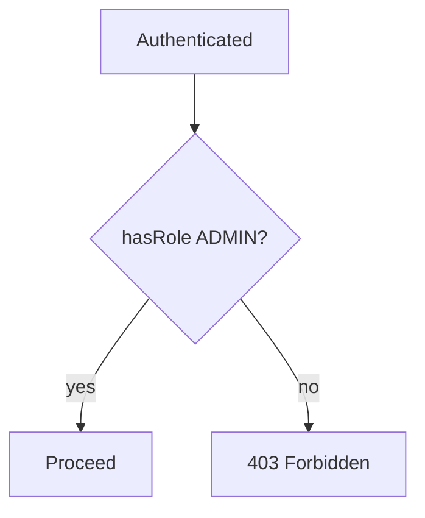

# Authorization

## 1. Introduction

**Authorization** decides *what* an authenticated user may do. Spring Security supports URL-based rules and **method security** with `@PreAuthorize`.

---

## 2. Why This Topic Is Important

- Roles/authorities gate sensitive operations.
- Method security keeps rules near the code.
- 403 handling is a senior-interview topic.
- Poor authorization = privilege escalation.

---

## 3. Real-World Analogy

Authorization is your **badge level**:
- After the ID check (authentication), your badge (roles) decides access.
- A "staff" badge opens staff rooms (hasRole("STAFF")).
- An "admin" badge opens everything (hasRole("ADMIN")).
- Swipe wrong room → 403, not 401 (you're identified, just not allowed).

---

## 4. Theory

### Roles vs Authorities
| Concept | Example | Prefix |
|---------|---------|--------|
| Role | ADMIN, USER | `ROLE_` |
| Authority | `READ`, `WRITE` | none |

### URL-Based Rules
| Expression | Meaning |
|------------|---------|
| `.permitAll()` | No auth needed |
| `.authenticated()` | Any logged-in user |
| `.hasRole("ADMIN")` | Only ADMIN |
| `.hasAnyRole("ADMIN","USER")` | Either role |
| `.hasAuthority("READ")` | Has the authority |

### Method Security
| Annotation | Meaning |
|------------|---------|
| `@PreAuthorize("hasRole('ADMIN')")` | Check before the method |
| `@PostAuthorize` | Check after |
| `@Secured("ROLE_ADMIN")` | Simpler role check |
| `@RolesAllowed("ADMIN")` | JSR-250 |

### Enable Method Security
```java
@Configuration
@EnableMethodSecurity
public class MethodSecurityConfig { }
```

---

## 5. Syntax

```java
@PreAuthorize("hasRole('ADMIN')")
public void deleteUser(Long id) { ... }
```

---

## 6. Flow Explanation



---

## 7. Memory Representation

Skip — policy logic.

---

## 8. Simple Example — URL Rules

```java
import org.springframework.context.annotation.*;
import org.springframework.http.HttpMethod;
import org.springframework.security.config.annotation.web.builders.HttpSecurity;
import org.springframework.security.web.SecurityFilterChain;

@Configuration
public class UrlSecurityConfig {

    @Bean
    public SecurityFilterChain filterChain(HttpSecurity http) throws Exception {
        return http
                .authorizeHttpRequests(auth -> auth
                        .requestMatchers("/", "/public/**").permitAll()
                        .requestMatchers(HttpMethod.GET, "/products/**").authenticated()
                        .requestMatchers("/admin/**").hasRole("ADMIN")
                        .anyRequest().authenticated())
                .formLogin(form -> {})
                .build();
    }
}
```

---

## 9. Intermediate Example — Method Security

```java
import org.springframework.security.access.prepost.PreAuthorize;
import org.springframework.web.bind.annotation.*;

@RestController
@RequestMapping("/api/users")
public class AdminController {

    @GetMapping("/list")
    @PreAuthorize("hasRole('ADMIN')")
    public String list() {
        return "Admin-only user list";
    }

    @GetMapping("/profile")
    @PreAuthorize("hasRole('USER') or hasRole('ADMIN')")
    public String profile() {
        return "Any logged-in user's profile";
    }

    @DeleteMapping("/{id}")
    @PreAuthorize("hasRole('ADMIN')")
    public String delete(@PathVariable Long id) {
        return "Deleted user " + id;
    }
}
```

```java
import org.springframework.context.annotation.*;
import org.springframework.security.config.annotation.method.configuration.EnableMethodSecurity;

@Configuration
@EnableMethodSecurity
public class MethodSecurityConfig { }
```

---

## 10. Advanced Example — Expression with #param

```java
import org.springframework.security.access.prepost.PreAuthorize;
import org.springframework.web.bind.annotation.*;

record Document(Long ownerId, String title) { }

@RestController
@RequestMapping("/api/documents")
public class DocumentController {

    // Only the document owner (id matches) or an admin can view
    @GetMapping("/{id}")
    @PreAuthorize("hasRole('ADMIN') or #ownerId == authentication.principal.uid")
    public Document get(@PathVariable Long id, @RequestParam Long ownerId) {
        return new Document(ownerId, "Doc " + id);
    }
}
```

---

## 11. Output

For the **Simple Example**:

```
GET /public/hello            → 200 (public)
GET /products/1 (logged in)  → 200
GET /products/1 (anonymous)  → redirect to login / 401
GET /admin/x as USER         → 403
GET /admin/x as ADMIN        → 200
```

For the **Intermediate Example**:

```
GET /api/users/list as USER  → 403
GET /api/users/list as ADMIN → "Admin-only user list"
```

---

## 12. Common Mistakes

| Mistake | Correction |
|---------|------------|
| hasRole vs hasAuthority | hasRole auto-adds ROLE_ |
| Missing @EnableMethodSecurity | @PreAuthorize ignored |
| anyRequest().permitAll() | Default to authenticated |
| Role stored without ROLE_ | Match how roles are stored |
| 401 vs 403 confusion | AuthN fails = 401; AuthZ fails = 403 |

---

## 13. Best Practices

- Default-deny: only open public paths.
- Use method security for fine control.
- Use hasRole for roles, hasAuthority for capabilities.
- Enable @EnableMethodSecurity.
- Test each role's access.

---

## 14. Interview Questions

**Q1. AuthN vs AuthZ?**
*AuthN = identity; AuthZ = permissions.*

**Q2. Role vs authority?**
*Role is a coarse capability with ROLE_ prefix; authority is granular.*

**Q3. What is @PreAuthorize?**
*Method security evaluated before execution.*

**Q4. hasRole vs hasAuthority?**
*hasRole("ADMIN") checks ROLE_ADMIN; hasAuthority checks exact.*

**Q5. How to return 403?**
*AccessDeniedHandler / @RestControllerAdvice.*

---

## 15. Practice Exercises

1. Configure URL rules for public/authenticated/admin.
2. Enable method security.
3. Add @PreAuthorize to a delete endpoint.
4. Test each role's 403 behavior.

---

## 16. Coding Challenges

1. **Easy:** Public vs protected URLs.
2. **Medium:** @PreAuthorize on CRUD methods.
3. **Hard:** Owner-based expressions with parameters.

---

## 17. Summary

- AuthZ gates access by roles/authorities.
- URL rules in the filter chain; method security near code.
- @EnableMethodSecurity + @PreAuthorize.
- Default-deny; open only public paths.
- hasRole for roles; hasAuthority for capabilities.

➡️ Continue to: [JWT](JWT.md)