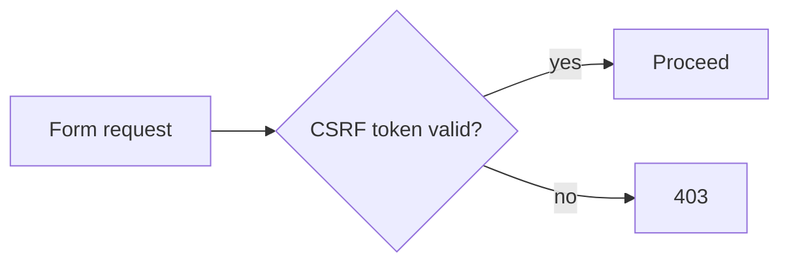
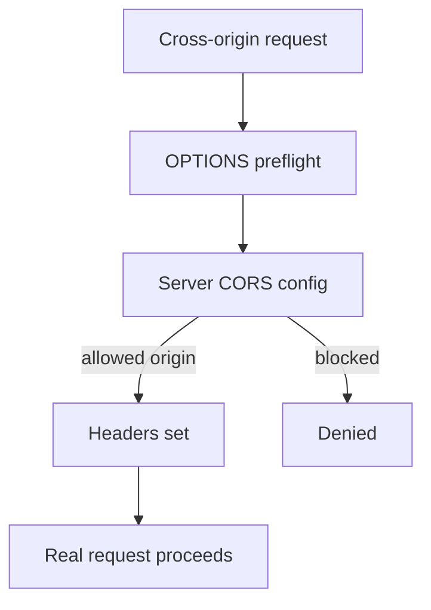

# CSRF & CORS

## 1. Introduction

**CSRF** protects browser sessions from forged requests. **CORS** controls which origins may call your API. Getting both right is essential for web security.

---

## 2. Why This Topic Is Important

- CSRF is enabled by default and breaks APIs if mishandled.
- CORS mistakes block legitimate frontends.
- Interviewers ask when to disable CSRF.
- Both are common deployment bugs.

---

## 3. Real-World Analogy

- **CSRF** is a **bouncer checking the ticket matches your face**: even if someone sneaks a ticket (cookie), the venue checks it's really yours. With sessions + cookies, forged cross-site requests are the danger.
- **CORS** is a **door policy listing allowed guests**: only named origins (myapp.com) may enter (call the API), others are turned away.

---

## 4. Theory

### CSRF (Cross-Site Request Forgery)
| Aspect | Detail |
|--------|--------|
| Attack | Malicious site sends a request using your session cookie |
| Defense | Token + cookie both required |
| In Spring | Enabled by default |
| APIs (Bearer tokens) | Safe to disable |



### CORS (Cross-Origin Resource Sharing)
| Concept | Meaning |
|---------|---------|
| Origin | scheme + host + port |
| Same-origin | Same origin = allowed |
| Cross-origin | Needs CORS headers |
| Preflight | OPTIONS check before the real call |

### Spring CORS Setup
```java
.cors(cors -> cors.configurationSource(source))
```
or
```java
@CrossOrigin(origins = "http://localhost:5173")
```

### When to Disable CSRF
| Case | CSRF |
|------|------|
| Session-based web app | Keep enabled |
| Stateless JWT API | Disable |
| Token in Authorization header | Safe to disable |

---

## 5. Syntax

```java
http.csrf(csrf -> csrf.disable())
    .cors(cors -> cors.configurationSource(corsConfig()))
```

```java
@CrossOrigin(origins = "http://localhost:5173")
@GetMapping("/api/orders")
public List<Order> orders() { ... }
```

---

## 6. Flow Explanation



---

## 7. Memory Representation

Skip — HTTP-level protections.

---

## 8. Simple Example — Disable CSRF for API

```java
import org.springframework.context.annotation.*;
import org.springframework.security.config.annotation.web.builders.HttpSecurity;
import org.springframework.security.web.SecurityFilterChain;

@Configuration
public class ApiSecurityConfig {

    @Bean
    public SecurityFilterChain filterChain(HttpSecurity http) throws Exception {
        return http
                .csrf(csrf -> csrf.disable())       // stateless JWT API
                .authorizeHttpRequests(auth -> auth
                        .requestMatchers("/api/**").authenticated()
                        .anyRequest().permitAll())
                .build();
    }
}
```

---

## 9. Intermediate Example — CORS Configuration

```java
import org.springframework.context.annotation.*;
import org.springframework.web.cors.CorsConfiguration;
import org.springframework.web.cors.CorsConfigurationSource;
import org.springframework.web.cors.UrlBasedCorsConfigurationSource;
import org.springframework.security.config.annotation.web.builders.HttpSecurity;
import org.springframework.security.web.SecurityFilterChain;
import java.util.List;

@Configuration
public class CorsSecurityConfig {

    @Bean
    public SecurityFilterChain filterChain(HttpSecurity http) throws Exception {
        return http
                .csrf(csrf -> csrf.disable())
                .cors(cors -> cors.configurationSource(corsConfigurationSource()))
                .authorizeHttpRequests(auth -> auth.anyRequest().permitAll())
                .build();
    }

    @Bean
    public CorsConfigurationSource corsConfigurationSource() {
        CorsConfiguration config = new CorsConfiguration();
        config.setAllowedOrigins(List.of("http://localhost:5173", "https://app.example.com"));
        config.setAllowedMethods(List.of("GET", "POST", "PUT", "DELETE"));
        config.setAllowedHeaders(List.of("*"));
        config.setAllowCredentials(true);

        UrlBasedCorsConfigurationSource source = new UrlBasedCorsConfigurationSource();
        source.registerCorsConfiguration("/**", config);
        return source;
    }
}
```

---

## 10. Advanced Example — Per-Endpoint @CrossOrigin

```java
import org.springframework.web.bind.annotation.*;

@RestController
public class OrderController {

    @CrossOrigin(origins = "http://localhost:5173")
    @GetMapping("/api/orders")
    public java.util.List<String> orders() {
        return java.util.List.of("ORD-1", "ORD-2");
    }

    @CrossOrigin(origins = "*", allowedHeaders = "*")
    @PostMapping("/api/webhooks")
    public String webhook(@RequestBody String payload) {
        return "Received: " + payload;
    }
}
```

---

## 11. Output

For the **Simple Example**:

```
POST /api/orders (with Bearer token) → 200
POST /api/orders (no token)          → 401
```

For the **Intermediate Example** (from allowed origin):

```
Browser fetch from http://localhost:5173 → 200 (CORS headers present)
Browser fetch from http://evil.com       → blocked
```

For the **Advanced Example**:

```
POST /api/webhooks from any origin → 200
```

---

## 12. Common Mistakes

| Mistake | Correction |
|---------|------------|
| Keeping CSRF for JWT APIs | Disable for stateless |
| `origins = "*"` + credentials | Incompatible — specify origins |
| Blocking valid frontend | Configure CORS properly |
| Missing preflight handling | Spring handles automatically |
| CORS not wired into filter chain | .cors(...) in HttpSecurity |

---

## 13. Best Practices

- Disable CSRF only for stateless token APIs.
- List explicit allowed origins (no `*` with credentials).
- Allow only needed methods/headers.
- Keep CORS centralized in one config.
- Test from the actual frontend origin.

---

## 14. Interview Questions

**Q1. What is CSRF?**
*Forged requests using your session cookie; blocked by tokens.*

**Q2. When disable CSRF?**
*Stateless APIs using Authorization header tokens.*

**Q3. What is CORS?**
*A browser policy letting specified origins call your API.*

**Q4. What is a preflight?*
*An OPTIONS request checking permissions before the real call.*

**Q5. `origins=*` with credentials?**
*Not allowed by the browser — list explicit origins.*

---

## 15. Practice Exercises

1. Disable CSRF for a token-based API.
2. Configure CORS for one origin.
3. Use @CrossOrigin on an endpoint.
4. Test allowed vs blocked origins.

---

## 16. Coding Challenges

1. **Easy:** CSRF off + JWT flow.
2. **Medium:** Central CORS config for a SPA origin.
3. **Hard:** Role-aware CORS (different origins per path).

---

## 17. Summary

- CSRF protects sessions; disable for stateless APIs.
- CORS controls cross-origin access.
- Explicit origins; no `*` with credentials.
- Wire CORS into the filter chain.
- Both are critical for production web apps.

➡️ Continue to: [Security Config](Security-Config.md)