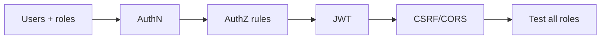

# Exercises — Spring Security

## 1. Introduction

Practice the security stack end-to-end: authentication, authorization, JWT, CSRF/CORS, and a full SecurityConfig.

---

## 2. Why This Topic Is Important

- Security is non-negotiable in production.
- JWT + roles are the most-asked patterns.
- These exercises build a security portfolio.

---

## 3. Real-World Analogy

Like **earning your security license**: you practice each checkpoint — ID checks (authN), room badges (authZ), wristbands (JWT), and door policies (CORS) — until you can secure any building (app) confidently.

---

## 4. Theory — Topic Map

| Topic | Key Skill |
|-------|-----------|
| Overview | AuthN vs AuthZ, filters |
| Authentication | UserDetailsService, BCrypt |
| Authorization | Roles, @PreAuthorize |
| JWT | Stateless tokens |
| CSRF/CORS | Web protections |
| Config | SecurityFilterChain |

---

## 5. Syntax Reminder

```java
http.authorizeHttpRequests(auth -> auth
        .requestMatchers("/admin/**").hasRole("ADMIN")
        .anyRequest().authenticated());
```

```java
@PreAuthorize("hasRole('ADMIN')")
public void delete(Long id) { ... }
```

```java
Authorization: Bearer eyJhbGci...
```

---

## 6. Practice Flow



---

## 7. Memory Representation

Skip — practice module.

---

## 8. Simple Exercises

**Ex 1 — Starter:** Add security; observe default login.

**Ex 2 — Users:** In-memory users with USER/ADMIN roles.

**Ex 3 — Passwords:** BCrypt encode stored passwords.

**Ex 4 — Rules:** Public, authenticated, and admin paths.

---

## 9. Intermediate Exercises

**Ex 5 — Method Security:** @PreAuthorize on CRUD.

**Ex 6 — JWT:** Generate and parse tokens with jjwt.

**Ex 7 — Login:** /api/login returning a JWT.

**Ex 8 — CSRF:** Disable for the stateless API.

**Ex 9 — CORS:** Allow a SPA origin.

---

## 10. Advanced Exercises

**Ex 10 — JWT Filter:** Validate Bearer tokens per request.

**Ex 11 — JSON Errors:** 401/403 as JSON.

**Ex 12 — Role Tests:** Confirm each role's access matrix.

**Ex 13 — Full Secure API:** Login → JWT → protected routes → CORS → JSON errors.

---

## 11. Expected Output Samples

**Ex 4:**
```
GET /public/x → 200
GET /admin/x as USER → 403
GET /admin/x as ADMIN → 200
```

**Ex 7:**
```
POST /api/login {"username":"ajay","password":"pass123"}
→ {"token":"eyJhbGciOiJIUzI1NiJ9..."}
```

**Ex 11:**
```
GET /api/orders without token → 401 {"error":"unauthorized"}
```

---

## 12. Common Mistakes

| Mistake | Fix |
|---------|-----|
| Plain passwords | BCrypt |
| Missing @EnableMethodSecurity | @PreAuthorize ignored |
| CSRF on for stateless API | Disable |
| Weak JWT secret | ≥32 random bytes |
| CORS with `*` + credentials | Explicit origins |

---

## 13. Best Practices

- Default-deny; open only public paths.
- BCrypt everywhere; never store plain.
- Short JWT expiry; verify signatures.
- STATELESS for token APIs.
- JSON 401/403 for clean client handling.

---

## 14. Interview Practice Questions

**Q1.** AuthN vs AuthZ?
**Q2.** How does JWT auth work?
**Q3.** When disable CSRF?
**Q4.** hasRole vs hasAuthority?
**Q5.** What does SecurityFilterChain configure?

---

## 15. Self-Check

- [ ] I can configure in-memory users.
- [ ] I can protect paths by role.
- [ ] I can issue and validate JWTs.
- [ ] I handle 401/403 cleanly.
- [ ] I configure CSRF/CORS correctly.

---

## 16. Next Steps

- Persist data in [30 — Hibernate/JPA](../30-Hibernate-JPA/README.md).
- Build distributed apps in [32 — Microservices](../32-Microservices/README.md).

---

## 17. Summary

- AuthN (who) + AuthZ (what) via filter chain.
- BCrypt passwords; @PreAuthorize method rules.
- JWT for stateless API auth.
- Disable CSRF for token APIs; CORS for origins.
- Central SecurityConfig ties it together.

➡️ Module complete! Continue to [30 — Hibernate/JPA](../30-Hibernate-JPA/README.md).