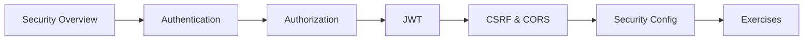

# 29 — Spring Security

> **Experience level: 🔴 Expert (3 – 5 years)**

**Spring Security** protects your app: authentication (who you are), authorization (what you can do), plus CSRF, CORS, and JWT support. This module covers the full security stack.

---

## 📂 Files in This Module

| File | What You'll Learn |
|------|-------------------|
| [Security-Overview.md](Security-Overview.md) | AuthN vs AuthZ, filter chain |
| [Authentication.md](Authentication.md) | Login, UserDetailsService, password |
| [Authorization.md](Authorization.md) | Roles, method security, authorities |
| [JWT.md](JWT.md) | Token-based auth for APIs |
| [CSRF-and-CORS.md](CSRF-and-CORS.md) | Web protections |
| [Security-Config.md](Security-Config.md) | SecurityFilterChain setup |
| [Exercises.md](Exercises.md) | Practice tasks for this module |

---

## 🎯 Learning Objectives

By the end of this module, you will be able to:

1. ✅ Explain authentication vs authorization.
2. ✅ Implement login with UserDetailsService.
3. ✅ Protect endpoints by role.
4. ✅ Secure a REST API with JWT.
5. ✅ Configure CSRF and CORS correctly.

---

## 🧭 Module Map



---

## 📌 Quick Preview

```java
@Bean
SecurityFilterChain filterChain(HttpSecurity http) throws Exception {
    return http
        .authorizeHttpRequests(auth -> auth
            .requestMatchers("/api/admin/**").hasRole("ADMIN")
            .anyRequest().authenticated())
        .build();
}
```

---

## Next Module

➡️ [30 — Hibernate & JPA](../30-Hibernate-JPA/README.md) — persist your data with ORM.