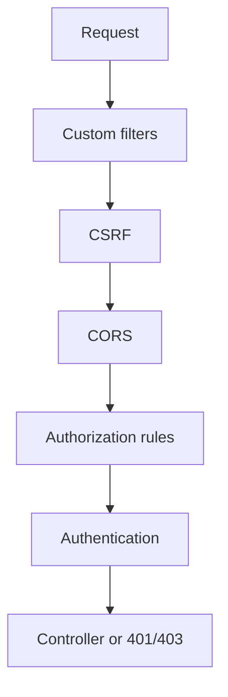

# Security Config

## 1. Introduction

**SecurityConfig** is the central file where you define the `SecurityFilterChain`: which paths are open, which require roles, how auth works, and CSRF/CORS behavior.

---

## 2. Why This Topic Is Important

- One config controls your app's whole security posture.
- A misconfigured chain can expose or lock out your app.
- Every Spring Security interview centers on this config.
- Boot auto-configures, but you override with your chain.

---

## 3. Real-World Analogy

The SecurityConfig is the **building's security master plan**: which doors are open to the public (permitAll), which need an employee badge (authenticated), and which need a manager key (hasRole). The plan (filter chain) is reviewed and enforced at every entrance.

---

## 4. Theory

### The SecurityFilterChain
```java
@Bean
SecurityFilterChain filterChain(HttpSecurity http) throws Exception {
    return http
            .csrf(csrf -> csrf.disable())
            .cors(cors -> cors.configurationSource(...))
            .authorizeHttpRequests(auth -> auth
                    .requestMatchers("/public/**").permitAll()
                    .requestMatchers("/admin/**").hasRole("ADMIN")
                    .anyRequest().authenticated())
            .formLogin(form -> {})
            .httpBasic(basic -> {})
            .addFilterBefore(jwtFilter, UsernamePasswordAuthenticationFilter.class)
            .build();
}
```

### Common Sections
| Section | Purpose |
|---------|---------|
| `csrf` | Enable/disable |
| `cors` | Origin policy |
| `authorizeHttpRequests` | URL rules |
| `formLogin` / `httpBasic` | Login style |
| `addFilterBefore` | Custom filters (JWT) |
| `sessionManagement` | Stateless config |
| `exceptionHandling` | 401/403 responses |

### Boot Defaults
Without config: form login, all paths authenticated, generated password.

---

## 5. Syntax

```java
@Configuration
@EnableWebSecurity
public class SecurityConfig {

    @Bean
    public SecurityFilterChain filterChain(HttpSecurity http) throws Exception {
        return http.build();
    }
}
```

---

## 6. Flow Explanation



---

## 7. Memory Representation

Skip — config pattern.

---

## 8. Simple Example — Stateless API Chain

```java
import org.springframework.context.annotation.*;
import org.springframework.security.config.annotation.web.builders.HttpSecurity;
import org.springframework.security.config.http.SessionCreationPolicy;
import org.springframework.security.web.SecurityFilterChain;

@Configuration
@EnableWebSecurity
public class SecurityConfig {

    @Bean
    public SecurityFilterChain filterChain(HttpSecurity http) throws Exception {
        return http
                .csrf(csrf -> csrf.disable())
                .sessionManagement(session ->
                        session.sessionCreationPolicy(SessionCreationPolicy.STATELESS))
                .authorizeHttpRequests(auth -> auth
                        .requestMatchers("/api/auth/**", "/actuator/health").permitAll()
                        .anyRequest().authenticated())
                .httpBasic(basic -> {})
                .build();
    }
}
```

---

## 9. Intermediate Example — Custom Entry Point (401/403 JSON)

```java
import org.springframework.context.annotation.*;
import org.springframework.http.*;
import org.springframework.security.config.annotation.web.builders.HttpSecurity;
import org.springframework.security.web.SecurityFilterChain;
import org.springframework.security.web.authentication.HttpStatusEntryPoint;

@Configuration
@EnableWebSecurity
public class JsonSecurityConfig {

    @Bean
    public SecurityFilterChain filterChain(HttpSecurity http) throws Exception {
        return http
                .csrf(csrf -> csrf.disable())
                .exceptionHandling(ex -> ex
                        .authenticationEntryPoint(
                                new HttpStatusEntryPoint(HttpStatus.UNAUTHORIZED))
                        .accessDeniedHandler((req, res, e) -> {
                            res.setStatus(403);
                            res.setContentType("application/json");
                            res.getWriter().write("{\"error\":\"forbidden\"}");
                        }))
                .authorizeHttpRequests(auth -> auth
                        .requestMatchers("/public/**").permitAll()
                        .anyRequest().authenticated())
                .httpBasic(basic -> {})
                .build();
    }
}
```

---

## 10. Advanced Example — Adding the JWT Filter

```java
import org.springframework.context.annotation.*;
import org.springframework.security.config.annotation.web.builders.HttpSecurity;
import org.springframework.security.config.http.SessionCreationPolicy;
import org.springframework.security.web.SecurityFilterChain;
import org.springframework.security.web.authentication.UsernamePasswordAuthenticationFilter;

@Configuration
@EnableWebSecurity
public class JwtSecurityConfig {

    @Bean
    public SecurityFilterChain filterChain(HttpSecurity http, JwtAuthFilter jwtAuthFilter)
            throws Exception {
        return http
                .csrf(csrf -> csrf.disable())
                .sessionManagement(s ->
                        s.sessionCreationPolicy(SessionCreationPolicy.STATELESS))
                .authorizeHttpRequests(auth -> auth
                        .requestMatchers("/api/login", "/public/**").permitAll()
                        .anyRequest().authenticated())
                .addFilterBefore(jwtAuthFilter, UsernamePasswordAuthenticationFilter.class)
                .build();
    }
}
```

---

## 11. Output

For the **Simple Example**:

```
GET /api/auth/login     → 200 (public)
GET /api/orders         → 401 without credentials
GET /api/orders (basic) → 200
```

For the **Intermediate Example**:

```
GET /api/orders (anonymous) →
401  {"error":"unauthorized"}
GET /api/orders as USER without role →
403  {"error":"forbidden"}
```

---

## 12. Common Mistakes

| Mistake | Correction |
|---------|------------|
| Order of matchers | Most specific first |
| Missing anyRequest() | Unmatched paths behave oddly |
| Sessions in JWT APIs | STATELESS policy |
| Filter order wrong | addFilterBefore the right class |
| Hardcoding users in prod | DB-backed users |

---

## 13. Best Practices

- Specific matchers before anyRequest().
- STATELESS for token APIs.
- Custom 401/403 JSON for APIs.
- Wire custom filters with addFilterBefore.
- Keep configuration in one file.

---

## 14. Interview Questions

**Q1. What is SecurityFilterChain?**
*The ordered set of security filters built from HttpSecurity.*

**Q2. Why STATELESS?**
*JWT APIs don't need server sessions.*

**Q3. How do you add a JWT filter?**
*addFilterBefore(jwtFilter, UsernamePasswordAuthenticationFilter.class).*

**Q4. Order matters?**
*Yes — specific matchers first.*

**Q5. How to return JSON 401?**
*authenticationEntryPoint + HttpStatusEntryPoint.*

---

## 15. Practice Exercises

1. Build a stateless API chain.
2. Open /public and /actuator/health.
3. Return JSON 401/403.
4. Wire a JWT filter into the chain.

---

## 16. Coding Challenges

1. **Easy:** Permit + authenticate URLs.
2. **Medium:** JSON error responses.
3. **Hard:** Full JWT filter chain + roles + CORS.

---

## 17. Summary

- One SecurityFilterChain configures everything.
- Match ordering and STATELESS matter.
- Custom entry points give clean 401/403 JSON.
- JWT filters slot in before auth.
- Centralize; test each rule.

➡️ Continue to: [Exercises](Exercises.md)