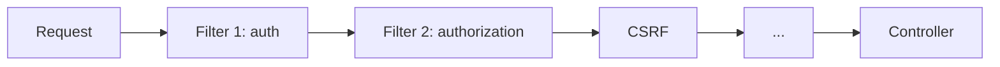
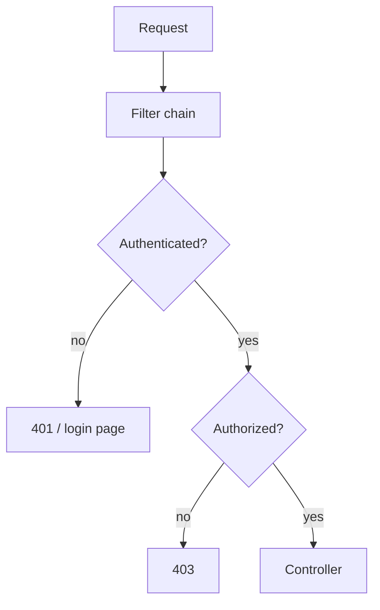

# Security Overview

## 1. Introduction

**Spring Security** is the de-facto security framework for Java. It handles **authentication** (who you are) and **authorization** (what you can do) through a chain of filters.

---

## 2. Why This Topic Is Important

- Every production API needs security.
- Security flaws are critical vulnerabilities.
- JWT, roles, and OAuth are interview staples.
- Spring Security is the standard solution.

---

## 3. Real-World Analogy

Spring Security is a **building's security system**:
- **Authentication**: the ID check at the door — proving who you are.
- **Authorization**: which rooms your badge opens — proving what you may do.
- The **filter chain** is the set of checkpoints: ID, bag check, room access — each filter one checkpoint.

---

## 4. Theory

### Authentication vs Authorization
| Concept | Question | In Spring |
|---------|----------|-----------|
| Authentication | Who are you? | Username/password, tokens |
| Authorization | What may you do? | Roles, authorities |

### The Security Filter Chain


### Core Components
| Component | Role |
|-----------|------|
| `SecurityFilterChain` | Ordered security filters |
| `AuthenticationManager` | Validates credentials |
| `UserDetailsService` | Loads users from storage |
| `PasswordEncoder` | Hashes/verifies passwords |
| `SecurityContext` | Holds the current user |

### Defaults (Boot Starter)
- Every endpoint requires authentication.
- Auto-generated password + user.
- Form login page.
- CSRF enabled.

---

## 5. Syntax (Starter)

```xml
<dependency>
    <groupId>org.springframework.boot</groupId>
    <artifactId>spring-boot-starter-security</artifactId>
</dependency>
```

---

## 6. Flow Explanation



---

## 7. Memory Representation

Skip — framework behavior.

---

## 8. Simple Example — Default Security

Add the starter and run. Console output shows:

```
Using generated security password: 12345678
```

Access `http://localhost:8080/` → you get a login page. Sign in with `user` / the generated password.

---

## 9. Intermediate Example — Custom User

```java
import org.springframework.context.annotation.*;
import org.springframework.security.core.userdetails.*;
import org.springframework.security.crypto.bcrypt.BCryptPasswordEncoder;
import org.springframework.security.crypto.password.PasswordEncoder;
import org.springframework.security.provisioning.InMemoryUserDetailsManager;

@Configuration
public class SecurityConfig {

    @Bean
    public UserDetailsService users() {
        UserDetails admin = User.withUsername("admin")
                .password(passwordEncoder().encode("admin123"))
                .roles("ADMIN")
                .build();

        UserDetails user = User.withUsername("ajay")
                .password(passwordEncoder().encode("user123"))
                .roles("USER")
                .build();

        return new InMemoryUserDetailsManager(admin, user);
    }

    @Bean
    public PasswordEncoder passwordEncoder() {
        return new BCryptPasswordEncoder();
    }
}
```

---

## 10. Advanced Example — Protecting Endpoints

```java
import org.springframework.context.annotation.*;
import org.springframework.http.HttpMethod;
import org.springframework.security.config.annotation.web.builders.HttpSecurity;
import org.springframework.security.config.annotation.web.configuration.EnableWebSecurity;
import org.springframework.security.web.SecurityFilterChain;

@Configuration
@EnableWebSecurity
public class ApiSecurityConfig {

    @Bean
    public SecurityFilterChain filterChain(HttpSecurity http) throws Exception {
        return http
                .csrf(csrf -> csrf.disable())   // API-only demo
                .authorizeHttpRequests(auth -> auth
                        .requestMatchers("/api/public/**").permitAll()
                        .requestMatchers(HttpMethod.GET, "/api/products/**").authenticated()
                        .requestMatchers("/api/admin/**").hasRole("ADMIN")
                        .anyRequest().authenticated())
                .httpBasic(basic -> {})
                .build();
    }
}
```

---

## 11. Output

For the **Intermediate Example** (using basic auth):

```
GET /any  with user:user123  → 200
GET /any  with wrong creds   → 401
```

For the **Advanced Example**:

```
GET /api/public/x         → 200 (public)
GET /api/products/1       → 200 with login, 401 without
GET /api/admin/x as USER  → 403
GET /api/admin/x as ADMIN → 200
```

---

## 12. Common Mistakes

| Mistake | Correction |
|---------|------------|
| Plain-text passwords | BCrypt encoder |
| csrf disabled on stateful apps | Keep CSRF for sessions |
| AnyRequest().permitAll() | Only for truly public APIs |
| Roles mismatch (`ROLE_` prefix) | Use hasRole, not hasAuthority for roles |
| Not hashing in DB | Always encode before saving |

---

## 13. Best Practices

- Always use a PasswordEncoder (BCrypt).
- Lock down by default; open only public paths.
- Prefer method security for fine control.
- Enable CSRF for session-based apps.
- Token auth for stateless APIs (JWT next).

---

## 14. Interview Questions

**Q1. AuthN vs AuthZ?**
*AuthN proves identity; AuthZ grants access.*

**Q2. What is the filter chain?**
*An ordered set of security filters applied to every request.*

**Q3. PasswordEncoder?**
*BCrypt hashes and verifies passwords.*

**Q4. What is UserDetailsService?**
*Loads user records for authentication.*

**Q5. 401 vs 403?**
*401 unauthenticated; 403 forbidden.*

---

## 15. Practice Exercises

1. Add the security starter and observe defaults.
2. Create in-memory users with roles.
3. Protect admin paths with hasRole.
4. Encode passwords with BCrypt.

---

## 16. Coding Challenges

1. **Easy:** Default login working.
2. **Medium:** In-memory users + role-based paths.
3. **Hard:** A full filter chain with public, authenticated, and admin areas.

---

## 17. Summary

- AuthN (who) + AuthZ (what) via filters.
- Filter chain guards every request.
- BCrypt for passwords.
- Default = everything authenticated.
- 401 vs 403; open only public paths.
- Next: JWT for stateless APIs.

➡️ Continue to: [Authentication](Authentication.md)