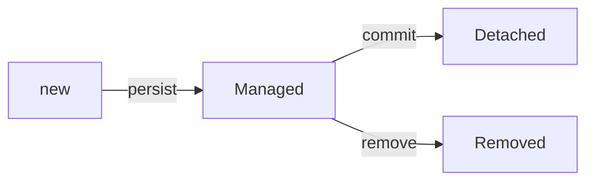
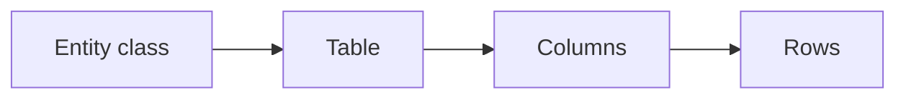

# Entities

## 1. Introduction

An **entity** is a Java class mapped to a database table. It's the core of JPA — columns, keys, and lifecycle all hang off `@Entity`.

---

## 2. Why This Topic Is Important

- Entities define your data model.
- Mapping mistakes cause data-loss bugs.
- The lifecycle (persist/merge/remove) is interview material.
- Every Spring Data app revolves around entities.

---

## 3. Real-World Analogy

An entity is a **medical record form**: each field (name, date, notes) maps to a column in the patient file cabinet. The form tells the clerk (Hibernate) exactly where each piece of information lives — and how to update it.

---

## 4. Theory

### Mapping Annotations
| Annotation | Purpose |
|------------|---------|
| `@Entity` | Class is table-mapped |
| `@Table(name="...")` | Table name override |
| `@Id` | Primary key |
| `@GeneratedValue` | Key generation |
| `@Column(name, nullable, length)` | Column details |
| `@Transient` | Not persisted |
| `@Enumerated` | Enum storage |
| `@Temporal` / `@Column(updatable=false)` | Dates, audit |

### Key Strategies
```java
@Id @GeneratedValue(strategy = GenerationType.IDENTITY)  // auto-increment
@Id @GeneratedValue(strategy = GenerationType.SEQUENCE)  // sequence
@Id @GeneratedValue(strategy = GenerationType.UUID)      // UUID (Hibernate 6+)
```

### Entity Rules
| Rule | Reason |
|------|--------|
| No-args constructor | Hibernate instantiates |
| @Id required | Key to identity |
| getters/setters | Access + mapping |
| equals/hashCode | Collections & identity |

### Lifecycle


---

## 5. Syntax

```java
@Entity
@Table(name = "users")
public class User {
    @Id
    @GeneratedValue(strategy = GenerationType.IDENTITY)
    private Long id;

    @Column(nullable = false, length = 50)
    private String name;
}
```

---

## 6. Flow Explanation



---

## 7. Memory Representation

Managed entities sit in the persistence context, synced to the DB on flush.

---

## 8. Simple Example — User Entity

```java
import jakarta.persistence.*;

@Entity
@Table(name = "users")
public class User {

    @Id
    @GeneratedValue(strategy = GenerationType.IDENTITY)
    private Long id;

    @Column(nullable = false, unique = true, length = 50)
    private String email;

    @Column(nullable = false)
    private String fullName;

    public User() { }

    public User(String email, String fullName) {
        this.email = email;
        this.fullName = fullName;
    }

    public Long getId() { return id; }
    public void setId(Long id) { this.id = id; }

    public String getEmail() { return email; }
    public void setEmail(String email) { this.email = email; }

    public String getFullName() { return fullName; }
    public void setFullName(String fullName) { this.fullName = fullName; }
}
```

---

## 9. Intermediate Example — Enums & Dates

```java
import jakarta.persistence.*;
import java.time.LocalDateTime;

enum OrderStatus { PENDING, PAID, SHIPPED, CANCELLED }

@Entity
@Table(name = "orders")
public class Order {

    @Id
    @GeneratedValue(strategy = GenerationType.IDENTITY)
    private Long id;

    @Enumerated(EnumType.STRING)
    @Column(nullable = false)
    private OrderStatus status = OrderStatus.PENDING;

    @Column(nullable = false, updatable = false)
    private LocalDateTime createdAt = LocalDateTime.now();

    @Transient
    private String tempCalculation;   // not stored

    public Long getId() { return id; }
    public void setId(Long id) { this.id = id; }

    public OrderStatus getStatus() { return status; }
    public void setStatus(OrderStatus status) { this.status = status; }

    public LocalDateTime getCreatedAt() { return createdAt; }
    public void setCreatedAt(LocalDateTime createdAt) { this.createdAt = createdAt; }

    public String getTempCalculation() { return tempCalculation; }
    public void setTempCalculation(String v) { this.tempCalculation = v; }
}
```

---

## 10. Advanced Example — Auditing (created/modified)

```java
import jakarta.persistence.*;
import org.springframework.data.annotation.*;
import org.springframework.data.jpa.domain.support.AuditingEntityListener;
import java.time.LocalDateTime;

@Entity
@Table(name = "audited_products")
@EntityListeners(AuditingEntityListener.class)
public class Product {

    @Id
    @GeneratedValue(strategy = GenerationType.IDENTITY)
    private Long id;

    private String name;

    @CreatedDate
    @Column(nullable = false, updatable = false)
    private LocalDateTime createdAt;

    @LastModifiedDate
    private LocalDateTime updatedAt;

    // getters/setters...
    public Long getId() { return id; }
    public void setId(Long id) { this.id = id; }
    public String getName() { return name; }
    public void setName(String name) { this.name = name; }
    public LocalDateTime getCreatedAt() { return createdAt; }
    public LocalDateTime getUpdatedAt() { return updatedAt; }
}
```

Enable auditing:

```java
@Configuration
@EnableJpaAuditing
public class JpaConfig { }
```

---

## 11. Output

For the **Simple Example** (Hibernate DDL):

```
create table users (
    id bigint generated by default as identity,
    email varchar(50) not null unique,
    full_name varchar(255) not null,
    primary key (id)
)
```

For the **Advanced Example** (insert SQL):

```
insert into audited_products (name, created_at, updated_at) values (?, ?, ?)
```

---

## 12. Common Mistakes

| Mistake | Correction |
|---------|------------|
| Missing no-args constructor | Hibernate fails |
| No @Id | Invalid entity |
| Enum stored as ordinal | @Enumerated(STRING) |
| Mutable createdAt | updatable=false |
| equals/hashCode issues | Implement on the business key |

---

## 13. Best Practices

- Explicit column names and constraints.
- Enums as strings.
- Timestamps with @EnableJpaAuditing.
- Default values in Java (LocalDateTime.now()).
- Keep entities focused on persistence.

---

## 14. Interview Questions

**Q1. What is an entity?**
*A Java class mapped to a table with @Entity.*

**Q2. Why a no-args constructor?*
*Hibernate creates instances reflectively.*

**Q3. IDENTITY vs SEQUENCE?**
*IDENTITY: auto-increment (MySQL); SEQUENCE: DB sequence (Postgres).*

**Q4. What is @Transient?**
*A field excluded from persistence.*

**Q5. What is auditing?*
*Automatically set createdAt/updatedAt via @EnableJpaAuditing.*

---

## 15. Practice Exercises

1. Map a User entity with constraints.
2. Add an enum with STRING storage.
3. Add createdAt with auditing.
4. Verify the generated DDL.

---

## 16. Coding Challenges

1. **Easy:** Simple Product entity.
2. **Medium:** Enum + timestamp entity.
3. **Hard:** Audited entity + custom column names + uniqueness.

---

## 17. Summary

- @Entity maps class → table.
- @Id + @GeneratedValue define keys.
- Rules: no-args ctor, getters/setters, equals/hashCode.
- Enums as strings; auditing for timestamps.
- Clean entities = clean data model.

➡️ Continue to: [Repositories](Repositories.md)