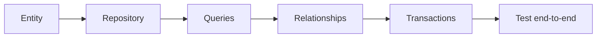

# Exercises — Hibernate & JPA

## 1. Introduction

Practice the persistence stack: entities, repositories, queries, relationships, and transactions.

---

## 2. Why This Topic Is Important

- JPA/Hibernate is how Java apps store data.
- Entity + repository design is daily work.
- These exercises build a complete persistence flow.

---

## 3. Real-World Analogy

Like **learning to run a warehouse**: you design the shelves (entities), the catalog (repositories), the search (queries), the layouts (relationships), and the safety rules (transactions). Practice each area, then run the whole warehouse.

---

## 4. Theory — Topic Map

| Topic | Key Skill |
|-------|-----------|
| Overview | ORM, Hibernate |
| Entities | @Entity mappings |
| Repositories | Spring Data CRUD |
| Queries | JPQL, native, @Modifying |
| Relationships | 1:N, N:M, mappedBy |
| Transactions | @Transactional |

---

## 5. Syntax Reminder

```java
@Entity class Product { @Id @GeneratedValue private Long id; ... }

interface ProductRepository extends JpaRepository<Product, Long> {
    List<Product> findByNameContainingIgnoreCase(String part);
}
```

```java
@Transactional
public void transfer(...) { ... }
```

---

## 6. Practice Flow



---

## 7. Memory Representation

Skip — practice module.

---

## 8. Simple Exercises

**Ex 1 — Entity:** Map a Task entity (id, title, done).

**Ex 2 — Repo:** JpaRepository + findByTitle.

**Ex 3 — Service:** CRUD service using the repo.

**Ex 4 — Controller:** Expose /api/tasks CRUD.

---

## 9. Intermediate Exercises

**Ex 5 — Queries:** JPQL for done tasks.

**Ex 6 — @Modifying:** Bulk mark-all-done update.

**Ex 7 — Enum:** Status enum as STRING.

**Ex 8 — Auditing:** createdAt/updatedAt with @EnableJpaAuditing.

**Ex 9 — Paging:** Paginated task list.

---

## 10. Advanced Exercises

**Ex 10 — 1:N:** Project ↔ Task relationship.

**Ex 11 — N:M:** Student ↔ Course.

**Ex 12 — N+1:** JOIN FETCH query to fix it.

**Ex 13 — Transactions:** Reassign a task between projects with rollback safety.

**Ex 14 — Full App:** Project management API with entities, relationships, queries, and transactions.

---

## 11. Expected Output Samples

**Ex 5:**
```
Hibernate: select t.* from task t where t.done = true
```

**Ex 6:**
```
Hibernate: update task set done = true
→ 3 rows affected
```

**Ex 13 (failure):**
```
Exception → transaction rolled back; no partial changes.
```

---

## 12. Common Mistakes

| Mistake | Fix |
|---------|-----|
| No no-args constructor | Add it |
| Lazy access outside transaction | Fetch within @Transactional |
| N+1 queries | JOIN FETCH |
| mappedBy on owning side | Only inverse uses mappedBy |
| Transactions on controllers | Service layer only |

---

## 13. Best Practices

- Clean entities; repositories for access.
- JPQL preferred; native when needed.
- Lazy default; fetch joins for performance.
- @Transactional at the service boundary.
- readOnly for reads.

---

## 14. Interview Practice Questions

**Q1.** What is JPA vs Hibernate?
**Q2.** How do derived queries work?
**Q3.** What is the N+1 problem?
**Q4.** mappedBy vs owning side?
**Q5.** When does rollback happen?

---

## 15. Self-Check

- [ ] I can map entities and constraints.
- [ ] I can build repositories + queries.
- [ ] I can model relationships.
- [ ] I can use @Transactional correctly.
- [ ] I avoid N+1 with fetch joins.

---

## 16. Next Steps

- Scale to services in [32 — Microservices](../32-Microservices/README.md).
- Test all of it in [34 — Testing](../34-Testing/README.md).

---

## 17. Summary

- JPA entities map to tables; repositories handle access.
- JPQL/native/@Modifying for queries.
- Relationships: owning side + mappedBy.
- Transactions: @Transactional, rollbackFor.
- Persistence mastery is the backbone of backend apps.

➡️ Module complete! Continue to [32 — Microservices](../32-Microservices/README.md).