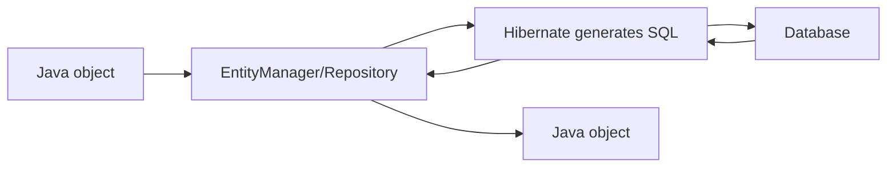

# JPA Overview

## 1. Introduction

**JPA** (Jakarta Persistence API) is the Java standard for **object-relational mapping** — mapping Java objects to database tables. **Hibernate** is the reference implementation.

---

## 2. Why This Topic Is Important

- JPA removes hand-written SQL for CRUD.
- Hibernate is used in nearly every Spring app.
- Entities/repositories are daily work.
- Interviews test ORM concepts.

---

## 3. Real-World Analogy

JPA is a **human resources translation service**:
- Your Java objects are the people.
- Database tables are the filing cabinets.
- JPA (with Hibernate as the translator) converts a Person object into a file in the cabinet — and back — automatically. You never hand-file records yourself.

---

## 4. Theory

### ORM Stack
| Layer | Role |
|-------|------|
| JPA | The standard interfaces/annotations |
| Hibernate | The implementation doing the work |
| Spring Data JPA | Repositories on top of JPA |

### Why Use It
| Without JPA | With JPA |
|-------------|----------|
| Hand-written INSERT/UPDATE/SELECT | save/findById/delete |
| SQL scattered in code | Repositories |
| Manual result mapping | Automatic |
| Bug-prone joins | Relationship mappings |

### Core Annotations
| Annotation | Purpose |
|------------|---------|
| `@Entity` | Marks a table-mapped class |
| `@Table` | Table name |
| `@Id` | Primary key |
| `@GeneratedValue` | Auto keys |
| `@Column` | Column details |
| `@OneToMany` etc. | Relationships |

### Entity Manager
```java
EntityManager em;        // manages entities
em.persist(entity);      // INSERT
em.find(Entity.class, id);  // SELECT by id
em.remove(entity);       // DELETE
```

---

## 5. Syntax (Setup)

```xml
<dependency>
    <groupId>org.springframework.boot</groupId>
    <artifactId>spring-boot-starter-data-jpa</artifactId>
</dependency>
<dependency>
    <groupId>com.h2database</groupId>
    <artifactId>h2</artifactId>
    <scope>runtime</scope>
</dependency>
```

```properties
spring.datasource.url=jdbc:h2:mem:testdb
spring.jpa.hibernate.ddl-auto=update
spring.jpa.show-sql=true
```

---

## 6. Flow Explanation



---

## 7. Memory Representation

Entities live in the **persistence context** (first-level cache) during a transaction; Hibernate tracks changes to flush them.

---

## 8. Simple Example — Basic Entity + Repo

```java
import jakarta.persistence.*;

@Entity
public class Product {
    @Id
    @GeneratedValue(strategy = GenerationType.IDENTITY)
    private Long id;

    private String name;
    private double price;

    public Product() { }
    public Product(String name, double price) {
        this.name = name;
        this.price = price;
    }

    // getters/setters
    public Long getId() { return id; }
    public void setId(Long id) { this.id = id; }
    public String getName() { return name; }
    public void setName(String name) { this.name = name; }
    public double getPrice() { return price; }
    public void setPrice(double price) { this.price = price; }
}
```

```java
import org.springframework.data.jpa.repository.JpaRepository;

public interface ProductRepository extends JpaRepository<Product, Long> {
}
```

---

## 9. Intermediate Example — Service Using the Repo

```java
import org.springframework.stereotype.Service;
import java.util.List;

@Service
public class ProductService {
    private final ProductRepository repo;

    ProductService(ProductRepository repo) { this.repo = repo; }

    public Product create(String name, double price) {
        return repo.save(new Product(name, price));
    }

    public List<Product> all() {
        return repo.findAll();
    }

    public Product byId(Long id) {
        return repo.findById(id)
                .orElseThrow(() -> new RuntimeException("Not found: " + id));
    }

    public void delete(Long id) {
        repo.deleteById(id);
    }
}
```

---

## 10. Advanced Example — Controller + H2 Console

```java
import org.springframework.web.bind.annotation.*;
import java.util.List;

@RestController
@RequestMapping("/api/products")
public class ProductController {

    private final ProductService service;

    ProductController(ProductService service) { this.service = service; }

    @GetMapping
    public List<Product> list() { return service.all(); }

    @PostMapping
    public Product create(@RequestBody Product product) {
        return service.create(product.getName(), product.getPrice());
    }

    @GetMapping("/{id}")
    public Product get(@PathVariable Long id) { return service.byId(id); }

    @DeleteMapping("/{id}")
    public void delete(@PathVariable Long id) { service.delete(id); }
}
```

Enable the H2 console:

```properties
spring.h2.console.enabled=true
spring.datasource.url=jdbc:h2:mem:testdb
```

---

## 11. Output

For the **Simple Example** (Hibernate SQL log):

```
Hibernate: insert into product (name, price) values (?, ?)
Hibernate: select p1_0.id,p1_0.name,p1_0.price from product p1_0
```

For the **Controller Example**:

```
POST /api/products {"name":"Laptop","price":1200.0} → 200 (created)
GET  /api/products → [{"id":1,"name":"Laptop","price":1200.0}]
```

---

## 12. Common Mistakes

| Mistake | Correction |
|---------|------------|
| No no-args constructor | Hibernate needs it |
| Missing @Id | Entity won't map |
| Lazy loading outside transaction | Fetch within @Transactional |
| ddl-auto=create in prod | update or none |
| N+1 queries | Use joins/fetch |

---

## 13. Best Practices

- Use Spring Data repositories, not raw EntityManager.
- Keep entities simple; map via DTOs.
- Set ddl-auto appropriately (none in prod).
- Watch for N+1 with relationships.
- Use @Transactional at the service layer.

---

## 14. Interview Questions

**Q1. What is JPA?**
*The Java ORM standard; Hibernate implements it.*

**Q2. What is an entity?**
*A Java class mapped to a database table with @Entity.*

**Q3. What does Spring Data JPA give you?*
*Repositories with CRUD methods out of the box.*

**Q4. What is the persistence context?*
*The first-level cache tracking entities during a transaction.*

**Q5. What is the N+1 problem?*
*One query per child row — solved with joins/fetch strategies.*

---

## 15. Practice Exercises

1. Create a Product entity.
2. Build a repository and service.
3. Expose CRUD via a controller.
4. Enable H2 console and inspect the table.

---

## 16. Coding Challenges

1. **Easy:** CRUD for Product.
2. **Medium:** Find products by price range.
3. **Hard:** Pagination + search across fields.

---

## 17. Summary

- JPA standardizes ORM; Hibernate implements it.
- @Entity + repositories handle CRUD.
- Persistence context caches and flushes.
- Watch lazy loading and N+1.
- Spring Data JPA is the practical interface.

➡️ Continue to: [Entities](Entities.md)