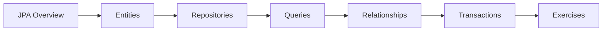

# 30 — Hibernate & JPA

> **Experience level: 🔴 Expert (3 – 5 years)**

**JPA** is Java's ORM standard; **Hibernate** is its most popular implementation. This module covers entities, repositories, queries, and relationships — persistence without SQL boilerplate.

---

## 📂 Files in This Module

| File | What You'll Learn |
|------|-------------------|
| [JPA-Overview.md](JPA-Overview.md) | ORM concepts, Hibernate |
| [Entities.md](Entities.md) | @Entity, mappings, lifecycle |
| [Repositories.md](Repositories.md) | Spring Data interfaces |
| [Queries.md](Queries.md) | Derived, JPQL, native, @Query |
| [Relationships.md](Relationships.md) | One-to-many, many-to-many |
| [Transactions.md](Transactions.md) | @Transactional, ACID |
| [Exercises.md](Exercises.md) | Practice tasks for this module |

---

## 🎯 Learning Objectives

By the end of this module, you will be able to:

1. ✅ Map entities to tables.
2. ✅ Build repositories with Spring Data.
3. ✅ Write derived and JPQL queries.
4. ✅ Model relationships correctly.
5. ✅ Manage transactions.

---

## 🧭 Module Map



---

## 📌 Quick Preview

```java
@Entity
class Product {
    @Id
    @GeneratedValue
    private Long id;

    private String name;
    private double price;
}
```

```java
interface ProductRepository extends JpaRepository<Product, Long> { }
```

---

## Next Module

➡️ [32 — Microservices](../32-Microservices/README.md) — split your system into independent services.