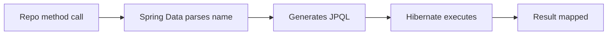

# Repositories

## 1. Introduction

**Spring Data repositories** give you CRUD and query methods with zero implementation. Just define an interface extending `JpaRepository`.

---

## 2. Why This Topic Is Important

- Repos replace hand-written data access code.
- Derived queries come free from method names.
- Paging/sorting built in.
- This is how every Spring Data app reads/writes data.

---

## 3. Real-World Analogy

A repository is a **library assistant**: you say "give me all books by this author" (findByAuthor), and the assistant fetches them — you never search the stacks yourself. Different assistants (repository interfaces) serve different shelves (entities).

---

## 4. Theory

### Repository Hierarchy
```mermaid
flowchart TD
    A[Repository (marker)] --> B[CrudRepository]
    B --> C[JpaRepository]
    C --> D[PagingAndSortingRepository]
```

| Interface | Provides |
|-----------|----------|
| `CrudRepository<T, ID>` | save, findById, findAll, delete |
| `PagingAndSortingRepository<T, ID>` | Pageable/Sort support |
| `JpaRepository<T, ID>` | All the above + flush, deleteInBatch |

### Key Methods
| Method | SQL |
|--------|-----|
| `save(e)` | INSERT or UPDATE |
| `findById(id)` | SELECT by PK |
| `findAll()` | SELECT all |
| `deleteById(id)` | DELETE by PK |
| `count()` | COUNT |
| `existsById(id)` | EXISTS |

### Derived Query Names
| Method Name | Meaning |
|-------------|---------|
| `findByName(String name)` | WHERE name = ? |
| `findByPriceGreaterThan(double p)` | WHERE price > ? |
| `findByStatusAndDate(...)` | AND |
| `findTop10ByOrderByPriceAsc()` | LIMIT 10 ORDER BY price |
| `countByStatus(...)` | COUNT WHERE status = ? |
| `deleteByEmail(...)` | DELETE WHERE email = ? |

---

## 5. Syntax

```java
public interface UserRepository extends JpaRepository<User, Long> {
    Optional<User> findByEmail(String email);
    List<User> findByFullNameContainingIgnoreCase(String name);
    List<User> findByStatusAndCreatedAtAfter(String status, LocalDateTime date);
}
```

---

## 6. Flow Explanation



---

## 7. Memory Representation

Repositories are Spring beans wrapping the EntityManager; queries run per call.

---

## 8. Simple Example — Product Repository

```java
import org.springframework.data.jpa.repository.JpaRepository;
import java.util.List;

public interface ProductRepository extends JpaRepository<Product, Long> {

    List<Product> findByName(String name);

    List<Product> findByPriceGreaterThan(double price);

    List<Product> findByNameContainingIgnoreCase(String part);

    long countByPriceLessThan(double price);
}
```

---

## 9. Intermediate Example — Service Usage

```java
import org.springframework.stereotype.Service;
import java.util.List;

@Service
public class ProductService {

    private final ProductRepository repo;

    ProductService(ProductRepository repo) { this.repo = repo; }

    public List<Product> search(String part) {
        return repo.findByNameContainingIgnoreCase(part);
    }

    public List<Product> cheap(double maxPrice) {
        return repo.findByPriceGreaterThan(maxPrice);
    }

    public long cheapCount(double maxPrice) {
        return repo.countByPriceLessThan(maxPrice);
    }
}
```

---

## 10. Advanced Example — Paging & Sorting

```java
import org.springframework.data.domain.*;
import org.springframework.data.jpa.repository.JpaRepository;

public interface ProductRepository extends JpaRepository<Product, Long> {

    Page<Product> findByPriceGreaterThan(double price, Pageable pageable);
}

@Service
public class PagedService {

    private final ProductRepository repo;

    PagedService(ProductRepository repo) { this.repo = repo; }

    public Page<Product> expensiveProducts(int page, int size) {
        Pageable pageable = PageRequest.of(page, size, Sort.by("price").descending());
        return repo.findByPriceGreaterThan(500, pageable);
    }
}
```

---

## 11. Output

For the **Simple Example**:

```
productRepository.findByPriceGreaterThan(500)
Hibernate: select ... from product p1_0 where p1_0.price > ?
→ [Laptop, Monitor]
```

For the **Advanced Example**:

```
expensiveProducts(0, 2)
Hibernate: select ... order by p1_0.price desc limit ?
→ Page of 2, totalPages = N
```

---

## 12. Common Mistakes

| Mistake | Correction |
|---------|------------|
| Method names not matching properties | FindBy + exact property |
| Returning List when many rows | Use Page for large data |
| Forgetting optional returns | findById → Optional |
| Naming collisions | Give methods distinct names |
| Heavy queries as derived | Use @Query (next topic) |

---

## 13. Best Practices

- Extend JpaRepository for full CRUD.
- Use derived names for simple queries.
- Return Optional for single finds.
- Use Page/Pageable for lists.
- Keep complex queries in @Query.

---

## 14. Interview Questions

**Q1. What is a Spring Data repository?*
*An interface giving CRUD/query methods automatically.*

**Q2. JpaRepository vs CrudRepository?*
*JpaRepository adds paging/sorting, flush, batch delete.*

**Q3. How do derived queries work?*
*Spring parses the method name into JPQL.*

**Q4. findById returns what?*
*Optional<T>.*

**Q5. How do you paginate?*
*Pageable parameter + Page return.*

---

## 15. Practice Exercises

1. Build a UserRepository with findByEmail.
2. Add a search by name containing.
3. Count by a field.
4. Paginate a list result.

---

## 16. Coding Challenges

1. **Easy:** CRUD repo for a Task.
2. **Medium:** Derived queries with AND/OR.
3. **Hard:** Paginated + sorted repository with search.

---

## 17. Summary

- JpaRepository = free CRUD + paging.
- Method names become queries.
- Optional for single results; Page for lists.
- Spring Data handles the SQL.
- Repositories keep services clean.

➡️ Continue to: [Queries](Queries.md)