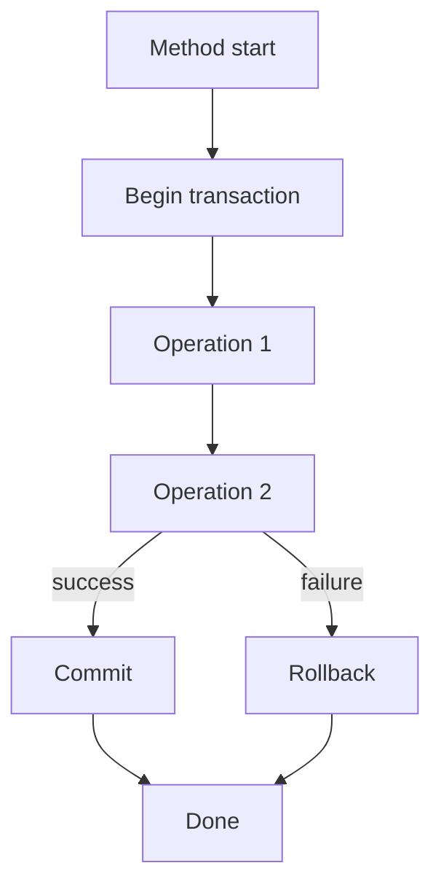

# Transactions

## 1. Introduction

A **transaction** groups operations into an all-or-nothing unit. Spring's `@Transactional` manages them automatically — commit on success, rollback on failure.

---

## 2. Why This Topic Is Important

- Data integrity requires ACID guarantees.
- `@Transactional` is used daily in services.
- Rollback behavior is a classic interview trap.
- Poor transaction boundaries cause corrupted data.

---

## 3. Real-World Analogy

A transaction is a **bank transfer**: debit the sender and credit the receiver must both succeed. If either fails, the whole transfer is rolled back — money never disappears into the void. A transaction is the "all or nothing" promise.

---

## 4. Theory

### ACID
| Letter | Meaning |
|--------|---------|
| **A**tomicity | All or nothing |
| **C**onsistency | Valid state before/after |
| **I**solation | Concurrent transactions don't interfere |
| **D**urability | Committed changes survive |

### @Transactional
```java
@Service
class TransferService {

    @Transactional
    public void transfer(Long fromId, Long toId, double amount) {
        accountRepo.withdraw(fromId, amount);
        accountRepo.deposit(toId, amount);   // if this throws → rollback
    }
}
```

### Propagation
| Propagation | Behavior |
|-------------|----------|
| `REQUIRED` | Join existing transaction or create (default) |
| `REQUIRES_NEW` | Always new transaction |
| `MANDATORY` | Fail if none exists |
| `NEVER` | Fail if one exists |

### Rollback Rules
| Setting | Meaning |
|---------|---------|
| Default | Rollback on unchecked exceptions |
| `rollbackFor = Exception.class` | Also rollback checked |
| `noRollbackFor = ...` | Never rollback these |

---

## 5. Syntax

```java
@Transactional
public void transfer(...) { ... }

@Transactional(rollbackFor = Exception.class)
public void risky(...) { ... }

@Transactional(readOnly = true)
public List<Product> list() { ... }
```

---

## 6. Flow Explanation



---

## 7. Memory Representation

The persistence context joins the transaction; dirty entities flush on commit.

---

## 8. Simple Example — Transfer

```java
import org.springframework.stereotype.Service;
import org.springframework.transaction.annotation.Transactional;

@Service
public class AccountService {

    private final AccountRepository repo;

    AccountService(AccountRepository repo) { this.repo = repo; }

    @Transactional
    public void transfer(Long fromId, Long toId, double amount) {
        Account from = repo.findById(fromId).orElseThrow();
        Account to = repo.findById(toId).orElseThrow();

        from.withdraw(amount);
        to.deposit(amount);

        // If deposit throws, withdraw is rolled back too.
    }
}
```

---

## 9. Intermediate Example — Rollback Rules

```java
import org.springframework.stereotype.Service;
import org.springframework.transaction.annotation.Transactional;

@Service
public class OrderService {

    private final OrderRepository orders;
    private final PaymentRepository payments;

    OrderService(OrderRepository orders, PaymentRepository payments) {
        this.orders = orders;
        this.payments = payments;
    }

    @Transactional(rollbackFor = PaymentFailedException.class)
    public void placeOrder(Long orderId) throws PaymentFailedException {
        orders.updateStatus(orderId, "PROCESSING");

        // checked exception → rollback because of rollbackFor
        if (!payments.charge(orderId)) {
            throw new PaymentFailedException("Payment declined");
        }
        orders.updateStatus(orderId, "PAID");
    }

    static class PaymentFailedException extends Exception {
        PaymentFailedException(String m) { super(m); }
    }
}
```

---

## 10. Advanced Example — Read-Only + Isolation

```java
import org.springframework.stereotype.Service;
import org.springframework.transaction.annotation.*;
import java.util.List;

@Service
public class ReportingService {

    private final ProductRepository repo;

    ReportingService(ProductRepository repo) { this.repo = repo; }

    @Transactional(readOnly = true)
    public List<Product> snapshot() {
        // No writes allowed; optimized for reads
        return repo.findAll();
    }

    @Transactional(isolation = Isolation.REPEATABLE_READ)
    public double calculateTotal() {
        return repo.findAll().stream()
                .mapToDouble(Product::getPrice)
                .sum();
    }
}
```

---

## 11. Output

For the **Simple Example** (success):

```
Hibernate: select account ...
Hibernate: update account set balance=? where id=?   (withdraw)
Hibernate: update account set balance=? where id=?   (deposit)
Transaction committed.
```

For the **Simple Example** (failure):

```
Exception thrown → Transaction rolled back.
Both updates are discarded.
```

---

## 12. Common Mistakes

| Mistake | Correction |
|---------|------------|
| @Transactional on private methods | Proxies need public methods |
| Self-invocation | Call via another bean |
| Checked exceptions not rolled back | Set rollbackFor |
| Long transactions | Keep boundaries short |
| Transactions in controllers | Service layer only |

---

## 13. Best Practices

- Annotate service methods, not controllers.
- Default: unchecked → rollback.
- `rollbackFor = Exception.class` for checked.
- `readOnly = true` for reads.
- Avoid self-invocation (proxy caveat).

---

## 14. Interview Questions

**Q1. What is a transaction?*
*An all-or-nothing unit of work with ACID guarantees.*

**Q2. How does @Transactional work?*
*AOP proxy begins/commits/rolls back around the method.*

**Q3. Default rollback behavior?*
*Rollback on RuntimeException/Error only.*

**Q4. Why isn't a checked exception rolled back?*
*Spring defaults exclude checked exceptions; use rollbackFor.*

**Q5. What is REQUIRES_NEW?*
*A brand-new transaction, independent of the outer one.*

---

## 15. Practice Exercises

1. Add @Transactional to a multi-step service.
2. Force a failure and verify rollback.
3. Use rollbackFor with a checked exception.
4. Mark a read-only method.

---

## 16. Coding Challenges

1. **Easy:** Transfer with rollback.
2. **Medium:** Order + payment with rollbackFor.
3. **Hard:** Nested transactions with REQUIRES_NEW.

---

## 17. Summary

- Transactions = all-or-nothing ACID.
- @Transactional via AOP proxies.
- Default rollback on unchecked only.
- rollbackFor for checked; readOnly for reads.
- Service layer boundaries; avoid self-invocation.

➡️ Continue to: [Exercises](Exercises.md)