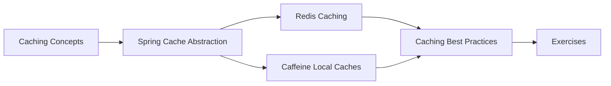

# 31 — Caching

> **Experience level: 🔴 Expert (3 – 5 years)**

Caching is how high-scale applications respond in milliseconds: frequently read data is stored close to the application, so slow databases and external APIs are not hit on every request. This module covers caching concepts, Spring's cache abstraction, Redis, and local caches like Caffeine.

---

## 📂 Files in This Module

| File | What You'll Learn |
|------|-------------------|
| [Caching-Concepts.md](Caching-Concepts.md) | Why cache, TTL, eviction, cache-aside |
| [Spring-Cache-Abstraction.md](Spring-Cache-Abstraction.md) | @Cacheable, @CacheEvict, @CachePut |
| [Redis-Caching.md](Redis-Caching.md) | Distributed cache with Redis |
| [Caffeine-and-Local-Caches.md](Caffeine-and-Local-Caches.md) | In-process cache with Caffeine |
| [Caching-Best-Practices.md](Caching-Best-Practices.md) | Staleness, stampede, invalidation |
| [Exercises.md](Exercises.md) | Practice tasks for this module |

---

## 🎯 Learning Objectives

By the end of this module, you will be able to:

1. ✅ Explain cache-aside and common eviction policies.
2. ✅ Add caching to Spring services with annotations.
3. ✅ Configure Redis as a shared cache.
4. ✅ Use Caffeine for local caching.
5. ✅ Handle invalidation and cache stampede safely.

---

## 🧭 Module Map



---

## 📌 Quick Preview

```java
@Service
public class ProductService {

    @Cacheable(value = "products", key = "#id")
    public Product getById(Long id) {
        return productRepository.findById(id).orElseThrow();
    }

    @CacheEvict(value = "products", key = "#id")
    public void delete(Long id) {
        productRepository.deleteById(id);
    }
}
```

---

## Next Module

➡️ [32 — Microservices](../32-Microservices/README.md) — split the monolith into services.