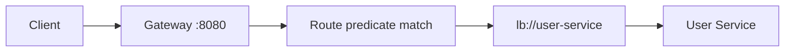

# API Gateway

## 1. Introduction

An **API gateway** is the single entry point for clients: routing, auth, and load balancing in one place. **Spring Cloud Gateway** is the reactive implementation.

---

## 2. Why This Topic Is Important

- Clients don't know service addresses — they hit one URL.
- Cross-cutting concerns (auth, rate limiting) centralize.
- Routing by path and discovery integration.
- Interviewers ask why a gateway exists.

---

## 3. Real-World Analogy

A gateway is a **main reception desk** at a company: visitors (clients) walk in through one entrance and the receptionist (gateway) routes them to the right department (service), checks their badge (auth), and directs crowds (load balancing). Departments stay focused on work, not visitors.

---

## 4. Theory

### Why a Gateway
| Concern | Gateway Role |
|---------|--------------|
| Routing | Path → service |
| AuthN/AuthZ | Validate tokens centrally |
| Rate limiting | Throttle requests |
| Aggregation | Combine responses |
| Load balancing | Distribute to instances |
| Logging/monitoring | Single observability point |

### Routing Concepts
| Term | Meaning |
|------|---------|
| Route | A path mapping to a service |
| Predicate | Condition to match (path, header) |
| Filter | Modify request/response |

### Spring Cloud Gateway
- Reactive (WebFlux-based).
- Routes defined in YAML or Java DSL.
- Integrates with Eureka for service resolution.

---

## 5. Syntax (YAML)

```yaml
spring:
  cloud:
    gateway:
      routes:
        - id: user-service
          uri: lb://user-service
          predicates:
            - Path=/api/users/**
        - id: order-service
          uri: lb://order-service
          predicates:
            - Path=/api/orders/**
```

---

## 6. Flow Explanation



---

## 7. Memory Representation

The gateway is a reactive server (Netty) proxying requests to downstream services.

---

## 8. Simple Example — Gateway Setup

```xml
<dependency>
    <groupId>org.springframework.cloud</groupId>
    <artifactId>spring-cloud-starter-gateway</artifactId>
</dependency>
<dependency>
    <groupId>org.springframework.cloud</groupId>
    <artifactId>spring-cloud-starter-netflix-eureka-client</artifactId>
</dependency>
```

```java
@SpringBootApplication
@EnableDiscoveryClient
public class GatewayApplication {
    public static void main(String[] args) {
        SpringApplication.run(GatewayApplication.class, args);
    }
}
```

```yaml
spring:
  application:
    name: api-gateway
  cloud:
    gateway:
      routes:
        - id: user-service
          uri: lb://user-service
          predicates:
            - Path=/api/users/**
        - id: order-service
          uri: lb://order-service
          predicates:
            - Path=/api/orders/**

server:
  port: 8080
```

---

## 9. Intermediate Example — Filters & Rewrites

```yaml
spring:
  cloud:
    gateway:
      routes:
        - id: user-service
          uri: lb://user-service
          predicates:
            - Path=/users/**
          filters:
            - StripPrefix=1
            - AddRequestHeader=X-Gateway, true
```

Request `GET /users/api/users/1` → strips `/users` → forwards `/api/users/1` with header `X-Gateway: true`.

---

## 10. Advanced Example — Route in Java + Fallback

```java
import org.springframework.cloud.gateway.route.*;
import org.springframework.context.annotation.*;
import org.springframework.web.bind.annotation.*;
import org.springframework.web.server.ServerWebExchange;
import reactor.core.publisher.Mono;

@Configuration
public class GatewayRoutes {

    @Bean
    public RouteLocator customRoutes(RouteLocatorBuilder builder) {
        return builder.routes()
                .route("user-service", r -> r
                        .path("/users/**")
                        .filters(f -> f.stripPrefix(1)
                                      .circuitBreaker(config -> config
                                              .setName("userCb")
                                              .setFallbackUri("forward:/fallback")))
                        .uri("lb://user-service"))
                .build();
    }

    @RestController
    static class FallbackController {
        @GetMapping("/fallback")
        public Mono<String> fallback(ServerWebExchange exchange) {
            return Mono.just("{\"error\":\"service unavailable\"}");
        }
    }
}
```

---

## 11. Output

For the **Simple Example**:

```
curl http://localhost:8080/api/users/1
→ routed to user-service → "User 1"
```

For the **Advanced Example** (downstream down):

```
curl http://localhost:8080/users/api/users/1
→ {"error":"service unavailable"}
```

---

## 12. Common Mistakes

| Mistake | Correction |
|---------|------------|
| Hardcoded URIs | Use lb://service-name |
| Missing discovery client | lb:// won't resolve |
| Gateway without fallbacks | Failures surface to clients |
| Forgetting StripPrefix | Paths mismatch downstream |
| Reactive vs servlet confusion | Gateway is reactive (WebFlux) |

---

## 13. Best Practices

- Single entry point with route table.
- Centralize auth at the gateway.
- Add circuit breakers + fallbacks.
- Use StripPrefix for clean paths.
- Monitor gateway traffic.

---

## 14. Interview Questions

**Q1. What is an API gateway?*
*The single entry point routing clients to services.*

**Q2. Why one gateway?*
*Central auth, routing, rate limiting, observability.*

**Q3. What are predicates and filters?*
*Predicates match routes; filters modify requests/responses.*

**Q4. How does it resolve services?*
*lb:// + Eureka discovery + load balancing.*

**Q5. Gateway vs service mesh?*
*Gateway at the edge; mesh manages internal service traffic.*

---

## 15. Practice Exercises

1. Set up a gateway routing two services.
2. Add a StripPrefix filter.
3. Add a header filter.
4. Add a circuit-breaker fallback.

---

## 16. Coding Challenges

1. **Easy:** Two-route gateway.
2. **Medium:** Path rewrites + headers.
3. **Hard:** Gateway with auth filter + fallback routing.

---

## 17. Summary

- Gateway = single entry: routing, auth, rate limiting.
- Routes = predicates + filters + lb:// URIs.
- Integrates with Eureka discovery.
- Fallbacks keep clients safe.
- Centralize cross-cutting concerns.

➡️ Continue to: [Resilience](Resilience.md)