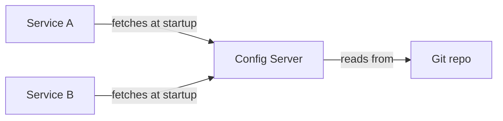
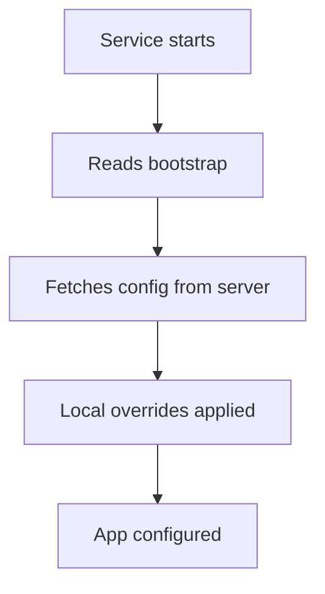

# Centralized Configuration

## 1. Introduction

**Spring Cloud Config** centralizes configuration in a git-backed server. Services fetch their config at startup — no more per-service property files.

---

## 2. Why This Topic Is Important

- Many services, many configs — duplication and drift.
- Central config = change once, apply everywhere.
- Secrets and environment configs managed in one place.
- Interviewers ask how services stay configured.

---

## 3. Real-World Analogy

Spring Cloud Config is a **central HR directory**: instead of every office writing its own phone book, HR keeps one directory. When anyone's contact changes (config), it updates once and everyone reads the same source.

---

## 4. Theory

### Architecture


### How It Works
| Component | Role |
|-----------|------|
| Config Server | Serves config over HTTP |
| Backend | Git (default), Vault, file system |
| Client dependency | spring-cloud-starter-config |
| Refresh | /actuator/refresh or bus |

### Config Resolution Order
1. `bootstrap.properties` → locate config server
2. Fetch `application-{profile}.yml` + `application.yml`
3. Local properties override as needed

### Files in Git
```
config/
├── application.yml            # shared
├── order-service.yml          # per service
├── order-service-dev.yml      # per profile
```

---

## 5. Syntax (Server)

```properties
# config-server application.properties
server.port=8888
spring.application.name=config-server
spring.cloud.config.server.git.uri=https://github.com/you/config-repo
```

```java
@SpringBootApplication
@EnableConfigServer
public class ConfigServerApplication {
    public static void main(String[] args) {
        SpringApplication.run(ConfigServerApplication.class, args);
    }
}
```

---

## 6. Flow Explanation



---

## 7. Memory Representation

The service caches fetched config in its Environment; refresh reloads it.

---

## 8. Simple Example — Config Server

```xml
<dependency>
    <groupId>org.springframework.cloud</groupId>
    <artifactId>spring-cloud-config-server</artifactId>
</dependency>
```

```java
@SpringBootApplication
@EnableConfigServer
public class ConfigServerApplication {
    public static void main(String[] args) {
        SpringApplication.run(ConfigServerApplication.class, args);
    }
}
```

```properties
server.port=8888
spring.application.name=config-server
spring.cloud.config.server.git.uri=https://github.com/example/config-repo
```

Verify: `http://localhost:8888/order-service/dev` returns JSON config.

---

## 9. Intermediate Example — Client Service

```xml
<dependency>
    <groupId>org.springframework.cloud</groupId>
    <artifactId>spring-cloud-starter-config</artifactId>
</dependency>
```

```properties
# bootstrap.properties (or config in application.yml)
spring.application.name=order-service
spring.profiles.active=dev
spring.config.import=optional:configserver:http://localhost:8888
```

```java
@SpringBootApplication
@RestController
public class OrderService {

    @org.springframework.beans.factory.annotation.Value("${app.message}")
    private String message;

    @GetMapping("/config")
    public String config() {
        return "Config: " + message;
    }

    public static void main(String[] args) {
        SpringApplication.run(OrderService.class, args);
    }
}
```

Git file `order-service.yml`:
```yaml
app:
  message: Hello from central config!
```

---

## 10. Advanced Example — Dynamic Refresh

```xml
<dependency>
    <groupId>org.springframework.boot</groupId>
    <artifactId>spring-boot-starter-actuator</artifactId>
</dependency>
```

```java
import org.springframework.cloud.context.config.annotation.RefreshScope;
import org.springframework.web.bind.annotation.*;

@RefreshScope
@RestController
public class ConfigController {

    @org.springframework.beans.factory.annotation.Value("${app.message}")
    private String message;

    @GetMapping("/config")
    public String config() {
        return message;
    }
}
```

```properties
management.endpoints.web.exposure.include=refresh
```

After changing Git config:
```bash
POST http://localhost:8080/actuator/refresh
```

---

## 11. Output

For the **Simple Example** (server):

```
curl http://localhost:8888/order-service/dev →
{"name":"order-service","profiles":["dev"],"propertySources":[{
  "name":".../order-service-dev.yml","source":{"app.message":"..."}
}]}
```

For the **Intermediate Example**:

```
GET /config → "Config: Hello from central config!"
```

---

## 12. Common Mistakes

| Mistake | Correction |
|---------|------------|
| Missing spring.config.import | Client can't reach server |
| Config server not @EnableConfigServer | No server behavior |
| Secrets in Git | Use Vault backend |
| No refresh mechanism | Changes require restart |
| Wrong profile files | Per-profile resolution |

---

## 13. Best Practices

- Git-backed central config.
- Use Vault for secrets.
- Profile-specific files (dev/prod).
- @RefreshScope for live updates.
- Version configs alongside code.

---

## 14. Interview Questions

**Q1. What is Spring Cloud Config?*
*Centralized config served to services, backed by Git.*

**Q2. How do services get config?*
*They fetch from the config server at startup.*

**Q3. Why centralize?*
*Consistency, single source, no per-service drift.*

**Q4. How to update without restart?*
*@RefreshScope + /actuator/refresh.*

**Q5. Secrets handling?*
*Vault backend or secret manager, not Git.*

---

## 15. Practice Exercises

1. Stand up a config server.
2. Point a service at it.
3. Serve per-service + per-profile files.
4. Add @RefreshScope and refresh live.

---

## 16. Coding Challenges

1. **Easy:** Config server + one client.
2. **Medium:** Multi-profile configs.
3. **Hard:** Refresh-without-restart workflow.

---

## 17. Summary

- Central config via Config Server + Git.
- Services fetch config at startup.
- Profiles and per-service files.
- @RefreshScope for live updates.
- Vault for secrets.

➡️ Continue to: [Exercises](Exercises.md)