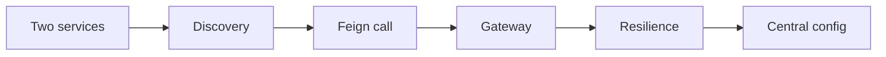

# Exercises — Microservices

## 1. Introduction

Practice the microservices stack: discovery, communication, gateway, resilience, and central config.

---

## 2. Why This Topic Is Important

- Microservices dominate enterprise architecture.
- These patterns appear in every distributed interview.
- Practice builds a complete services portfolio.

---

## 3. Real-World Analogy

Like **building a mall**: you plan the shops (services), the directory (discovery), the paths (communication), the main entrance (gateway), the backup power (resilience), and the central office (config). Practicing each piece builds the whole mall.

---

## 4. Theory — Topic Map

| Topic | Key Skill |
|-------|-----------|
| Overview | Monolith vs microservices |
| Discovery | Eureka registry |
| Communication | Feign, REST, messaging |
| Gateway | Routing, filters |
| Resilience | Circuit breaker |
| Config | Central config server |

---

## 5. Syntax Reminder

```java
@EnableEurekaServer
public class DiscoveryApplication { ... }
```

```java
@FeignClient(name = "user-service")
interface UserClient { ... }
```

```yaml
spring:
  cloud:
    gateway:
      routes:
        - id: user-service
          uri: lb://user-service
          predicates:
            - Path=/api/users/**
```

---

## 6. Practice Flow



---

## 7. Memory Representation

Skip — practice module.

---

## 8. Simple Exercises

**Ex 1 — Services:** Two Boot services on ports 8081/8082.

**Ex 2 — Eureka:** Registry server; register both services.

**Ex 3 — Dashboard:** Verify instances show UP.

**Ex 4 — Config:** A shared property in each service.

---

## 9. Intermediate Exercises

**Ex 5 — Feign:** Order service calls user service by name.

**Ex 6 — Gateway:** Route /api/users and /api/orders.

**Ex 7 — StripPrefix:** Rewrite a path through the gateway.

**Ex 8 — Circuit Breaker:** Fallback when a service is down.

**Ex 9 — Central Config:** Config server + client fetch.

---

## 10. Advanced Exercises

**Ex 10 — Gateway Fallback:** Circuit breaker fallback route.

**Ex 11 — Retry:** Retry a transient failure.

**Ex 12 — Refresh:** @RefreshScope + /actuator/refresh.

**Ex 13 — Full Flow:** Client → gateway → (discovery) → user-service, with breaker fallback and central config.

---

## 11. Expected Output Samples

**Ex 6:**
```
curl http://localhost:8080/api/users/1 → "User 1"
curl http://localhost:8080/api/orders  → "Order list"
```

**Ex 8 (service down):**
```
"Fallback user for 1"
```

**Ex 12:**
```
POST /actuator/refresh → ["config.client.version","app.message"]
GET  /config → updated value
```

---

## 12. Common Mistakes

| Mistake | Fix |
|---------|-----|
| Hardcoded URLs | Service names + discovery |
| Missing @EnableEurekaServer | No registry |
| No fallback | Failures cascade |
| Missing spring.config.import | Client can't fetch config |
| Forgetting StripPrefix | Path mismatch |

---

## 13. Best Practices

- Start monolith; split deliberately.
- Discover, don't hardcode.
- Fallbacks everywhere downstream calls happen.
- Gateway for cross-cutting concerns.
- Central config with profiles.

---

## 14. Interview Practice Questions

**Q1.** Monolith vs microservices?
**Q2.** How does discovery work?
**Q3.** Feign vs messaging?
**Q4.** Why an API gateway?
**Q5.** Circuit breaker states?

---

## 15. Self-Check

- [ ] I can register services with Eureka.
- [ ] I can call services by name.
- [ ] I can route through a gateway.
- [ ] I add circuit breakers + fallbacks.
- [ ] I use central config.

---

## 16. Next Steps

- Test everything in [34 — Testing](../34-Testing/README.md).
- Containerize with [35 — Docker](../35-Docker/README.md).

---

## 17. Summary

- Discovery, Feign, gateway, resilience, central config = the stack.
- Call by name; never hardcode.
- Fallbacks prevent cascades.
- Central config keeps consistency.
- Practice the full flow for distributed mastery.

➡️ Module complete! Continue to [34 — Testing](../34-Testing/README.md).