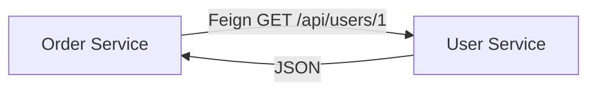

# Inter-Service Communication

## 1. Introduction

Services talk over the network via **synchronous** calls (REST/Feign) or **asynchronous** messaging (queues). Choosing the right pattern is key.

---

## 2. Why This Topic Is Important

- Every microservice integration is a communication decision.
- Feign makes REST calls declarative.
- Sync vs async trade-offs are interview favorites.
- Messaging decouples services for resilience.

---

## 3. Real-World Analogy

- **Synchronous (REST/Feign)**: ordering at a counter — you wait for your sandwich (request/response).
- **Asynchronous (messaging)**: ordering via a ticket system — you drop off the order and get notified later, no waiting (fire-and-forget).

---

## 4. Theory

### Communication Styles
| Style | Mechanism | Use When |
|-------|-----------|----------|
| Synchronous | REST, Feign, gRPC | Immediate response needed |
| Asynchronous | Kafka, RabbitMQ | Decoupling, heavy load |

### Feign (Declarative Client)
| Step | Code |
|------|------|
| Enable | `@EnableFeignClients` |
| Declare | `@FeignClient("user-service")` |
| Define | `@GetMapping` interface methods |

### Sync vs Async
| Aspect | Sync (REST) | Async (Messaging) |
|--------|-------------|-------------------|
| Latency | Wait for response | No wait |
| Coupling | Tight (caller knows callee) | Loose (events) |
| Failure handling | Circuit breaker | Retries/queues |
| Consistency | Easy to reason | Eventual |

### When to Use Messaging
- Long-running tasks
- Fan-out to many services
- Burst traffic smoothing
- Independent failure handling

---

## 5. Syntax (Feign)

```java
@FeignClient(name = "user-service")
public interface UserClient {
    @GetMapping("/api/users/{id}")
    UserDto getUser(@PathVariable("id") Long id);
}
```

---

## 6. Flow Explanation



---

## 7. Memory Representation

Feign generates a dynamic proxy implementing the interface, calling the remote URL.

---

## 8. Simple Example — Feign Client

```xml
<dependency>
    <groupId>org.springframework.cloud</groupId>
    <artifactId>spring-cloud-starter-openfeign</artifactId>
</dependency>
```

```java
import org.springframework.cloud.openfeign.EnableFeignClients;
import org.springframework.boot.SpringApplication;
import org.springframework.boot.autoconfigure.SpringBootApplication;

@SpringBootApplication
@EnableFeignClients
public class OrderApplication {
    public static void main(String[] args) {
        SpringApplication.run(OrderApplication.class, args);
    }
}
```

```java
import org.springframework.cloud.openfeign.FeignClient;
import org.springframework.web.bind.annotation.*;

record UserDto(Long id, String name) { }

@FeignClient(name = "user-service")
public interface UserClient {

    @GetMapping("/api/users/{id}")
    UserDto getUser(@PathVariable("id") Long id);
}
```

---

## 9. Intermediate Example — Service Using Feign

```java
import org.springframework.stereotype.Service;

@Service
public class OrderService {

    private final UserClient userClient;

    OrderService(UserClient userClient) { this.userClient = userClient; }

    public String orderSummary(Long orderId, Long userId) {
        UserDto user = userClient.getUser(userId);
        return "Order " + orderId + " for " + user.name();
    }
}
```

---

## 10. Advanced Example — REST via RestClient (Discovery + Load Balanced)

```java
import org.springframework.cloud.client.loadbalancer.reactive.LoadBalancerExchangeFilterFunction;
import org.springframework.context.annotation.*;
import org.springframework.web.client.RestClient;

@Configuration
class RestClientConfig {

    @Bean
    public RestClient restClient(
            LoadBalancerExchangeFilterFunction loadBalancer) {
        return RestClient.builder()
                .baseUrl("http://user-service")     // service name
                .requestFilter(loadBalancer)
                .build();
    }
}

@Service
public class UserLookup {

    private final RestClient restClient;

    UserLookup(RestClient restClient) { this.restClient = restClient; }

    public String find(Long id) {
        return restClient.get()
                .uri("/api/users/{id}", id)
                .retrieve()
                .body(String.class);
    }
}
```

---

## 11. Output

For the **Intermediate Example**:

```
orderSummary(101, 7)
→ "Order 101 for Ajay"
```

For the **Advanced Example**:

```
find(7) → "User 7"
```

---

## 12. Common Mistakes

| Mistake | Correction |
|---------|------------|
| Synchronous everywhere | Use messaging where needed |
| Forgetting @EnableFeignClients | Feign clients not created |
| Hardcoded ports | Service names via discovery |
| No timeouts | Calls hang forever |
| No fallback | Service failures cascade |

---

## 13. Best Practices

- Feign/RestClient for sync; messaging for async.
- Always set timeouts.
- Add circuit breakers/fallbacks.
- Use DTOs, not raw responses.
- Keep contracts versioned.

---

## 14. Interview Questions

**Q1. Feign vs RestTemplate?*
*Feign is declarative (interface); RestTemplate is imperative.*

**Q2. Sync vs async?*
*Sync waits for a response; async decouples via queues/events.*

**Q3. When use messaging?*
*Long tasks, fan-out, burst smoothing, decoupling.*

**Q4. How does Feign resolve services?*
*Service name + discovery + load balancer.*

**Q5. What is eventual consistency?*
*State converges over time; common with async messaging.*

---

## 15. Practice Exercises

1. Add a Feign client calling a service.
2. Return a DTO from the remote service.
3. Build the same call with RestClient.
4. Decide: sync or async for order notifications.

---

## 16. Coding Challenges

1. **Easy:** Feign client to one endpoint.
2. **Medium:** Service calling two other services.
3. **Hard:** Sync + async combined order flow with events.

---

## 17. Summary

- Sync (Feign/REST) for responses; async (messaging) for decoupling.
- Feign is declarative and discovery-aware.
- Set timeouts; add fallbacks.
- Choose the style by coupling and failure needs.
- Messaging gives resilience at the cost of eventual consistency.

➡️ Continue to: [API Gateway](API-Gateway.md)