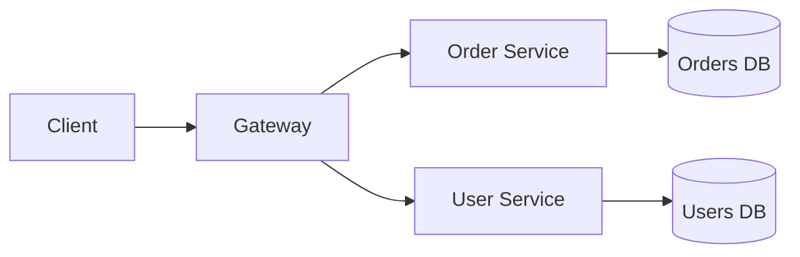

# Microservices Overview

## 1. Introduction

**Microservices** structure an app as small, independently deployable services, each owning its data and communicating over the network. Contrast: the **monolith**.

---

## 2. Why This Topic Is Important

- Microservices dominate enterprise architecture.
- Interviews probe the monolith-vs-micro decision.
- Understanding trade-offs prevents architectural disasters.
- It's the context for discovery, gateways, and resilience.

---

## 3. Real-World Analogy

A monolith is one **giant restaurant**: kitchen, servers, and cashiers all in one building. A microservice system is a **food court**: each stall is independent — you can close the burger stall without stopping the pizza stall. But now you need a directory (discovery) and a common entrance (gateway).

---

## 4. Theory

### Monolith vs Microservices
| Aspect | Monolith | Microservices |
|--------|----------|---------------|
| Deployment | One unit | Many units |
| Scaling | Scale whole app | Scale per service |
| Team ownership | Shared codebase | Per-service teams |
| Failure impact | Whole app | Single service |
| Complexity | Code-level | Network-level |

### Core Characteristics
| Trait | Meaning |
|-------|---------|
| Independent deploy | Ship services separately |
| Own data per service | No shared databases |
| Communication via APIs | REST/gRPC/messaging |
| Decentralized governance | Team choices per service |
| Automation heavy | CI/CD, containers, k8s |

### Microservices Need (Supporting Tech)
| Need | Solution |
|------|----------|
| Discovery | Eureka, Consul |
| Routing | API Gateway |
| Config | Spring Cloud Config |
| Resilience | Circuit breakers |
| Observability | Tracing, metrics, logs |

### When NOT to Use
- Small team / small app
- Low scale requirements
- Shared-data dependencies
- No deployment automation

---

## 5. Syntax (Nothing new — it's Spring Boot apps)

Each service is a Spring Boot app with its own port and repository.

---

## 6. Flow Explanation



---

## 7. Memory Representation

Each service is a separate JVM/container; they only share state via APIs and databases.

---

## 8. Simple Example — Two Services

**User Service** (port 8081):
```java
@SpringBootApplication
@RestController
public class UserService {

    @GetMapping("/api/users/{id}")
    public String getUser(@PathVariable Long id) {
        return "User " + id;
    }

    public static void main(String[] args) {
        SpringApplication.run(UserService.class, args);
    }
}
```

**Order Service** (port 8082):
```java
@SpringBootApplication
@RestController
public class OrderService {

    @GetMapping("/api/orders")
    public String orders() {
        return "Order list";
    }

    public static void main(String[] args) {
        SpringApplication.run(OrderService.class, args);
    }
}
```

---

## 9. Intermediate Example — Own Data per Service

Each service has its own H2 database and repository:

```java
// Order service only touches orders
@Entity
class Order {
    @Id @GeneratedValue private Long id;
    private Long userId;
    private double total;
}

interface OrderRepository extends JpaRepository<Order, Long> { }

// User service only touches users
@Entity
class AppUser {
    @Id @GeneratedValue private Long id;
    private String name;
}

interface UserRepository extends JpaRepository<AppUser, Long> { }
```

---

## 10. Advanced Example — Observability Endpoints

```java
// In each service: add actuator + expose health/metrics
@SpringBootApplication
public class OrderService {
    public static void main(String[] args) {
        SpringApplication.run(OrderService.class, args);
    }
}
```

```properties
spring.application.name=order-service
server.port=8082
management.endpoints.web.exposure.include=health,metrics,info
management.tracing.sampling.probability=1.0
```

---

## 11. Output

For the **Simple Example**:

```
order-service   → http://localhost:8082/api/orders
user-service    → http://localhost:8081/api/users/1
```

For the **Advanced Example**:

```
curl http://localhost:8082/actuator/health
→ {"status":"UP","components":{...}}
```

---

## 12. Common Mistakes

| Mistake | Correction |
|---------|------------|
| Shared database | Own data per service |
| Synchronous call chains | Consider messaging |
| Microservices too early | Start with a monolith |
| No discovery | Hardcoded URLs break |
| No resilience | One failure cascades |

---

## 13. Best Practices

- Start monolith; split when needed.
- Each service owns its data.
- Version APIs for independent deploys.
- Automate CI/CD and containers.
- Invest in observability early.

---

## 14. Interview Questions

**Q1. Monolith vs microservices?*
*Monolith one deployable unit; microservices independent services.*

**Q2. When use microservices?*
*Large teams, independent scaling, clear domain boundaries.*

**Q3. Why own data per service?*
*Autonomy and independent evolution.*

**Q4. Biggest downside?*
*Distributed complexity: network, consistency, ops.*

**Q5. Distributed monolith?*
*Microservices without independent databases — worst of both.*

---

## 15. Practice Exercises

1. Build two Boot services on different ports.
2. Give each its own repository.
3. Add actuator health to both.
4. List three reasons you might NOT use microservices.

---

## 16. Coding Challenges

1. **Easy:** Two services running together.
2. **Medium:** Services with separate data stores.
3. **Hard:** A documented decision: when to split your monolith.

---

## 17. Summary

- Microservices = independent, deployable services.
- Own data per service; communicate via APIs.
- Need discovery, gateway, config, resilience.
- Start with a monolith; split deliberately.
- Observability is non-negotiable.

➡️ Continue to: [Service Discovery](Service-Discovery.md)