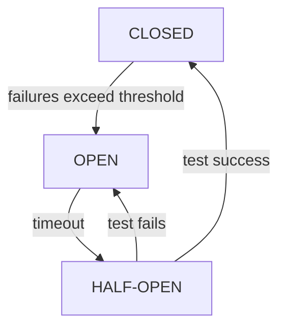
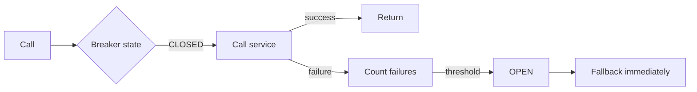

# Resilience

## 1. Introduction

**Resilience patterns** keep systems working when dependencies fail. The **circuit breaker** is the core pattern — fail fast instead of cascading.

---

## 2. Why This Topic Is Important

- In distributed systems, one failure can cascade.
- Circuit breakers, retries, and fallbacks prevent outages.
- Resilience is a senior-interview staple.
- Spring Cloud Circuit Breaker makes it easy.

---

## 3. Real-World Analogy

A circuit breaker is like a **fuse box**: when a device (service) malfunctions, the fuse trips and cuts power — the whole house (system) doesn't catch fire. After a cooldown, the fuse can be reset to try again. Same idea for services.

---

## 4. Theory

### Circuit Breaker States


| State | Behavior |
|-------|----------|
| **CLOSED** | Normal; calls pass |
| **OPEN** | Fail fast; no calls to the service |
| **HALF-OPEN** | Allow a few test calls to recover |

### Resilience Patterns
| Pattern | Purpose |
|---------|---------|
| Circuit breaker | Stop hammering a failing service |
| Retry | Retry transient failures |
| Fallback | Return a safe default |
| Timeout | Bound waiting |
| Bulkhead | Limit concurrent calls per service |

### Key Settings
| Setting | Meaning |
|---------|---------|
| failureRateThreshold | % failures to open |
| waitDurationInOpenState | How long OPEN lasts |
| slidingWindowSize | Calls evaluated |
| permittedNumberOfCallsInHalfOpenState | Test calls |

---

## 5. Syntax

```xml
<dependency>
    <groupId>org.springframework.cloud</groupId>
    <artifactId>spring-cloud-starter-circuitbreaker-resilience4j</artifactId>
</dependency>
```

```java
@CircuitBreaker(name = "userService", fallbackMethod = "fallbackUser")
public UserDto getUser(Long id) { ... }

public UserDto fallbackUser(Long id, Throwable t) {
    return new UserDto(id, "Fallback user");
}
```

---

## 6. Flow Explanation



---

## 7. Memory Representation

The breaker keeps per-service state (counts, state machine) in memory.

---

## 8. Simple Example — Fallback

```java
import io.github.resilience4j.circuitbreaker.annotation.CircuitBreaker;
import org.springframework.stereotype.Service;

@Service
public class UserClient {

    @CircuitBreaker(name = "userService", fallbackMethod = "fallback")
    public String getUser(Long id) {
        // Simulate a call that can fail
        if (id == 42) throw new RuntimeException("service down");
        return "User " + id;
    }

    public String fallback(Long id, Throwable t) {
        return "Fallback user for " + id;
    }
}
```

---

## 9. Intermediate Example — Retry + Fallback

```java
import io.github.resilience4j.retry.annotation.Retry;
import org.springframework.stereotype.Service;

@Service
public class PaymentClient {

    private int attempts = 0;

    @Retry(name = "paymentService", fallbackMethod = "fallback",
           maxAttempts = 3, waitDuration = 0)
    public String charge(double amount) {
        attempts++;
        System.out.println("Attempt " + attempts);
        if (attempts < 3) throw new RuntimeException("transient");
        return "Charged " + amount;
    }

    public String fallback(double amount, Throwable t) {
        return "Payment failed for " + amount;
    }
}
```

---

## 10. Advanced Example — Timeout + Bulkhead

```yaml
resilience4j:
  circuitbreaker:
    instances:
      userService:
        failureRateThreshold: 50
        waitDurationInOpenState: 10s
        slidingWindowSize: 10
        permittedNumberOfCallsInHalfOpenState: 3
  timelimiter:
    instances:
      userService:
        timeoutDuration: 2s
  bulkhead:
    instances:
      userService:
        maxConcurrentCalls: 5
```

```java
import io.github.resilience4j.bulkhead.annotation.Bulkhead;
import io.github.resilience4j.timelimiter.annotation.TimeLimiter;
import org.springframework.stereotype.Service;
import java.util.concurrent.*;

@Service
public class SlowClient {

    @Bulkhead(name = "userService", type = Bulkhead.Type.THREADPOOL,
              fallbackMethod = "fallback")
    public CompletableFuture<String> slowCall() {
        return CompletableFuture.supplyAsync(() -> {
            try { Thread.sleep(1000); } catch (InterruptedException e) { }
            return "Slow response";
        });
    }

    public CompletableFuture<String> fallback(Throwable t) {
        return CompletableFuture.completedFuture("Fallback");
    }
}
```

---

## 11. Output

For the **Simple Example**:

```
getUser(7)    → "User 7"
getUser(42)   → "Fallback user for 42"
```

For the **Intermediate Example**:

```
Attempt 1
Attempt 2
Attempt 3
→ "Charged 100.0"     (after retries)
```

For the **Advanced Example** (over 50% failures):

```
Breaker OPENS → subsequent calls return fallback instantly
```

---

## 12. Common Mistakes

| Mistake | Correction |
|---------|------------|
| No fallback method matching signature | Exact fallback param order |
| Retrying non-transient failures | Only retry transient |
| No timeouts | Threads hang |
| Opening breaker permanently | Set wait/open durations |
| Ignoring bulkhead | One slow service blocks others |

---

## 13. Best Practices

- Fallback signature must match + Throwable.
- Retry only transient errors.
- Always set timeouts.
- Configure thresholds per dependency.
- Test OPEN/HALF-OPEN transitions.

---

## 14. Interview Questions

**Q1. What is a circuit breaker?*
*Stops calls to a failing service; fails fast with fallback.*

**Q2. Three states?*
*CLOSED (normal), OPEN (fail fast), HALF-OPEN (test).*

**Q3. Retry vs breaker?*
*Retry tries again; breaker stops entirely after threshold.*

**Q4. Why fallbacks?*
*Graceful degradation instead of cascading failure.*

**Q5. What is a bulkhead?*
*Limits concurrent calls per service so one doesn't starve others.*

---

## 15. Practice Exercises

1. Add a circuit breaker with a fallback.
2. Test the fallback on failure.
3. Add a retry for a transient failure.
4. Configure thresholds in YAML.

---

## 16. Coding Challenges

1. **Easy:** Breaker + fallback.
2. **Medium:** Retry + breaker combined.
3. **Hard:** Full resilience stack (breaker, retry, timeout, bulkhead).

---

## 17. Summary

- Circuit breaker: CLOSED/OPEN/HALF-OPEN.
- Fallbacks = graceful degradation.
- Retries for transient; timeouts bound waits.
- Bulkheads isolate services.
- Resilience prevents cascading outages.

➡️ Continue to: [Centralized Configuration](Centralized-Configuration.md)