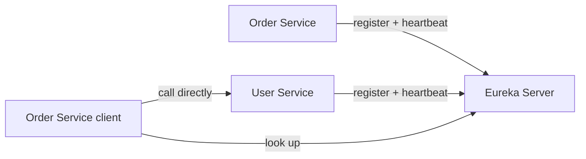
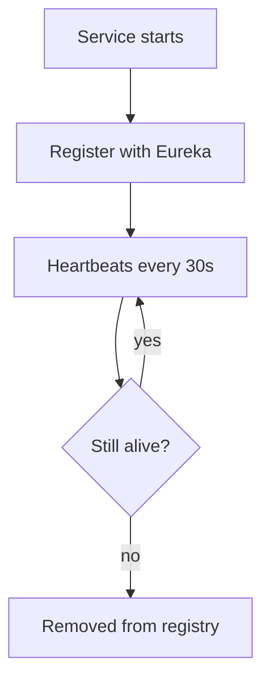

# Service Discovery

## 1. Introduction

**Service discovery** lets services find each other without hardcoded URLs. **Eureka** (Netflix/Spring Cloud) is the classic registry: services register, others look them up.

---

## 2. Why This Topic Is Important

- In cloud/k8s, IPs change constantly — URLs can't be hardcoded.
- Discovery enables dynamic scaling.
- It's the backbone of inter-service communication.
- Interviewers ask how services find each other.

---

## 3. Real-World Analogy

Eureka is a **building directory**: every office (service) lists itself in the directory when it opens (register) and leaves a forwarding card (heartbeat). Anyone needing the office (another service) checks the directory instead of guessing a room number.

---

## 4. Theory

### How It Works


### Key Concepts
| Concept | Detail |
|---------|--------|
| **Registry** | The Eureka server holding service→instances map |
| **Register** | Each instance registers on startup |
| **Heartbeat** | Periodic renewal (30s default) |
| **Discovery** | Clients fetch registered instances |
| **Client-side load balancing** | Pick among instances (Ribbon/LoadBalancer) |

### Components
| Component | Role |
|-----------|------|
| Eureka Server | The registry |
| Eureka Client | Registers + discovers |
| Spring Cloud LoadBalancer | Picks an instance |

---

## 5. Syntax (Setup)

Eureka server:
```java
@SpringBootApplication
@EnableEurekaServer
public class DiscoveryApplication {
    public static void main(String[] args) {
        SpringApplication.run(DiscoveryApplication.class, args);
    }
}
```

Clients:
```java
@SpringBootApplication
@EnableDiscoveryClient
public class OrderService { ... }
```

---

## 6. Flow Explanation



---

## 7. Memory Representation

The registry holds service names → list of instance URLs, refreshed on heartbeats.

---

## 8. Simple Example — Eureka Server

```xml
<dependency>
    <groupId>org.springframework.cloud</groupId>
    <artifactId>spring-cloud-starter-netflix-eureka-server</artifactId>
</dependency>
```

```java
import org.springframework.boot.SpringApplication;
import org.springframework.boot.autoconfigure.SpringBootApplication;
import org.springframework.cloud.netflix.eureka.server.EnableEurekaServer;

@SpringBootApplication
@EnableEurekaServer
public class DiscoveryApplication {
    public static void main(String[] args) {
        SpringApplication.run(DiscoveryApplication.class, args);
    }
}
```

```properties
# application.properties
server.port=8761
eureka.client.register-with-eureka=false
eureka.client.fetch-registry=false
```

Start it → `http://localhost:8761` shows the Eureka dashboard.

---

## 9. Intermediate Example — Client Registration

```xml
<dependency>
    <groupId>org.springframework.cloud</groupId>
    <artifactId>spring-cloud-starter-netflix-eureka-client</artifactId>
</dependency>
```

```java
@SpringBootApplication
@EnableDiscoveryClient
@RestController
public class UserService {

    @GetMapping("/api/users/{id}")
    public String user(@PathVariable Long id) {
        return "User " + id;
    }

    public static void main(String[] args) {
        SpringApplication.run(UserService.class, args);
    }
}
```

```properties
spring.application.name=user-service
server.port=8081
eureka.client.service-url.defaultZone=http://localhost:8761/eureka/
```

Start it → the Eureka dashboard now shows **USER-SERVICE** registered.

---

## 10. Advanced Example — Calling via Discovery

```java
import org.springframework.cloud.client.loadbalancer.LoadBalanced;
import org.springframework.context.annotation.*;
import org.springframework.stereotype.Service;
import org.springframework.web.client.RestTemplate;

@Configuration
class ClientConfig {
    @Bean
    @LoadBalanced
    public RestTemplate restTemplate() {
        return new RestTemplate();
    }
}

@Service
public class OrderClient {

    private final RestTemplate restTemplate;

    OrderClient(RestTemplate restTemplate) { this.restTemplate = restTemplate; }

    public String getUser(Long id) {
        // "user-service" resolved via Eureka + load balanced
        return restTemplate.getForObject(
                "http://user-service/api/users/" + id, String.class);
    }
}
```

---

## 11. Output

For the **Simple Example** (Eureka dashboard):

```
INSTANCES
USER-SERVICE      n/a (1)  UP
ORDER-SERVICE     n/a (1)  UP
```

For the **Advanced Example**:

```
Order service calls http://user-service/api/users/1
→ Eureka resolves to an instance → "User 1"
```

---

## 12. Common Mistakes

| Mistake | Correction |
|---------|------------|
| Hardcoded instance URLs | Use service names |
| Forgetting @LoadBalanced | Service name won't resolve |
| Missing service-url.defaultZone | Client can't find Eureka |
| One registry for prod | Use multiple/high-availability |
| No heartbeat config tuning | Defaults fine initially |

---

## 13. Best Practices

- Call by service name, not URL.
- Use @LoadBalanced client beans.
- Use Eureka for dynamic scaling.
- In k8s, consider native DNS/service discovery.
- Monitor the dashboard.

---

## 14. Interview Questions

**Q1. What is service discovery?**
*Services register with a registry; clients find them by name.*

**Q2. What is Eureka?**
*Spring Cloud's Netflix service registry.*

**Q3. How does a client call a service?**
*By service name; LoadBalancer picks an instance.*

**Q4. What are heartbeats?*
*Periodic renewals proving an instance is alive.*

**Q5. Why not hardcode URLs?*
*Instances change IPs with scaling and deploys.*

---

## 15. Practice Exercises

1. Stand up a Eureka server.
2. Register two client services.
3. Verify them in the dashboard.
4. Call one from the other via service name.

---

## 16. Coding Challenges

1. **Easy:** Eureka server + one client.
2. **Medium:** Two clients, one calling the other.
3. **Hard:** Load-balanced calls across two instances.

---

## 17. Summary

- Discovery = registry + heartbeats + lookups.
- Eureka server registers clients.
- Call by service name via LoadBalancer.
- No hardcoded URLs.
- Foundation for inter-service communication.

➡️ Continue to: [Inter-Service Communication](Inter-Service-Communication.md)