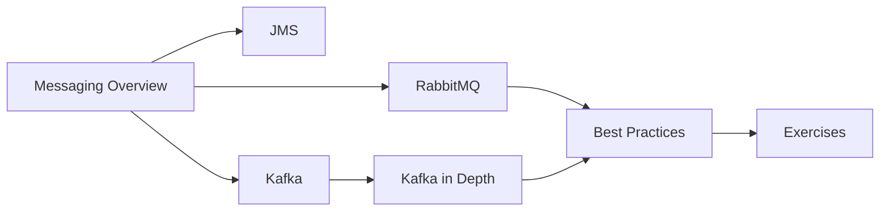

# 33 — Messaging

> **Experience level: 🔴 Expert (3 – 5 years)**

Asynchronous messaging decouples services: a producer sends a message and continues; a consumer processes it later. Queues and event streams power order processing, notifications, analytics, and inter-service communication. This module covers messaging concepts, JMS, RabbitMQ, and Kafka.

---

## 📂 Files in This Module

| File | What You'll Learn |
|------|-------------------|
| [Messaging-Overview.md](Messaging-Overview.md) | Queues, topics, pub/sub, patterns |
| [JMS.md](JMS.md) | The Java Message Service API |
| [RabbitMQ.md](RabbitMQ.md) | Broker with exchanges and queues |
| [Kafka.md](Kafka.md) | Distributed event streaming platform |
| [Kafka-in-Depth.md](Kafka-in-Depth.md) | Topics, partitions, consumer groups |
| [Messaging-Best-Practices.md](Messaging-Best-Practices.md) | Ordering, replay, idempotency, DLQs |
| [Exercises.md](Exercises.md) | Practice tasks for this module |

---

## 🎯 Learning Objectives

By the end of this module, you will be able to:

1. ✅ Explain queues vs topics and common messaging patterns.
2. ✅ Use JMS to send and receive messages.
3. ✅ Configure RabbitMQ exchanges, queues, and bindings.
4. ✅ Build Kafka producers and consumers.
5. ✅ Design for ordering, replay, and idempotency.

---

## 🧭 Module Map



---

## 📌 Quick Preview

```java
// Producer (Spring AMQP)
rabbitTemplate.convertAndSend("orders.exchange", "order.created", order);

// Consumer
@RabbitListener(queues = "orders.queue")
public void onOrderCreated(Order order) {
    inventoryService.reserve(order);
}
```

---

## Next Module

➡️ [34 — Testing](../34-Testing/README.md) — verify everything you've built.