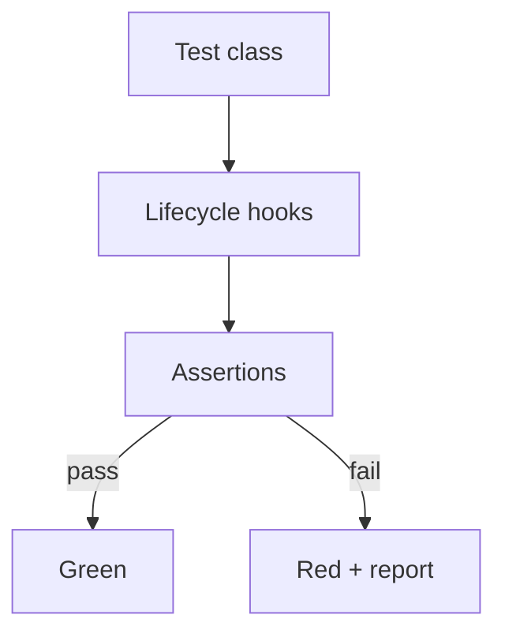

# JUnit 5

## 1. Introduction

**JUnit 5** is the modern Java test framework: `@Test`, lifecycle hooks, assertions, assumptions, and nesting. It's the default with Spring Boot.

---

## 2. Why This Topic Is Important

- JUnit is the standard test framework.
- Lifecycle annotations control setup/teardown.
- Assertions verify behavior.
- Every Spring test runs on JUnit.

---

## 3. Real-World Analogy

JUnit is a **quality-control checklist**: each `@Test` is one inspection step. `@BeforeEach` is the machine reset before each check; `@AfterEach` cleans up. Assertions are the pass/fail gauges.

---

## 4. Theory

### Core Annotations
| Annotation | Runs |
|------------|------|
| `@Test` | Marks a test method |
| `@BeforeAll` | Once, before all tests (static) |
| `@BeforeEach` | Before each test |
| `@AfterEach` | After each test |
| `@AfterAll` | Once, after all tests (static) |
| `@Disabled` | Skip a test |
| `@DisplayName` | Human-readable name |
| `@Tag` | Group/filter tests |

### Lifecycle Order


### Assertions
| Assertion | Checks |
|-----------|--------|
| `assertEquals(a, b)` | Equality |
| `assertTrue` / `assertFalse` | Boolean |
| `assertNull` / `assertNotNull` | Null |
| `assertThrows` | Exception |
| `assertTimeout` | Time bound |
| `assertAll` | Group assertions |

### Assumptions
`assumeTrue(cond)` — skip if condition false.

---

## 5. Syntax

```java
import org.junit.jupiter.api.*;

class DemoTest {

    @BeforeAll
    static void once() { }

    @BeforeEach
    void setup() { }

    @Test
    @DisplayName("Adds numbers")
    void adds() {
        assertEquals(5, 2 + 3);
    }
}
```

---

## 6. Flow Explanation



---

## 7. Memory Representation

Skip — framework behavior.

---

## 8. Simple Example — Basic Test

```java
import org.junit.jupiter.api.Test;
import static org.junit.jupiter.api.Assertions.*;

class StringUtilsTest {

    @Test
    void reverse_reversesString() {
        assertEquals("cba", reverse("abc"));
    }

    @Test
    void reverse_emptyString_returnsEmpty() {
        assertEquals("", reverse(""));
    }

    private String reverse(String s) {
        return new StringBuilder(s).reverse().toString();
    }
}
```

---

## 9. Intermediate Example — Lifecycle & Exceptions

```java
import org.junit.jupiter.api.*;

class LifecycleTest {

    @BeforeAll
    static void beforeAll() { System.out.println("1. before all"); }

    @BeforeEach
    void beforeEach() { System.out.println("2. before each"); }

    @Test
    void happyPath() { assertDoesNotThrow(() -> perform()); }

    @Test
    void errorPath() {
        Exception e = assertThrows(IllegalArgumentException.class,
                () -> performWithError());
        assertEquals("bad input", e.getMessage());
    }

    private void perform() { }
    private void performWithError() {
        throw new IllegalArgumentException("bad input");
    }

    @AfterEach
    void afterEach() { System.out.println("3. after each"); }

    @AfterAll
    static void afterAll() { System.out.println("4. after all"); }
}
```

---

## 10. Advanced Example — Nested + AssertAll

```java
import org.junit.jupiter.api.*;

class NestedTest {

    @Nested
    class Addition {

        @Test
        void addsPositiveNumbers() {
            assertAll("add",
                    () -> assertEquals(5, 2 + 3),
                    () -> assertEquals(10, 4 + 6),
                    () -> assertEquals(0, -1 + 1));
        }
    }

    @Nested
    class Disabled {

        @Test
        @Disabled("Not implemented yet")
        void pendingFeature() {
            fail("TODO");
        }
    }
}
```

---

## 11. Output

For the **Simple Example**:

```
Tests run: 2, Failures: 0, Errors: 0
```

For the **Intermediate Example**:

```
1. before all
2. before each
3. after each
2. before each
3. after each
4. after all
Tests run: 2, Failures: 0
```

---

## 12. Common Mistakes

| Mistake | Correction |
|---------|------------|
| @BeforeAll not static | It must be static |
| Forgetting import | Compilation fails |
| Testing too much in one method | Split into focused tests |
| Assertions without messages | Add messages for failures |
| Not using assertThrows | Try/catch in tests is messy |

---

## 13. Best Practices

- @DisplayName for readability.
- Use assertAll to group related checks.
- assertThrows over try/catch.
- Lifecycle hooks for setup/teardown.
- @Disabled to track unfinished work.

---

## 14. Interview Questions

**Q1. JUnit 5 core annotations?**
*@Test, @BeforeEach/@AfterEach, @BeforeAll/@AfterAll.*

**Q2. @BeforeAll vs @BeforeEach?**
*Once per class vs before every test.*

**Q3. How to test exceptions?**
*assertThrows.*

**Q4. What is an assumption?**
*assumeTrue skips a test if conditions aren't met.*

**Q5. How to group assertions?**
*assertAll.*

---

## 15. Practice Exercises

1. Write three simple tests.
2. Add lifecycle hooks in order.
3. Test a thrown exception.
4. Group assertions with assertAll.

---

## 16. Coding Challenges

1. **Easy:** Test a utility class.
2. **Medium:** Nested tests + lifecycle.
3. **Hard:** Comprehensive suite with assumptions and tags.

---

## 17. Summary

- JUnit 5: @Test + lifecycle + assertions.
- @BeforeAll/BeforeEach/AfterEach/AfterAll.
- assertThrows for exceptions; assertAll to group.
- Assumptions skip conditionally.
- It's the base of all Spring testing.

➡️ Continue to: [AssertJ](AssertJ.md)