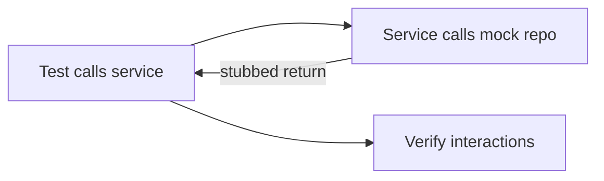

# Mockito

## 1. Introduction

**Mockito** creates **mocks** — fake dependencies that isolate the code under test. Services get mocked repos; behavior is verified without a real database.

---

## 2. Why This Topic Is Important

- Unit tests must isolate the class under test.
- Mocks replace real dependencies.
- Stubbing and verification are core skills.
- Every Spring unit test uses Mockito.

---

## 3. Real-World Analogy

A mock is a **flight simulator**: you practice flying (test the pilot/service) without a real plane (database/API). The simulator perfectly mimics inputs and records exactly what the pilot did — just like a mock records calls and returns scripted results.

---

## 4. Theory

### Core Concepts
| Concept | Meaning |
|---------|---------|
| **Mock** | Fake object; no real logic |
| **Stubbing** | `when(mock.method()).thenReturn(value)` |
| **Verification** | `verify(mock).method()` — did it get called? |
| **Argument matchers** | `any()`, `eq(x)` |

### Key Methods
| Method | Use |
|--------|-----|
| `mock(Class)` | Create a mock |
| `when(...).thenReturn(...)` | Stub a return |
| `when(...).thenThrow(...)` | Stub an exception |
| `verify(mock).call(...)` | Assert a call happened |
| `verifyNoMoreInteractions(mock)` | No unexpected calls |
| `@Mock` / `@InjectMocks` | Annotations (with `@ExtendWith(MockitoExtension.class)`) |

### Common Matchers
| Matcher | Meaning |
|---------|---------|
| `any()` | Any value |
| `anyLong()`, `anyString()` | Typed any |
| `eq(value)` | Exact value |

---

## 5. Syntax

```java
@ExtendWith(MockitoExtension.class)
class ServiceTest {

    @Mock
    ProductRepository repo;

    @InjectMocks
    ProductService service;

    @Test
    void findsProduct() {
        when(repo.findById(1L)).thenReturn(Optional.of(product));
        assertThat(service.get(1L)).isEqualTo(product);
        verify(repo).findById(1L);
    }
}
```

---

## 6. Flow Explanation



---

## 7. Memory Representation

Mocks are proxies; stubbed calls return scripted values; calls are recorded for verification.

---

## 8. Simple Example — Stubbing

```java
import org.junit.jupiter.api.Test;
import org.junit.jupiter.api.extension.ExtendWith;
import org.mockito.*;
import java.util.Optional;
import static org.assertj.core.api.Assertions.assertThat;

interface ProductRepository {
    Optional<String> findById(Long id);
}

class ProductService {
    private final ProductRepository repo;
    ProductService(ProductRepository repo) { this.repo = repo; }

    String get(Long id) {
        return repo.findById(id).orElse("unknown");
    }
}

@ExtendWith(MockitoExtension.class)
class SimpleMockTest {

    @Mock
    ProductRepository repo;

    @InjectMocks
    ProductService service;

    @Test
    void get_existingId_returnsProduct() {
        when(repo.findById(1L)).thenReturn(Optional.of("Laptop"));

        String result = service.get(1L);

        assertThat(result).isEqualTo("Laptop");
    }

    @Test
    void get_missingId_returnsUnknown() {
        when(repo.findById(99L)).thenReturn(Optional.empty());

        assertThat(service.get(99L)).isEqualTo("unknown");
    }
}
```

---

## 9. Intermediate Example — Verification

```java
import org.junit.jupiter.api.Test;
import org.junit.jupiter.api.extension.ExtendWith;
import org.mockito.*;
import java.util.Optional;
import static org.mockito.Mockito.*;

@ExtendWith(MockitoExtension.class)
class VerifyTest {

    @Mock
    ProductRepository repo;

    @InjectMocks
    ProductService service;

    @Test
    void get_callsRepositoryExactlyOnce() {
        when(repo.findById(anyLong())).thenReturn(Optional.of("X"));

        service.get(5L);
        service.get(5L);

        verify(repo, times(2)).findById(5L);
        verifyNoMoreInteractions(repo);
    }
}
```

---

## 10. Advanced Example — Throwing & Matchers

```java
import org.junit.jupiter.api.Test;
import org.junit.jupiter.api.extension.ExtendWith;
import org.mockito.*;
import static org.assertj.core.api.Assertions.*;

interface PaymentClient {
    void charge(double amount);
}

class CheckoutService {
    private final PaymentClient client;
    CheckoutService(PaymentClient client) { this.client = client; }

    String pay(double amount) {
        try {
            client.charge(amount);
            return "success";
        } catch (IllegalStateException e) {
            return "declined";
        }
    }
}

@ExtendWith(MockitoExtension.class)
class ThrowTest {

    @Mock
    PaymentClient client;

    @InjectMocks
    CheckoutService service;

    @Test
    void pay_paymentFails_returnsDeclined() {
        doThrow(new IllegalStateException("insufficient funds"))
                .when(client).charge(anyDouble());

        assertThat(service.pay(100)).isEqualTo("declined");
        verify(client).charge(100);
    }
}
```

---

## 11. Output

For the **Simple Example**:

```
get_existingId_returnsProduct  → passed
get_missingId_returnsUnknown   → passed
```

For the **Advanced Example**:

```
pay_paymentFails_returnsDeclined → passed
```

---

## 12. Common Mistakes

| Mistake | Correction |
|---------|------------|
| Real dependency instead of mock | @Mock + @InjectMocks |
| Forgetting @ExtendWith(MockitoExtension.class) | Mocks null |
| Stubbing void with when | Use doThrow().when() |
| Over-verification | Verify only meaningful calls |
| Mocking everything | Mock dependencies, test logic |

---

## 13. Best Practices

- Mock dependencies, not the class under test.
- Use @InjectMocks for clean wiring.
- Stub with when/thenReturn.
- Verify meaningful interactions.
- Prefer real collaborators in integration tests.

---

## 14. Interview Questions

**Q1. What is a mock?*
*A fake object returning scripted results.*

**Q2. Mock vs real object?*
*Mocks isolate the unit; no real DB/network.*

**Q3. What is stubbing?*
*when(mock).thenReturn(value).*

**Q4. What is verification?*
*verify(mock) asserts a call happened.*

**Q5. @Mock vs @InjectMocks?*
*@Mock creates the fake; @InjectMocks injects mocks into the unit.*

---

## 15. Practice Exercises

1. Mock a repository in a service test.
2. Stub a return and an empty result.
3. Verify call counts.
4. Stub an exception with doThrow.

---

## 16. Coding Challenges

1. **Easy:** Stub and assert.
2. **Medium:** Verification + matchers.
3. **Hard:** Exception paths + interaction checks.

---

## 17. Summary

- Mocks isolate the code under test.
- when/thenReturn stub; verify asserts.
- doThrow for void exceptions.
- @ExtendWith(MockitoExtension.class) + @Mock/@InjectMocks.
- Mockito is the backbone of unit testing.

➡️ Continue to: [Spring Boot Testing](Spring-Boot-Testing.md)