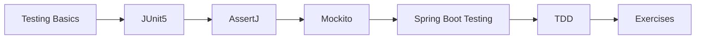

# 34 — Testing

> **Experience level: 🔴 Expert (3 – 5 years)**

**Testing** proves your code works and keeps it working. This module covers JUnit, assertions, mocking, and integration tests — including Spring Boot test slices.

---

## 📂 Files in This Module

| File | What You'll Learn |
|------|-------------------|
| [Testing-Basics.md](Testing-Basics.md) | Why test, test pyramid |
| [JUnit5.md](JUnit5.md) | Annotations, assertions |
| [AssertJ.md](AssertJ.md) | Fluent assertions |
| [Mockito.md](Mockito.md) | Mocking dependencies |
| [Spring-Boot-Testing.md](Spring-Boot-Testing.md) | @SpringBootTest, slices |
| [Test-Driven-Development.md](Test-Driven-Development.md) | TDD workflow |
| [Exercises.md](Exercises.md) | Practice tasks for this module |

---

## 🎯 Learning Objectives

By the end of this module, you will be able to:

1. ✅ Write JUnit 5 tests with assertions.
2. ✅ Use AssertJ for readable assertions.
3. ✅ Mock dependencies with Mockito.
4. ✅ Test Spring Boot layers with slices.
5. ✅ Follow a TDD workflow.

---

## 🧭 Module Map



---

## 📌 Quick Preview

```java
@SpringBootTest
class ServiceTest {

    @Test
    void testSomething() {
        assertThat(result).isEqualTo("expected");
    }
}
```

---

## Next Module

➡️ [35 — Docker](../35-Docker/README.md) — package your apps for any environment.