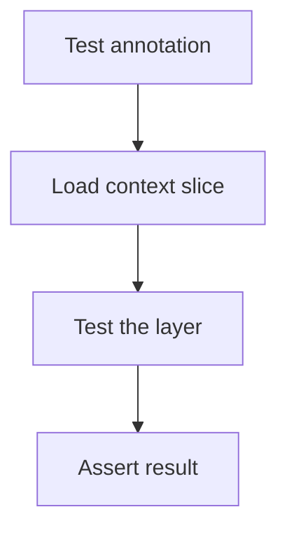

# Spring Boot Testing

## 1. Introduction

Spring Boot testing combines JUnit with the Spring context. `@SpringBootTest` loads the full app; **slices** load only one layer for speed.

---

## 2. Why This Topic Is Important

- Integration tests verify wiring end-to-end.
- Slices make layer tests fast.
- @MockBean replaces beans in context tests.
- This is how real Spring apps are tested.

---

## 3. Real-World Analogy

`@SpringBootTest` is a **full dress rehearsal**: the whole cast (all beans) is on stage, everyone wired. A **slice** is a *scene rehearsal*: only the controller and its props, with stand-ins for the rest — much faster to set up and run.

---

## 4. Theory

### Test Annotations
| Annotation | Scope |
|------------|-------|
| `@SpringBootTest` | Full application context |
| `@WebMvcTest` | Controller + MVC layer only |
| `@DataJpaTest` | JPA/repository layer only |
| `@ServiceTest`-like | Custom slices |

### Web Test Tools
| Tool | Use |
|------|-----|
| `MockMvc` | Call endpoints in-process |
| `@MockBean` | Replace a bean with a mock |
| `TestRestTemplate` / `WebTestClient` | HTTP-level tests |

### @DataJpaTest Features
- Uses in-memory DB (H2) by default.
- Rolls back after each test.
- Slice: no full context.

---

## 5. Syntax

```java
@SpringBootTest
class AppTest { }

@WebMvcTest(UserController.class)
class UserControllerTest { }

@DataJpaTest
class UserRepositoryTest { }
```

---

## 6. Flow Explanation



---

## 7. Memory Representation

`@SpringBootTest` builds the whole context; slices build minimal contexts.

---

## 8. Simple Example — @WebMvcTest + MockMvc

```java
import org.junit.jupiter.api.Test;
import org.springframework.beans.factory.annotation.Autowired;
import org.springframework.boot.test.autoconfigure.web.servlet.WebMvcTest;
import org.springframework.boot.test.mock.mockito.MockBean;
import org.springframework.test.web.servlet.MockMvc;
import static org.mockito.Mockito.when;
import static org.springframework.test.web.servlet.request.MockMvcRequestBuilders.get;
import static org.springframework.test.web.servlet.result.MockMvcResultMatchers.*;

@WebMvcTest(GreetingController.class)
class GreetingControllerTest {

    @Autowired
    MockMvc mockMvc;

    @MockBean
    GreetingService service;

    @Test
    void greet_returnsMessage() throws Exception {
        when(service.greet("Ajay")).thenReturn("Hello, Ajay!");

        mockMvc.perform(get("/greet").param("name", "Ajay"))
                .andExpect(status().isOk())
                .andExpect(content().string("Hello, Ajay!"));
    }
}
```

---

## 9. Intermediate Example — @DataJpaTest

```java
import org.junit.jupiter.api.Test;
import org.springframework.beans.factory.annotation.Autowired;
import org.springframework.boot.test.autoconfigure.orm.jpa.DataJpaTest;

@DataJpaTest
class ProductRepositoryTest {

    @Autowired
    ProductRepository repo;

    @Test
    void findByName_returnsMatchingProduct() {
        repo.save(new Product("Laptop", 1200));
        repo.save(new Product("Mouse", 25));

        assertThat(repo.findByName("Laptop"))
                .isNotEmpty()
                .allMatch(p -> "Laptop".equals(p.getName()));
    }
}
```

---

## 10. Advanced Example — @SpringBootTest with @MockBean

```java
import org.junit.jupiter.api.Test;
import org.springframework.beans.factory.annotation.Autowired;
import org.springframework.boot.test.context.SpringBootTest;
import org.springframework.boot.test.mock.mockito.MockBean;
import org.springframework.test.web.reactive.server.WebTestClient;
import static org.mockito.Mockito.when;

@SpringBootTest(webEnvironment = SpringBootTest.WebEnvironment.RANDOM_PORT)
class FullAppTest {

    @Autowired
    WebTestClient webTestClient;

    @MockBean
    ProductService productService;

    @Test
    void getProduct_returnsFromService() {
        when(productService.get(1L)).thenReturn(new Product("Laptop", 1200));

        webTestClient.get()
                .uri("/api/products/1")
                .exchange()
                .expectStatus().isOk()
                .expectBody()
                .jsonPath("$.name").isEqualTo("Laptop");
    }
}
```

---

## 11. Output

For the **Simple Example**:

```
greet_returnsMessage → passed
```

For the **Intermediate Example**:

```
findByName_returnsMatchingProduct → passed
Tests run: 1, Failures: 0
```

---

## 12. Common Mistakes

| Mistake | Correction |
|---------|------------|
| Full context when a slice suffices | Use @WebMvcTest/@DataJpaTest |
| Real dependencies in slice tests | @MockBean them |
| @SpringBootTest for everything | Slow suites |
| Forgetting random port env | WebTestClient needs a port |
| DB state leaking between tests | @DataJpaTest rolls back |

---

## 13. Best Practices

- Slices for layer tests; full context sparingly.
- @MockBean for external beans.
- Test JSON with jsonPath.
- Keep suites fast.
- Test the behavior, not the wiring details.

---

## 14. Interview Questions

**Q1. @SpringBootTest vs slice?**
*Full context vs one layer (faster).*

**Q2. What is MockMvc?*
*In-process HTTP testing of controllers.*

**Q3. What is @MockBean?*
*Replaces a bean with a mock in the context.*

**Q4. Why @DataJpaTest?*
*Fast JPA-layer tests with rollback and in-memory DB.*

**Q5. How do you test JSON responses?*
*jsonPath assertions.*

---

## 15. Practice Exercises

1. Test a controller with MockMvc.
2. Use @MockBean for its service.
3. Test a repository with @DataJpaTest.
4. Add a full-app test with WebTestClient.

---

## 16. Coding Challenges

1. **Easy:** Controller test.
2. **Medium:** Repository test + controller test.
3. **Hard:** Full end-to-end API test with mocked external calls.

---

## 17. Summary

- @SpringBootTest loads the full app.
- Slices (WebMvc/Jpa) test layers fast.
- MockMvc tests controllers; WebTestClient tests HTTP.
- @MockBean replaces dependencies.
- Rollback keeps data tests clean.

➡️ Continue to: [Test-Driven Development](Test-Driven-Development.md)