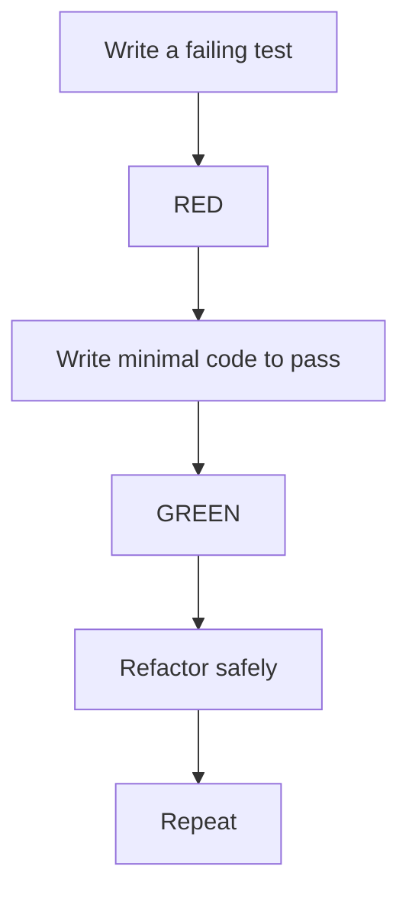
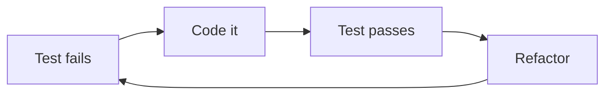

# Test-Driven Development (TDD)

## 1. Introduction

**TDD** (Test-Driven Development) writes the test **before** the code: Red → Green → Refactor. The test drives the design.

---

## 2. Why This Topic Is Important

- Tests-first leads to better-designed APIs.
- The safety net enables confident refactoring.
- TDD is a senior-interview topic.
- It builds a regression-proof workflow.

---

## 3. Real-World Analogy

TDD is like **writing the spec before building the bridge**: you first define exactly what the bridge must do (the test), watch it fail (no bridge yet), then build until it passes, then improve the design. The spec never lets you drift.

---

## 4. Theory

### The Red-Green-Refactor Loop


| Step | Action |
|------|--------|
| **RED** | Write a test that fails |
| **GREEN** | Minimal code to make it pass |
| **REFACTOR** | Clean up while tests stay green |

### TDD Rules
| Rule | Meaning |
|------|---------|
| Test first | Never code before a failing test |
| Minimal implementation | Only enough to pass |
| Small steps | Tiny loops |
| Refactor with safety | Tests guarantee behavior |

### Benefits
| Benefit | Detail |
|---------|--------|
| Design feedback | Tests force usable APIs |
| Documentation | Tests describe behavior |
| Confidence | Refactoring is safe |
| Fewer bugs | Every path is specified |

---

## 5. Syntax (Loop Pattern)

```java
// 1. RED — test fails
@Test
void calculateTotal_appliesDiscount() {
    assertThat(cart.calculateTotal()).isEqualTo(90.0);
}

// 2. GREEN — implement
double calculateTotal() {
    return subtotal * 0.9;   // minimal
}

// 3. REFACTOR — clean up
double calculateTotal() {
    return applyDiscount(subtotal, 0.10);
}
```

---

## 6. Flow Explanation



---

## 7. Memory Representation

Skip — workflow.

---

## 8. Simple Example — String Utility via TDD

**Step 1 — RED:**
```java
import org.junit.jupiter.api.Test;
import static org.assertj.core.api.Assertions.assertThat;

class SlugifyTest {

    @Test
    void slugify_convertsToLowerCaseHyphens() {
        assertThat(Slugify.convert("Hello World"))
                .isEqualTo("hello-world");
    }
}
```
Runs → fails (no `Slugify` class yet).

**Step 2 — GREEN:**
```java
class Slugify {
    static String convert(String input) {
        return input.toLowerCase().replace(' ', '-');
    }
}
```
Runs → passes.

**Step 3 — REFACTOR:**
```java
class Slugify {
    static String convert(String input) {
        return input.trim().toLowerCase()
                .replaceAll("[^a-z0-9]+", "-");
    }
}
```
Tests still pass.

---

## 9. Intermediate Example — Service TDD

```java
// RED
@Test
void totalPrice_zeroItems_returnsZero() {
    when(cartService.itemCount()).thenReturn(0);
    assertThat(cartService.totalPrice()).isEqualTo(0.0);
}
```
```java
// GREEN
double totalPrice() {
    return itemCount() * averagePrice;
}
```
```java
// Refined behavior tests
@Test
void totalPrice_twoItems_appliesDiscount() {
    when(cartService.itemCount()).thenReturn(2);
    when(cartService.averagePrice()).thenReturn(50.0);
    assertThat(cartService.totalPrice()).isEqualTo(95.0);  // 5% off 2+ items
}
```

---

## 10. Advanced Example — Test-First Feature

**Feature:** A `validateEmail` method.

**RED tests first:**
```java
@Test
void validateEmail_validAddress_true() {
    assertThat(EmailValidator.isValid("a@b.com")).isTrue();
}

@Test
void validateEmail_missingAt_false() {
    assertThat(EmailValidator.isValid("abc.com")).isFalse();
}

@Test
void validateEmail_empty_false() {
    assertThat(EmailValidator.isValid("")).isFalse();
}
```

**GREEN minimal:**
```java
class EmailValidator {
    static boolean isValid(String email) {
        return email != null && email.contains("@")
                && email.indexOf('@') > 0
                && email.indexOf('@') < email.length() - 1;
    }
}
```

**REFACTOR with a regex (tests still pass):**
```java
class EmailValidator {
    private static final String PATTERN = "^[^@\\s]+@[^@\\s]+\\.[^@\\s]+$";
    static boolean isValid(String email) {
        return email != null && email.matches(PATTERN);
    }
}
```

---

## 11. Output

For the **Advanced Example**:

```
validateEmail_validAddress_true    → passed
validateEmail_missingAt_false      → passed
validateEmail_empty_false          → passed
```

---

## 12. Common Mistakes

| Mistake | Correction |
|---------|------------|
| Writing tests after code | Reverse — test first |
| Big leaps in implementation | Small minimal steps |
| Skipping refactor step | Clean up while green |
| Tests that pass trivially | Assert real behavior |
| Over-testing internals | Test public behavior |

---

## 13. Best Practices

- Test first, always.
- One behavior per test.
- Minimal code to pass.
- Refactor with the safety net.
- Keep the loop tight.

---

## 14. Interview Questions

**Q1. What is TDD?*
*Write a failing test, make it pass, refactor — repeatedly.*

**Q2. Red-Green-Refactor?*
*RED: failing test; GREEN: minimal pass; REFACTOR: clean up.*

**Q3. Why test first?*
*Forces good design and a safety net.*

**Q4. What if the test can't be written first?*
*Reconsider the design; tests should come first.*

**Q5. TDD vs test-after?*
*TDD drives design; test-after only verifies.*

---

## 15. Practice Exercises

1. Write a failing test for a new method.
2. Implement minimally to pass.
3. Refactor while staying green.
4. Add edge-case tests in the next loop.

---

## 16. Coding Challenges

1. **Easy:** TDD a string method.
2. **Medium:** TDD a discount service.
3. **Hard:** TDD a validation class with many cases.

---

## 17. Summary

- TDD: Red → Green → Refactor.
- Tests first; minimal implementation; safe refactoring.
- Small loops keep quality high.
- Tests document behavior.
- TDD builds regression-proof code.

➡️ Continue to: [Exercises](Exercises.md)