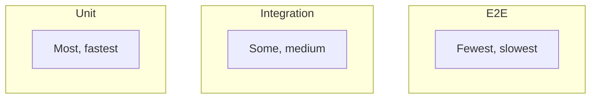
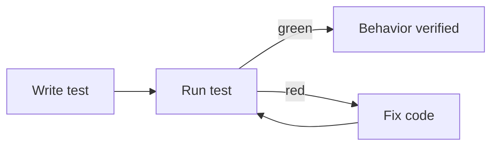

# Testing Basics

## 1. Introduction

**Testing** verifies behavior and prevents regressions. The **test pyramid** guides where tests go: many unit tests, fewer integration tests, fewest end-to-end tests.

---

## 2. Why This Topic Is Important

- Tests are part of the definition of done.
- They catch bugs before users do.
- They enable safe refactoring.
- Interviewers value testing mindset.

---

## 3. Real-World Analogy

Testing is like **inspecting a car at every stage**: you test each part (unit), how parts fit together (integration), and the full drive (end-to-end). Catching a bad brake pad early is cheap; catching it on the road is a disaster.

---

## 4. Theory

### The Test Pyramid


### Test Levels
| Level | Scope | Speed | Count |
|-------|-------|-------|-------|
| Unit | One class/method | Fast | Many |
| Integration | Layers + DB | Medium | Some |
| End-to-end | Whole app | Slow | Few |

### Unit Test Traits
| Trait | Meaning |
|-------|---------|
| Isolated | No network/DB |
| Deterministic | Same result every run |
| Fast | Milliseconds |
| Focused | One behavior per test |

### Naming
- `methodName_condition_expectedResult`
- e.g., `calculateTotal_emptyCart_returnsZero`

---

## 5. Syntax (Minimal)

```java
import org.junit.jupiter.api.Test;
import static org.assertj.core.api.Assertions.assertThat;

class CalculatorTest {

    @Test
    void add_twoNumbers_returnsSum() {
        Calculator calc = new Calculator();
        assertThat(calc.add(2, 3)).isEqualTo(5);
    }
}
```

---

## 6. Flow Explanation



---

## 7. Memory Representation

Skip — methodology.

---

## 8. Simple Example — Unit Test

```java
class Calculator {
    public int add(int a, int b) { return a + b; }
    public int divide(int a, int b) {
        if (b == 0) throw new IllegalArgumentException("divide by zero");
        return a / b;
    }
}
```

```java
import org.junit.jupiter.api.Test;
import static org.assertj.core.api.Assertions.assertThat;
import static org.assertj.core.api.Assertions.assertThatThrownBy;

class CalculatorTest {

    @Test
    void add_positiveNumbers_returnsSum() {
        Calculator calc = new Calculator();
        assertThat(calc.add(2, 3)).isEqualTo(5);
    }

    @Test
    void divide_byZero_throws() {
        Calculator calc = new Calculator();
        assertThatThrownBy(() -> calc.divide(10, 0))
                .isInstanceOf(IllegalArgumentException.class)
                .hasMessage("divide by zero");
    }
}
```

---

## 9. Intermediate Example — Grouped Tests

```java
import org.junit.jupiter.api.*;

class GroupedTest {

    @BeforeAll
    static void setUpAll() { System.out.println("Before all tests"); }

    @BeforeEach
    void setUp() { System.out.println("Before each test"); }

    @Test
    void firstTest() { assertThat(1 + 1).isEqualTo(2); }

    @Test
    @DisplayName("Second test with a friendly name")
    void secondTest() { assertThat("hi").contains("h"); }

    @AfterEach
    void tearDown() { System.out.println("After each test"); }
}
```

---

## 10. Advanced Example — Parametrized Tests

```java
import org.junit.jupiter.params.ParameterizedTest;
import org.junit.jupiter.params.provider.*;

class ParametrizedTest {

    @ParameterizedTest
    @ValueSource(ints = {1, 2, 3, 4, 5})
    void positive_numbers_arePositive(int number) {
        assertThat(number).isPositive();
    }

    @ParameterizedTest
    @CsvSource({"2,3,5", "10,20,30", "0,0,0"})
    void add_returnsSum(int a, int b, int expected) {
        assertThat(new Calculator().add(a, b)).isEqualTo(expected);
    }
}
```

---

## 11. Output

For the **Simple Example** (maven):

```
Tests run: 2, Failures: 0, Errors: 0, Skipped: 0
```

For the **Advanced Example**:

```
Tests run: 6 (3 value + 3 csv), Failures: 0
```

---

## 12. Common Mistakes

| Mistake | Correction |
|---------|------------|
| Testing implementation, not behavior | Assert outcomes |
| Flaky tests (timing/network) | Isolate deterministically |
| One giant test | One behavior per test |
| Skipping tests "to save time" | Tests save time long-term |
| Not running the suite | CI runs every push |

---

## 13. Best Practices

- Follow the pyramid: many unit tests.
- Name tests behaviorally.
- Isolate: no DB/network in unit tests.
- Keep tests fast and deterministic.
- Run them in CI.

---

## 14. Interview Questions

**Q1. Why test?*
*Catches bugs, enables refactoring, documents behavior.*

**Q2. What is the test pyramid?*
*Many unit, some integration, few e2e.*

**Q3. Unit vs integration test?*
*Unit tests one class in isolation; integration tests layers.*

**Q4. What makes a good test?*
*Fast, isolated, deterministic, behavior-focused.*

**Q5. What is a regression?*
*New code breaking existing behavior — tests catch it.*

---

## 15. Practice Exercises

1. Write a unit test for a Calculator.
2. Test an exception case.
3. Use @BeforeEach and @AfterEach.
4. Write a parametrized test.

---

## 16. Coding Challenges

1. **Easy:** Test a String utility.
2. **Medium:** Test with multiple cases.
3. **Hard:** Refactor a messy method while keeping tests green.

---

## 17. Summary

- Tests verify behavior and prevent regressions.
- Pyramid: unit → integration → e2e.
- Fast, isolated, deterministic tests.
- Behavior-focused assertions.
- Run them in CI always.

➡️ Continue to: [JUnit 5](JUnit5.md)