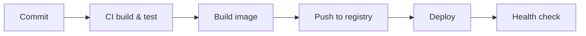
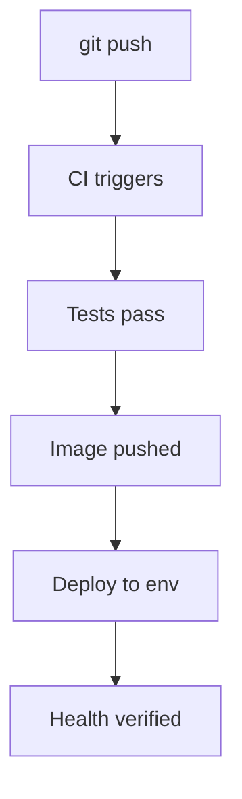

# Deployment

## 1. Introduction

Deploying containers to production means **registries**, **CI/CD**, and **orchestration** (k8s). This module covers pushing images and wiring automated pipelines.

---

## 2. Why This Topic Is Important

- Production deployment is the end of every feature.
- Registries share images with servers/cloud.
- CI/CD automates build → test → deploy.
- Orchestration (k8s) manages running apps at scale.

---

## 3. Real-World Analogy

Deployment is a **distribution system**: the warehouse (registry) stores your product (images); the trucks (CI/CD) deliver to stores; the store manager (orchestrator) decides how many workers (pods) run and restocks when one leaves (restart).

---

## 4. Theory

### Deployment Flow


### Registries
| Registry | Use |
|----------|-----|
| Docker Hub | Public/private |
| GHCR | GitHub-hosted |
| ECR / ACR / GCR | Cloud-native |

### CI/CD Pipeline Stages
| Stage | What Happens |
|-------|--------------|
| Checkout | Fetch code |
| Build | Compile + package |
| Test | Run test suite |
| Image build | Docker build |
| Push | To registry |
| Deploy | Update environment |

### Orchestration (k8s)
| Concept | Meaning |
|---------|---------|
| Pod | Smallest deployable unit |
| Deployment | Desired state (replicas) |
| Service | Stable network entry |
| Probe | Health/liveness checks |
| ConfigMap/Secret | Configuration |

---

## 5. Syntax (Push & Pull)

```bash
# Tag and push
docker tag my-app:1.0 ghcr.io/you/my-app:1.0
docker push ghcr.io/you/my-app:1.0

# Pull anywhere
docker pull ghcr.io/you/my-app:1.0
```

---

## 6. Flow Explanation



---

## 7. Memory Representation

Skip — ops workflow.

---

## 8. Simple Example — Push to Registry

```bash
# Build with a registry tag
docker build -t ghcr.io/yourname/my-app:1.0 .

# Authenticate
docker login ghcr.io -u yourname

# Push
docker push ghcr.io/yourname/my-app:1.0

# Any machine can now pull
docker pull ghcr.io/yourname/my-app:1.0
```

---

## 9. Intermediate Example — GitHub Actions

```yaml
# .github/workflows/deploy.yml
name: Build & Deploy

on:
  push:
    branches: [main]

jobs:
  build:
    runs-on: ubuntu-latest
    steps:
      - uses: actions/checkout@v4

      - name: Set up JDK 17
        uses: actions/setup-java@v4
        with:
          distribution: temurin
          java-version: '17'

      - name: Build with Maven
        run: mvn clean package -DskipTests

      - name: Run tests
        run: mvn test

      - name: Build Docker image
        run: docker build -t ghcr.io/yourname/my-app:${{ github.sha }} .

      - name: Push image
        run: |
          echo "${{ secrets.GHCR_TOKEN }}" | docker login ghcr.io -u yourname --password-stdin
          docker push ghcr.io/yourname/my-app:${{ github.sha }}
```

---

## 10. Advanced Example — Kubernetes Deployment

```yaml
apiVersion: apps/v1
kind: Deployment
metadata:
  name: my-app
spec:
  replicas: 3
  selector:
    matchLabels:
      app: my-app
  template:
    metadata:
      labels:
        app: my-app
    spec:
      containers:
        - name: app
          image: ghcr.io/yourname/my-app:1.0
          ports:
            - containerPort: 8080
          env:
            - name: SPRING_PROFILES_ACTIVE
              value: prod
          readinessProbe:
            httpGet:
              path: /actuator/health
              port: 8080
            initialDelaySeconds: 10
---
apiVersion: v1
kind: Service
metadata:
  name: my-app
spec:
  selector:
    app: my-app
  ports:
    - port: 80
      targetPort: 8080
```

```bash
kubectl apply -f deployment.yaml
kubectl get pods
kubectl logs deployment/my-app
```

---

## 11. Output

For the **Intermediate Example** (CI logs):

```
Run mvn test
[INFO] Tests run: 23, Failures: 0
Successfully tagged ghcr.io/yourname/my-app:<sha>
The push refers to repository [ghcr.io/yourname/my-app]
```

For the **Advanced Example**:

```
kubectl get pods
NAME                      READY   STATUS    RESTARTS
my-app-6f5c8d7b4c-abc12   1/1     Running   0
my-app-6f5c8d7b4c-def34   1/1     Running   0
my-app-6f5c8d7b4c-ghi56   1/1     Running   0
```

---

## 12. Common Mistakes

| Mistake | Correction |
|---------|------------|
| Pushing with :latest | Use commit/version tags |
| Secrets in the image | Inject at runtime (Secrets) |
| No health probe | k8s can't manage safely |
| Manual deploys | Automate with CI/CD |
| Skipping tests in CI | Run the suite first |

---

## 13. Best Practices

- Version tags, never :latest for prod.
- Secrets via secret managers/env.
- Health probes in manifests.
- CI/CD for every push.
- Rollback strategy ready.

---

## 14. Interview Questions

**Q1. How do you deploy containers?*
*Push to a registry, then deploy via k8s/CI to environments.*

**Q2. What is a registry?*
*Storage and distribution for images (Docker Hub, GHCR).*

**Q3. What is CI/CD?*
*Automated build/test/deploy on every change.*

**Q4. Why not :latest?*
*Untraceable, non-reproducible deployments.*

**Q5. What is a readiness probe?*
*k8s checks health before sending traffic.*

---

## 15. Practice Exercises

1. Tag and push an image.
2. Pull it on another machine.
3. Write a CI pipeline (build → test → push).
4. Apply a k8s manifest with probes.

---

## 16. Coding Challenges

1. **Easy:** Push/pull flow.
2. **Medium:** CI pipeline for a Boot app.
3. **Hard:** k8s deployment with health probes + env.

---

## 17. Summary

- Registry stores; CI/CD ships; k8s runs.
- Version-tag every image.
- Secrets at runtime, not in images.
- Health probes for orchestration.
- Automate everything.

➡️ Continue to: [Exercises](Exercises.md)