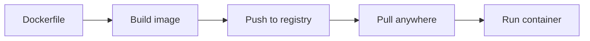

# Docker Basics

## 1. Introduction

**Docker** runs apps in isolated **containers** using **images** — the app plus everything it needs. Same behavior on any machine.

---

## 2. Why This Topic Is Important

- "Works on my machine" disappears.
- Containers are the deployment standard.
- Every interview at 3+ years covers Docker.
- It's the foundation of CI/CD and k8s.

---

## 3. Real-World Analogy

Docker images are like **frozen meal kits**: everything needed (ingredients, recipe, tools) is pre-packed. Containers are the cooked meals — identical wherever you cook them. Vs a **VM** which is like building a full restaurant for each meal.

---

## 4. Theory

### Containers vs VMs
| Aspect | VM | Container |
|--------|----|-----------|
| OS | Full guest OS per VM | Shares host kernel |
| Boot | Minutes | Seconds |
| Size | GBs | MBs |
| Isolation | Strong | Good |
| Density | Low | High |

### Images vs Containers
| Concept | Meaning |
|---------|---------|
| **Image** | Read-only template (blueprint) |
| **Container** | Running instance of an image |
| Relationship | Class → Object |

### Layers
- Images are built from layers (each Dockerfile instruction).
- Layers are cached and shared.

### Key Terms
| Term | Meaning |
|------|---------|
| Registry | Store of images (Docker Hub) |
| Tag | Image version (`app:1.0`) |
| Docker daemon | Runs containers |
| Dockerfile | Build recipe |

---

## 5. Syntax

```bash
docker pull eclipse-temurin:17
docker images
docker ps
docker run -p 8080:8080 my-app
```

---

## 6. Flow Explanation



---

## 7. Memory Representation

Containers share the host kernel; processes are isolated via namespaces/cgroups.

---

## 8. Simple Example — Run a Container

```bash
# Run an nginx container (pulls from Docker Hub)
docker run -d --name web -p 8080:80 nginx

# See it running
docker ps

# Verify
curl http://localhost:8080
```

---

## 9. Intermediate Example — Java Container

```bash
# Run a Java 17 environment
docker run --rm -it eclipse-temurin:17 java -version

# Run a Spring Boot JAR
docker run -d --name myapp -p 8080:8080 \
  -v "$(pwd)/target:/app" \
  --workdir /app \
  eclipse-temurin:17-jre \
  java -jar app.jar
```

---

## 10. Advanced Example — Volumes & Ports

```bash
# Named volume for persistent data
docker run -d --name db \
  -p 5432:5432 \
  -v pgdata:/var/lib/postgresql/data \
  -e POSTGRES_PASSWORD=secret \
  postgres:16

# Attach to inspect
docker exec -it db psql -U postgres

# See volumes
docker volume ls
```

---

## 11. Output

For the **Simple Example**:

```
docker ps
CONTAINER ID   IMAGE     STATUS        PORTS
abc12345       nginx     Up 2 seconds  0.0.0.0:8080->80/tcp
```

---

## 12. Common Mistakes

| Mistake | Correction |
|---------|------------|
| Missing port mapping | `-p host:container` |
| Running foreground by accident | `-d` for detached |
| Data loss on container removal | Use volumes |
| Large images | Multi-stage, slim bases |
| Forgetting `--rm` for temp | Auto-clean |

---

## 13. Best Practices

- Small, tagged images.
- Use volumes for persistence.
- Name containers (`--name`).
- Prefer `-d` for servers.
- Pin image tags, avoid `:latest`.

---

## 14. Interview Questions

**Q1. Container vs VM?**
*Container shares the host kernel (fast, light); VM runs a full guest OS.*

**Q2. Image vs container?*
*Image is the template; container is the running instance.*

**Q3. Why Docker?*
*Portable, consistent, lightweight packaging.*

**Q4. What is a volume?*
*Persistent storage outside the container filesystem.*

**Q5. What is Docker Hub?*
*A public registry for sharing images.*

---

## 15. Practice Exercises

1. Run an nginx container and open it in a browser.
2. Run a Java container printing the version.
3. Mount a volume for data.
4. List images and containers.

---

## 16. Coding Challenges

1. **Easy:** Run + stop a container.
2. **Medium:** Persistent DB container with a volume.
3. **Hard:** Run a Spring Boot JAR in a Java container.

---

## 17. Summary

- Containers = portable, lightweight apps.
- Images = templates; containers = instances.
- Volumes persist data; ports expose services.
- Same image runs anywhere.
- Docker is the deployment foundation.

➡️ Continue to: [Dockerfile](Dockerfile.md)