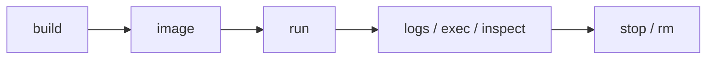

# Docker Commands

## 1. Introduction

The Docker CLI is your everyday toolkit: build, run, list, logs, exec, and clean up.

---

## 2. Why This Topic Is Important

- These commands are used hourly in real work.
- Interviews test practical fluency.
- Knowing them makes debugging containers easy.

---

## 3. Real-World Analogy

Docker commands are like **kitchen appliance controls**: `docker build` bakes the cake (image), `docker run` serves it (container), `docker logs` shows the smoke alarm history, and `docker exec` lets you peek inside while it's baking.

---

## 4. Theory — Command Groups

### Build & Run
| Command | Purpose |
|---------|---------|
| `docker build -t name:tag .` | Build an image |
| `docker run -d -p H:P --name n img` | Run a container |
| `docker run --rm` | Remove when it exits |
| `docker start/stop/restart n` | Lifecycle |

### Inspect
| Command | Purpose |
|---------|---------|
| `docker ps` / `docker ps -a` | Running / all containers |
| `docker images` | Local images |
| `docker logs n` | Container logs |
| `docker exec -it n cmd` | Run inside container |
| `docker inspect n` | Detailed config |
| `docker stats` | Live resource usage |

### Clean Up
| Command | Purpose |
|---------|---------|
| `docker rm n` | Remove container |
| `docker rmi img` | Remove image |
| `docker system prune` | Remove unused everything |
| `docker volume ls` / `rm` | Volumes |

### Registry
| Command | Purpose |
|---------|---------|
| `docker pull img` | Download image |
| `docker push img` | Upload image |
| `docker tag img new` | Tag/retag |

---

## 5. Syntax

```bash
docker build -t my-app:1.0 .
docker run -d -p 8080:8080 --name myapp my-app:1.0
docker logs -f myapp
```

---

## 6. Flow Explanation



---

## 7. Memory Representation

Skip — CLI reference.

---

## 8. Simple Example — Full Lifecycle

```bash
# Build
docker build -t demo-app .

# Run detached with a name and port
docker run -d --name demo -p 8080:8080 demo-app

# Check it's running
docker ps

# Watch logs
docker logs -f demo
```

---

## 9. Intermediate Example — Exec & Inspect

```bash
# Open a shell inside the container
docker exec -it demo sh

# Inside: view files and processes
ls -la
ps aux

# Exit
exit

# Inspect configuration (networks, mounts, env)
docker inspect demo | grep -i environment

# Live resource usage
docker stats
```

---

## 10. Advanced Example — Cleanup Routine

```bash
# Stop everything
docker stop $(docker ps -q)

# Remove stopped containers
docker rm $(docker ps -aq)

# Remove dangling images
docker image prune

# Full cleanup (careful!)
docker system prune -a
```

---

## 11. Output

For the **Simple Example**:

```
docker ps
CONTAINER ID   IMAGE      STATUS        PORTS
a1b2c3d4       demo-app   Up 2 minutes  0.0.0.0:8080->8080/tcp
```

---

## 12. Common Mistakes

| Mistake | Correction |
|---------|------------|
| Port conflict on restart | Use `docker rm` first |
| `-it` on non-interactive | Omit for background |
| Logs unavailable after stop | Containers keep logs until removed |
| `docker system prune -a` in shared env | Be careful — removes volumes too (with -v) |
| Not naming containers | Hard to manage |

---

## 13. Best Practices

- Name every container (`--name`).
- Use `-d` for long-running apps.
- `--rm` for one-off containers.
- Follow logs with `-f`.
- Prune regularly to save disk.

---

## 14. Interview Questions

**Q1. `docker ps -a` vs `docker ps`?*
*ps shows running; -a shows all (incl. stopped).*

**Q2. How do you see logs?*
*docker logs <name>.*

**Q3. How do you run a command inside a container?*
*docker exec -it <name> sh.*

**Q4. How do you remove all stopped containers?*
*docker rm $(docker ps -aq).*

**Q5. What does -p do?*
*Maps host:container ports.*

---

## 15. Practice Exercises

1. Build an image and run it.
2. Name it and watch logs.
3. Exec a shell inside.
4. Stop, remove, and prune cleanly.

---

## 16. Coding Challenges

1. **Easy:** Build → run → logs → stop.
2. **Medium:** Inspect env/mounts of a running container.
3. **Hard:** Debug a failing container via logs + exec + inspect.

---

## 17. Summary

- build/run/ps/logs/exec/rm cover daily work.
- Name containers; use -d and --rm.
- Logs and exec are debugging essentials.
- Prune to keep the machine clean.
- CLI fluency is a daily professional skill.

➡️ Continue to: [Docker Compose](Docker-Compose.md)