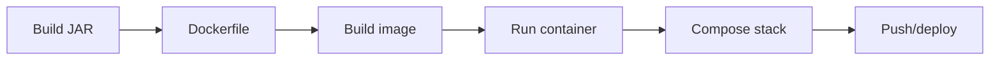

# Exercises — Docker

## 1. Introduction

Practice the container stack end-to-end: images, Dockerfiles, commands, Compose, and a Boot container.

---

## 2. Why This Topic Is Important

- Containers are how apps run today.
- Docker fluency is a daily professional skill.
- These exercises build a deployable pipeline.

---

## 3. Real-World Analogy

Like **learning to run a delivery fleet**: you package goods (images), build the trucks (Dockerfiles), drive them (commands), coordinate a convoy (Compose), and deliver at scale (deployment). Practice each step.

---

## 4. Theory — Topic Map

| Topic | Key Skill |
|-------|-----------|
| Basics | Images vs containers |
| Dockerfile | Build recipes |
| Commands | Daily CLI |
| Compose | Multi-container |
| Java & Docker | Boot images |
| Deployment | Registry + CI/CD |

---

## 5. Syntax Reminder

```bash
docker build -t app:1.0 .
docker run -d -p 8080:8080 --name app app:1.0
docker logs -f app
docker compose up -d
```

---

## 6. Practice Flow



---

## 7. Memory Representation

Skip — practice module.

---

## 8. Simple Exercises

**Ex 1 — Run:** Pull nginx; map port 8080.

**Ex 2 — Java:** Run `eclipse-temurin:17` printing the version.

**Ex 3 — Logs:** Follow logs of a container.

**Ex 4 — Cleanup:** Stop, remove, and prune.

---

## 9. Intermediate Exercises

**Ex 5 — Dockerfile:** Single-stage for a Boot JAR.

**Ex 6 — Multi-stage:** Maven build → slim runtime.

**Ex 7 — Volumes:** Persist a Postgres data directory.

**Ex 8 — Exec:** Shell into a running container.

---

## 10. Advanced Exercises

**Ex 9 — Compose:** App + Postgres stack with health ordering.

**Ex 10 — Layered JAR:** Extract layers; copy into runtime.

**Ex 11 — Health check:** Actuator-based HEALTHCHECK.

**Ex 12 — CI:** GitHub Actions build → test → push.

**Ex 13 — Full flow:** Containerized Boot app deployed via Compose with a database.

---

## 11. Expected Output Samples

**Ex 1:**
```
docker ps
CONTAINER ID   IMAGE   STATUS        PORTS
abc123         nginx   Up 5 seconds  0.0.0.0:8080->80/tcp
```

**Ex 9:**
```
 ✔ Network stack_default   Created
 ✔ Container stack-db-1    Started
 ✔ Container stack-app-1   Started
```

---

## 12. Common Mistakes

| Mistake | Fix |
|---------|-----|
| No port mapping | -p host:container |
| Data lost | Named volumes |
| localhost for DB in Compose | Service name |
| :latest for production | Version tags |
| No health check | Add HEALTHCHECK |

---

## 13. Best Practices

- Multi-stage builds; small images.
- Name containers; volumes for data.
- Health checks for services.
- Version-tag and automate deploys.
- Compose for multi-container apps.

---

## 14. Interview Practice Questions

**Q1.** Container vs VM?
**Q2.** CMD vs ENTRYPOINT?
**Q3.** Why multi-stage builds?
**Q4.** How do Compose services communicate?
**Q5.** How do you deploy containers?

---

## 15. Self-Check

- [ ] I can write a Dockerfile.
- [ ] I can build/run/log/exec.
- [ ] I use Compose for stacks.
- [ ] I containerize Spring Boot.
- [ ] I push to a registry.

---

## 16. Next Steps

- Build real projects in [36 — Mini Projects](../36-Mini-Projects/README.md).
- Master advanced in [37 — Advanced Projects](../37-Advanced-Projects/README.md).

---

## 17. Summary

- Docker packages apps portably.
- Dockerfile + commands + Compose + deployment.
- Boot + layered JARs = efficient images.
- Health checks and version tags.
- Containers are the deployment standard.

➡️ Module complete! Continue to [36 — Mini Projects](../36-Mini-Projects/README.md).