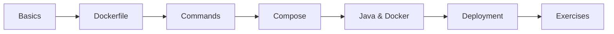

# 35 — Docker

> **Experience level: 🔴 Expert (3 – 5 years)**

**Docker** packages apps into portable containers — code, runtime, and dependencies together. This module covers images, containers, Dockerfiles, compose, and CI integration.

---

## 📂 Files in This Module

| File | What You'll Learn |
|------|-------------------|
| [Docker-Basics.md](Docker-Basics.md) | Containers vs VMs, images |
| [Dockerfile.md](Dockerfile.md) | Writing image builds |
| [Docker-Commands.md](Docker-Commands.md) | Build, run, logs, exec |
| [Docker-Compose.md](Docker-Compose.md) | Multi-container apps |
| [Java-and-Docker.md](Java-and-Docker.md) | Spring Boot containers |
| [Deployment.md](Deployment.md) | Registries, CI/CD |
| [Exercises.md](Exercises.md) | Practice tasks for this module |

---

## 🎯 Learning Objectives

By the end of this module, you will be able to:

1. ✅ Explain images vs containers.
2. ✅ Write efficient Dockerfiles.
3. ✅ Run and manage containers.
4. ✅ Orchestrate multi-container apps with Compose.
5. ✅ Containerize and push Spring Boot apps.

---

## 🧭 Module Map



---

## 📌 Quick Preview

```dockerfile
FROM eclipse-temurin:17-jre
WORKDIR /app
COPY target/app.jar app.jar
ENTRYPOINT ["java", "-jar", "app.jar"]
```

---

## Next Module

➡️ [36 — Mini Projects](../36-Mini-Projects/README.md) — build real apps with everything so far.