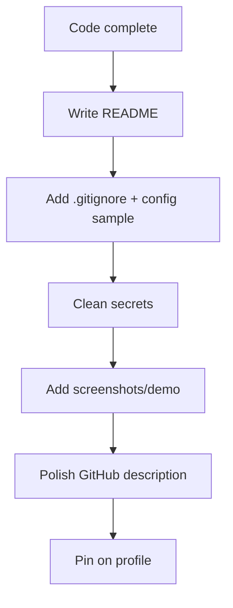

# Portfolio Guidance

## 1. Introduction

You've built real projects — now **present them like a professional**. This file teaches you how to structure each project, write great READMEs, and make your GitHub profile and résumé stand out to recruiters.

---

## 2. Why This Is Important

- Recruiters spend seconds scanning a profile.
- A polished repo **compounds** the value of your code.
- The #1 reason junior candidates get interviews is a strong, focused portfolio.

---

## 3. Real-World Analogy

Your GitHub is like a **designer's showroom**: the code is the product, but the presentation (README, screenshots, live demo) decides whether anyone walks in. Polish the showroom.

---

## 4. Theory — What a Strong Portfolio Needs

### The 3 project tiers
| Tier | Example | Purpose |
|------|---------|---------|
| Showcase (1–2) | Task Manager API | Deep, complete, documented |
| Supporting (2–3) | Bookstore, Quiz | Show breadth |
| Small (3–5) | CLI tools, DSA problems | Show volume + consistency |

### Quality over quantity
- 3 well-done projects beat 10 half-finished ones.
- Every project must **run** with 2 commands or fewer.

---

## 5. Syntax — The Ideal Project README

```markdown
# Task Manager API

Secure REST API for personal task management.

## Features
- JWT auth, role-based access
- Owner-scoped CRUD with Spring Data JPA
- 95% test coverage (JUnit 5, Mockito)

## Tech Stack
Java 17 · Spring Boot 3 · JPA/Hibernate · MySQL · Docker

## Quick Start
1. `docker compose up -d` (starts MySQL)
2. `mvn spring-boot:run`
3. Open `http://localhost:8080/api/tasks`

## API Examples
GET /api/tasks (with Bearer token) → 200 OK [...]

## Screenshots

```

---

## 6. Flow — Preparing a Project for Public



---

## 7. Memory Representation

A project is **three views of one thing**: the code (repo), the explanation (README), and the proof (demo/screenshots). All three must be consistent.

---

## 8. Simple Example — .gitignore & Sample Config

```gitignore
# application.properties holds real secrets — NEVER commit it
target/
*.class
application-local.properties
```

```properties
# application-sample.properties (committed)
spring.datasource.url=jdbc:mysql://localhost:3306/taskdb
spring.datasource.username=taskuser
spring.datasource.password=${DB_PASSWORD}   # env var
```

---

## 9. Intermediate Example — Commit Hygiene

```text
feat: add JWT refresh-token endpoint
fix: scope task queries to authenticated user
docs: add quick-start to README
test: cover login and task CRUD
```

- One logical change per commit.
- Conventional commit prefixes (`feat`, `fix`, `docs`, `test`).
- Never commit secrets, logs, or build output.

---

## 10. Advanced Example — Résumé & LinkedIn Wording

> **Task Manager API** — Spring Boot, JWT, JPA
> Built a secure task-management backend with stateless JWT auth, role-based
> access, and owner-scoped data. Improved release safety with 60+ unit and
> integration tests and containerized MySQL via Docker Compose.

**The STAR formula for interviews:** Situation → Task → Action → Result. Always end with a measurable result (coverage %, latency, scale).

---

## 11. Output — A Profile That Converts

```text
GitHub profile pinned repos:
⭐ Task Manager API      — Spring Boot + JWT + JPA
⭐ REST Bookstore        — Full CRUD + validation
⭐ Bank Console App      — JDBC + ACID transactions
```

```text
LinkedIn summary line:
"Java Developer building secure Spring Boot APIs. 38-module self-study
roadmap completed — from core Java to Kafka, Docker, and testing."
```

---

## 12. Common Mistakes

| Mistake | Fix |
|---------|-----|
| No README | First impression lost |
| Committed secrets | Use env vars + sample config |
| Huge single commits | Logical, small commits |
| No screenshot/demo | Add proof it works |
| Many empty repos | Delete or archive them |

---

## 13. Best Practices

- Pin your best 3–5 repos.
- Use an eye-catching profile README.
- Keep a consistent tech stack story.
- Write commits that read like a changelog.
- Link projects from your LinkedIn and résumé.

---

## 14. Interview Questions

**Q1. Which project are you most proud of, and why?**
*Pick one; explain the problem, your choices, and the result.*

**Q2. What was the hardest bug you fixed?**
*Concurrency/JWT/transaction issue — show debugging process.*

**Q3. What would you improve next?**
*Show you evaluate your own work: caching, CI, observability.*

**Q4. How do you keep secrets safe?**
*Env vars, .gitignore, sample config, secret managers.*

**Q5. How do you know your code works?**
*Automated tests + run instructions in the README.*

---

## 15. Practice Exercises

1. Write a README for one completed project from this module.
2. Add a `.gitignore` and sample config.
3. Squash and clean commit history.
4. Write a one-paragraph project summary for LinkedIn.

---

## 16. Coding Challenges

1. **Easy:** Add a screenshot to a project README.
2. **Medium:** Write a CI pipeline (GitHub Actions) that runs your tests.
3. **Hard:** Deploy your Task Manager to a free host (Railway/Render) with a live URL.

---

## 17. Summary

- 3-tier portfolio strategy: showcase, supporting, small.
- README, secrets hygiene, and commit discipline.
- Résumé/LinkedIn wording that converts into interviews.
- Your roadmap is complete — go apply.

➡️ Next: [37 — Advanced Projects](../37-Advanced-Projects/README.md)