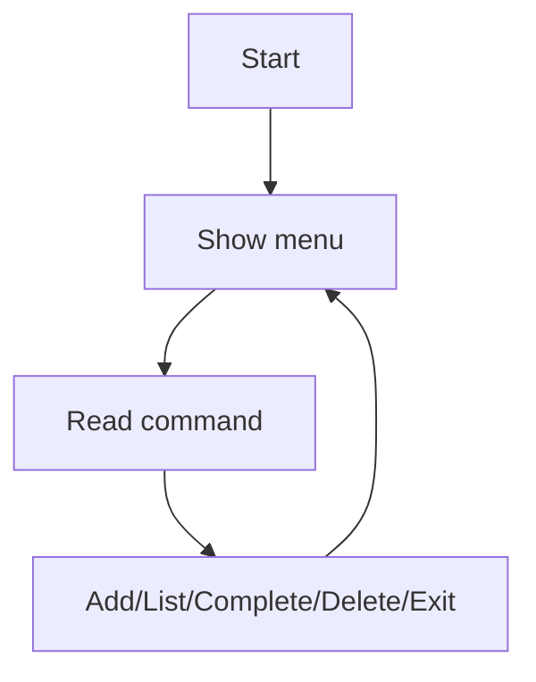

# Project 1 — CLI ToDo App

## 1. Introduction

Build a **console-based ToDo manager**: add, list, complete, and delete tasks. It exercises classes, collections, and input handling.

---

## 2. Why This Project Is Important

- Complete program from input to output.
- Core Java skills in one app.
- A natural first portfolio piece.

---

## 3. Real-World Analogy

This is a **digital sticky-note pad**: you add tasks (notes), mark them done (check marks), and throw away finished ones — all through typed commands instead of paper.

---

## 4. Theory — Design

### Features
| Feature | Behavior |
|---------|----------|
| Add task | Prompt → store |
| List tasks | Show with status |
| Complete | Mark done |
| Delete | Remove by id |
| Exit | Quit loop |

### Classes
| Class | Responsibility |
|-------|----------------|
| `Task` | id, description, done |
| `TodoService` | Business logic |
| `TodoApp` | Main loop + input |

### Data Structure
- `List<Task>` in memory.

---

## 5. Syntax (Core Pattern)

```java
Scanner in = new Scanner(System.in);
while (running) {
    System.out.print("> ");
    String cmd = in.nextLine();
    // dispatch command
}
```

---

## 6. Flow Explanation



---

## 7. Memory Representation

Tasks live in a List; each is an object with id, description, done.

---

## 8. Simple Example — Task Model

```java
class Task {
    private final int id;
    private final String description;
    private boolean done;

    Task(int id, String description) {
        this.id = id;
        this.description = description;
    }

    public int getId() { return id; }
    public String getDescription() { return description; }
    public boolean isDone() { return done; }
    public void markDone() { this.done = true; }

    @Override
    public String toString() {
        return (done ? "[x] " : "[ ] ") + id + ". " + description;
    }
}
```

---

## 9. Intermediate Example — Service

```java
import java.util.*;

class TodoService {
    private final List<Task> tasks = new ArrayList<>();
    private int nextId = 1;

    public Task add(String description) {
        Task task = new Task(nextId++, description);
        tasks.add(task);
        return task;
    }

    public List<Task> all() {
        return Collections.unmodifiableList(tasks);
    }

    public boolean complete(int id) {
        return find(id).map(t -> { t.markDone(); return true; }).orElse(false);
    }

    public boolean delete(int id) {
        return tasks.removeIf(t -> t.getId() == id);
    }

    private Optional<Task> find(int id) {
        return tasks.stream().filter(t -> t.getId() == id).findFirst();
    }
}
```

---

## 10. Advanced Example — Main Loop

```java
import java.util.Scanner;

public class TodoApp {

    private final TodoService service = new TodoService();
    private final Scanner in = new Scanner(System.in);

    public void run() {
        while (true) {
            System.out.println("\nCommands: add <desc> | list | done <id> | delete <id> | exit");
            System.out.print("> ");
            String input = in.nextLine().trim();

            if (input.equals("exit")) break;

            if (input.startsWith("add ")) {
                service.add(input.substring(4));
            } else if (input.equals("list")) {
                service.all().forEach(System.out::println);
            } else if (input.startsWith("done ")) {
                boolean ok = service.complete(parseId(input));
                System.out.println(ok ? "Marked done" : "Not found");
            } else if (input.startsWith("delete ")) {
                boolean ok = service.delete(parseId(input));
                System.out.println(ok ? "Deleted" : "Not found");
            } else {
                System.out.println("Unknown command");
            }
        }
        System.out.println("Bye!");
    }

    private int parseId(String input) {
        return Integer.parseInt(input.split(" ")[1]);
    }

    public static void main(String[] args) {
        new TodoApp().run();
    }
}
```

---

## 11. Output

```
> add Buy milk
> add Write resume
> list
[ ] 1. Buy milk
[ ] 2. Write resume
> done 1
Marked done
> list
[x] 1. Buy milk
[ ] 2. Write resume
> exit
Bye!
```

---

## 12. Common Mistakes

| Mistake | Correction |
|---------|------------|
| `in.nextLine()` after `nextInt()` | Read full lines |
| Out-of-bounds on `substring` | Check `startsWith` first |
| Mutable lists exposed | Unmodifiable view |
| Ids colliding after delete | Monotonic counter |
| Infinite loops | Clear exit path |

---

## 13. Best Practices

- Separate UI from logic.
- Use a `nextId` counter.
- Read full lines for commands.
- Immutable list views.
- Clear, consistent prompts.

---

## 14. Interview Questions

**Q1. Why separate service from UI?*
*Testable logic; clean structure.*

**Q2. Why `Collections.unmodifiableList`?*
*Prevents external mutation.*

**Q3. How would you persist tasks?*
*File/JSON or a database (see Project 4).*

**Q4. What if the input is invalid?*
*Parse safely; show helpful errors.*

**Q5. How would you test this?*
*Unit test the service (Mockito/AssertJ).*

---

## 15. Practice Exercises

1. Add a `dueDate` field.
2. Add a `clear` command.
3. Show task counts (done/total).
4. Add a `search <text>` command.

---

## 16. Coding Challenges

1. **Easy:** Add due dates.
2. **Medium:** Persist tasks to a file on exit.
3. **Hard:** Sort by due date and add priorities.

---

## 17. Summary

- Full CLI loop: add/list/complete/delete/exit.
- Service layer separated from the UI.
- Collection + stream skills throughout.
- A complete first portfolio project.
- Extend with persistence (Project 4).

➡️ Continue to: [Project 2 — REST Bookstore](Project-2-REST-Bookstore.md)