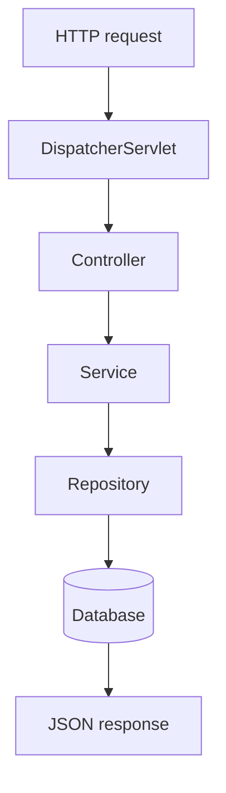

# Project 2 — REST Bookstore API

## 1. Introduction

Build a **Spring Boot REST API** for a bookstore: create, read, update, and delete books, with persistence via JPA and validation on the input. It exercises everything from modules 25–30 in one project.

---

## 2. Why This Project Is Important

- First real **backend API** — the core of every web app.
- Combines Spring Boot, JPA, REST, and validation.
- Directly mirrors what junior backend developers do daily.

---

## 3. Real-World Analogy

Think of an online bookstore's **product service**: the app receives a request ("show me all Java books") and the API answers by reading from a database. You are building the exact layer that serves that app.

---

## 4. Theory — Design

### Features
| Feature | Method | URL |
|---------|--------|-----|
| List books | `GET` | `/api/books` |
| Get one | `GET` | `/api/books/{id}` |
| Add book | `POST` | `/api/books` |
| Update | `PUT` | `/api/books/{id}` |
| Delete | `DELETE` | `/api/books/{id}` |

### Layers
| Layer | Class | Responsibility |
|-------|-------|----------------|
| Controller | `BookController` | Handle HTTP + JSON |
| Service | `BookService` | Business logic |
| Repository | `BookRepository` | Database access (JPA) |
| Entity | `Book` | The persisted row |

### Dependencies (pom.xml)
- `spring-boot-starter-web`
- `spring-boot-starter-data-jpa`
- `spring-boot-starter-validation`
- `h2` (in-memory DB for development)

---

## 5. Syntax (Core Pattern)

```java
@RestController
@RequestMapping("/api/books")
class BookController {

    @GetMapping
    public List<Book> all() { return service.findAll(); }
}
```

---

## 6. Flow Explanation



---

## 7. Memory Representation

Each `Book` entity maps to a database row; the repository returns entities that Spring converts to JSON (`id`, `title`, `author`, `price`).

---

## 8. Simple Example — Entity

```java
@Entity
public class Book {
    @Id @GeneratedValue
    private Long id;
    private String title;
    private String author;
    private double price;

    // getters & setters (omitted for brevity)
}
```

---

## 9. Intermediate Example — Repository + Service

```java
public interface BookRepository extends JpaRepository<Book, Long> {}

@Service
public class BookService {
    private final BookRepository repo;

    public BookService(BookRepository repo) { this.repo = repo; }

    public List<Book> findAll() { return repo.findAll(); }

    public Optional<Book> findById(Long id) { return repo.findById(id); }

    public Book create(Book book) { return repo.save(book); }
}
```

---

## 10. Advanced Example — Full Controller with Validation

```java
@RestController
@RequestMapping("/api/books")
public class BookController {

    private final BookService service;

    public BookController(BookService service) { this.service = service; }

    @GetMapping
    public List<Book> all() { return service.findAll(); }

    @GetMapping("/{id}")
    public Book one(@PathVariable Long id) {
        return service.findById(id)
            .orElseThrow(() -> new ResponseStatusException(HttpStatus.NOT_FOUND));
    }

    @PostMapping
    @ResponseStatus(HttpStatus.CREATED)
    public Book create(@Valid @RequestBody Book book) {
        return service.create(book);
    }

    @DeleteMapping("/{id}")
    @ResponseStatus(HttpStatus.NO_CONTENT)
    public void delete(@PathVariable Long id) {
        service.delete(id);
    }
}
```

```java
// application.properties
spring.datasource.url=jdbc:h2:mem:bookstore
spring.jpa.hibernate.ddl-auto=update
```

---

## 11. Output

```
POST /api/books
{"title":"Clean Code","author":"Robert C. Martin","price":39.99}
→ 201 Created
{"id":1,"title":"Clean Code","author":"Robert C. Martin","price":39.99}

GET /api/books
→ 200 OK
[{"id":1,"title":"Clean Code","author":"Robert C. Martin","price":39.99}]

GET /api/books/99
→ 404 Not Found
```

---

## 12. Common Mistakes

| Mistake | Correction |
|---------|------------|
| Forgetting `@RequestBody` | Annotate the JSON body |
| Returning entities directly | Use DTOs in real apps |
| No `@Valid` | Add validation annotations |
| Infinite JSON recursion | Annotate relationships (`@JsonIgnore`) |
| Exposing IDs in URLs blindly | Use UUIDs for public IDs |

---

## 13. Best Practices

- One layer per responsibility (controller/service/repo).
- Return proper status codes (201, 404, 400).
- Validate input with Jakarta Bean Validation.
- Never expose the entity — use DTOs.
- Write tests for the controller (module 34).

---

## 14. Interview Questions

**Q1. What's the role of the repository?**
*It isolates data access; Spring Data generates the SQL.*

**Q2. `@RestController` vs `@Controller`?**
*@RestController = @Controller + @ResponseBody on every method.*

**Q3. Why DTOs instead of entities?**
*Entities leak persistence concerns; DTOs control the API contract.*

**Q4. How do you test an API?**
*@SpringBootTest + MockMvc, or @WebMvcTest.*

**Q5. How do you handle errors uniformly?**
*@ControllerAdvice + ProblemDetail.*

---

## 15. Practice Exercises

1. Add a `GET /api/books?author=...` search endpoint.
2. Add a `genre` field and filter by it.
3. Add pagination (`?page=0&size=10`).
4. Add a global `@ControllerAdvice` error handler.

---

## 16. Coding Challenges

1. **Easy:** Add PUT update with validation.
2. **Medium:** Add a one-to-many `Review` entity.
3. **Hard:** Add search by title/author with sorting and paging.

---

## 17. Summary

- Full CRUD REST API with Spring Boot + JPA.
- Layered architecture: controller → service → repository.
- Validation and correct HTTP status codes.
- Ready to extend into the Task Manager (Project 3).

➡️ Continue to: [Project 3 — Task Manager](Project-3-Task-Manager.md)