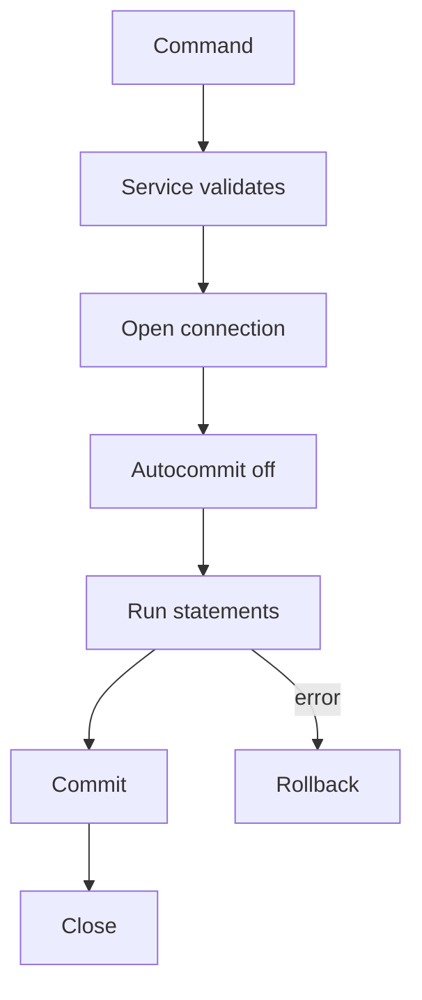

# Project 4 — Bank Console App

## 1. Introduction

Build a **console banking application** with a real database behind it: accounts, deposits, withdrawals, transfers, and a transaction history. It ties together JDBC (module 19), SQL (module 18), and good architecture.

---

## 2. Why This Project Is Important

- Exercises **JDBC + SQL** with realistic data.
- Introduces **transactions and atomicity** — the heart of banking.
- Plain-Java alternative to Spring, proving you know the fundamentals.

---

## 3. Real-World Analogy

This is a tiny **bank teller terminal**: the user types commands, and the system reads and updates a database — exactly how ATMs and teller systems talk to their ledgers.

---

## 4. Theory — Design

### Features
| Feature | Behavior |
|---------|----------|
| Create account | Name + initial deposit |
| Deposit | Add money |
| Withdraw | Check balance, deduct |
| Transfer | Two accounts, atomic |
| Statement | List transactions |

### Tables
| Table | Columns |
|-------|---------|
| `accounts` | id, name, balance |
| `transactions` | id, account_id, type, amount, created_at |

### Atomicity
A transfer must be all-or-nothing: if the second update fails, the first must roll back. Use a **database transaction**.

---

## 5. Syntax (Core Pattern)

```java
try (Connection conn = dataSource.getConnection()) {
    conn.setAutoCommit(false);
    // multiple statements...
    conn.commit();          // all applied
} catch (SQLException e) {
    // conn.rollback() happens implicitly on close
}
```

---

## 6. Flow Explanation



---

## 7. Memory Representation

The database is the source of truth; the console app keeps no state between commands. Balance is always **recomputed from the account row** — never cached in the app.

---

## 8. Simple Example — Create Account

```java
public void createAccount(String name, double initial) throws SQLException {
    try (Connection conn = getConnection();
         PreparedStatement ps = conn.prepareStatement(
             "INSERT INTO accounts(name, balance) VALUES(?, ?)")) {
        ps.setString(1, name);
        ps.setDouble(2, initial);
        ps.executeUpdate();
    }
}
```

---

## 9. Intermediate Example — Withdraw with Validation

```java
public boolean withdraw(long accountId, double amount) throws SQLException {
    try (Connection conn = getConnection()) {
        PreparedStatement check = conn.prepareStatement(
            "SELECT balance FROM accounts WHERE id = ? FOR UPDATE");
        check.setLong(1, accountId);
        ResultSet rs = check.executeQuery();
        if (!rs.next()) return false;
        if (rs.getDouble("balance") < amount) return false;

        PreparedStatement update = conn.prepareStatement(
            "UPDATE accounts SET balance = balance - ? WHERE id = ?");
        update.setDouble(1, amount);
        update.setLong(2, accountId);
        return update.executeUpdate() > 0;
    }
}
```

---

## 10. Advanced Example — Atomic Transfer

```java
public boolean transfer(long fromId, long toId, double amount) throws SQLException {
    try (Connection conn = getConnection()) {
        conn.setAutoCommit(false);
        try {
            debit(conn, fromId, amount);   // checks balance
            credit(conn, toId, amount);
            log(conn, fromId, "TRANSFER_OUT", amount);
            log(conn, toId, "TRANSFER_IN", amount);
            conn.commit();
            return true;
        } catch (SQLException e) {
            conn.rollback();
            throw e;
        }
    }
}
```

---

## 11. Output

```
> create Alice 1000
Account #1 created: Alice, balance 1000.00
> create Bob 500
Account #2 created: Bob, balance 500.00
> transfer 1 2 300
Transferred 300.00 from #1 to #2
> statement 1
TRANSFER_OUT   300.00
> balance 1
Alice: 700.00
```

---

## 12. Common Mistakes

| Mistake | Correction |
|---------|------------|
| Forgetting `setAutoCommit(false)` | Multi-step ops lose atomicity |
| Using string concatenation in SQL | Always `PreparedStatement` |
| Not closing resources | Try-with-resources |
| Money as `double` | Use `BigDecimal` |
| Locking order varies | Always lock in a fixed order |

---

## 13. Best Practices

- One connection per operation (or a pool).
- `PreparedStatement` everywhere — prevents SQL injection.
- `BigDecimal` for money.
- Fixed lock ordering to avoid deadlocks.
- Wrap multi-statement logic in a transaction.

---

## 14. Interview Questions

**Q1. What is ACID?**
*Atomicity, Consistency, Isolation, Durability.*

**Q2. Why `PreparedStatement` over `Statement`?**
*Prevents SQL injection and pre-compiles.*

**Q3. What happens if the app crashes mid-transfer?**
*Without commit, the DB rolls back on disconnect.*

**Q4. `double` vs `BigDecimal` for money?**
*Binary floating point can't represent decimals exactly.*

**Q5. How do you avoid deadlocks?**
*Consistent lock ordering + short transactions.*

---

## 15. Practice Exercises

1. Add a `balance` summary command.
2. Add overdraft protection (reject or fee).
3. Add transaction pagination.
4. Add a login step before commands.

---

## 16. Coding Challenges

1. **Easy:** List all accounts sorted by balance.
2. **Medium:** Add interest accrual (daily or monthly).
3. **Hard:** Add concurrent transfers with proper locking — prove no lost updates.

---

## 17. Summary

- Real JDBC + SQL with transactional integrity.
- Prepared statements, `BigDecimal`, and atomic transfers.
- A console app that talks to a real database.
- Great refresher of modules 18 and 19.

➡️ Continue to: [Project 5 — Quiz Game](Project-5-Quiz-Game.md)